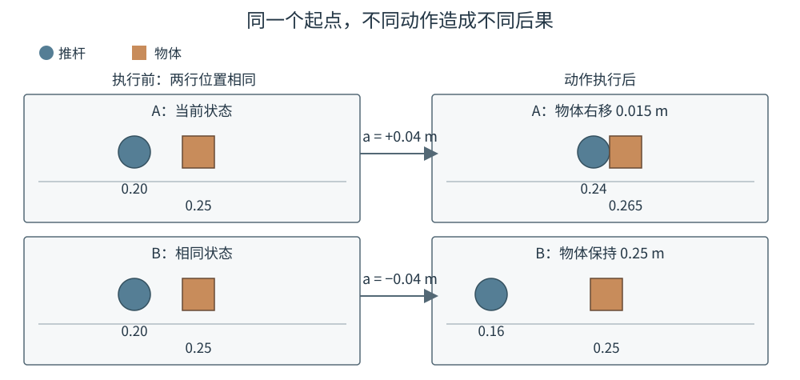

# 14-1 动作条件预测：状态与动作如何决定下一刻

第 13 章已经让机器人根据观测与任务生成候选动作，并把合格动作送往控制器。但动作模型回答的是“接下来可以执行什么”，不能只凭动作数值回答“执行后环境会怎样”。同样给推杆一条向右移动的命令，它可能还没碰到物体，也可能已经把物体推走。高级篇先从这个区别建立世界模型最基本的预测任务。

## 1. 预测对象与动作条件

这里的“世界”并非房间里的所有细节，而是完成任务需要跟踪的机器人、物体及其关系。**动作条件世界模型**接收当前状态和一个已经指定的动作，预测执行这个动作之后的状态：

$$
\hat s_{t+1}=F_\phi(s_t,a_t).
$$

$s_t$ 是执行前的状态，$a_t$ 是从时刻 $t$ 到 $t+1$ 之间施加的动作，$\hat s_{t+1}$ 是模型预测的执行后状态，$\phi$ 是训练得到的参数。真正执行后记录到的 $s_{t+1}$ 才是核对答案。式中的“条件”指**预测时已给定动作 $a_t$**：同一个状态若改用另一动作，未来可能不同。它不是说模型会替机器人挑选动作。

本章以一维推物为例，只记录推杆中心位置 $p_t$ 和物体中心位置 $b_t$，单位均为米，写成 $s_t=(p_t,b_t)$。动作 $a_t$ 表示本周期最终交给控制器的推杆位移命令，向右为正、向左为负；**教学环境假定这条命令被准确执行**。教学规则还规定：推杆在物体左侧，二者中心相距 0.025 m 时视为接触；推杆可以向右推动物体，却不能把物体向左拉回来。这套规则使结果容易逐项计算，不代表真实物体的全部接触、摩擦和旋转行为。

## 2. 从同一起点比较两种后果

固定推杆在 $0.20$ m、物体在 $0.25$ m。若推杆右移 $0.04$ m，它到达 $0.24$ m；按接触间距，物体中心至少要到 $0.265$ m，因此物体从 $0.25$ m 被推到 $0.265$ m。若推杆从相同起点左移 $0.04$ m，它到达 $0.16$ m，物体仍留在 $0.25$ m。同一起点给出两种不同动作，得到两种不同结果。

<figure markdown="span">
  { width="1000" loading=lazy }
  <figcaption>图 14-1　两行左侧是相同起点；蓝圆表示推杆，橙方块表示物体。向右动作接触并推动物体，向左动作使推杆离开物体。图中后果由教学规则算出，不是模型预先知道的答案。（本教程绘制）</figcaption>
</figure>

模型需要从许多真实交互中学会这样的对应关系，而不是把图 14-1 的两个结果写死。在这个例子里，如果只给 $s_t=(0.20,0.25)$、不给动作，模型无法分辨物体下一刻该不该移动；如果只给“右移 $0.04$ m”、不给两者当前距离，模型也不知道这一步是否会接触。因此状态和动作缺一不可。

这个任务与进阶篇的 Context Model 不同。Context Model 为**生成动作**组织视觉、语言、身体状态与历史；动作条件世界模型则在动作已确定时预测**动作造成的变化**。两者可复用某些输入特征，但 $C_t$ 未必保留微小接触间隙等预测所需信息，不能未经检查就把它当成完整物理状态。任务目标“最终把物体推到哪里”可用于后续选择动作，却不是核对本次状态转移的答案：同一真实状态和同一实际动作，不会因为目标文字改变而改写已经发生的物理后果。

## 3. 当前状态什么时候不够用

本章暂时假定 $(p_t,b_t)$ 足以决定下一步。但如果两次记录的位置相同、推杆速度却不同，下一刻的接触可能不同；若物体正在滑动，仅凭当前位置也无法判断它接下来是否继续移动。此时要把速度、接触状态或一段观测与动作历史加入输入。**缺少必要状态变量时，单纯增加网络层数不能替模型补回从未给过的信息。**

即使输入足够，模型此时也只会处理“给定一个动作，预测下一刻”。要让它学会，首先需要把真实交互整理成执行前状态、区间动作和执行后状态严格配对的训练样本。下一节从一段四次观测的记录具体展开。

[返回 14 导读](14-action-conditioned-world-model.md) · [继续阅读 14-2 交互记录与训练样本](14-2-transition-dataset.md)
