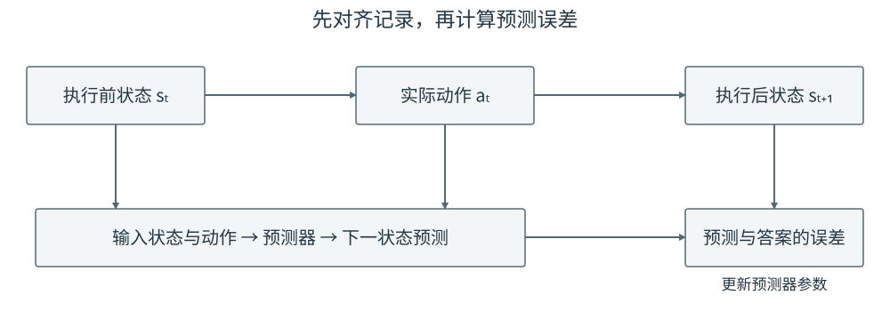

# 14-2 从交互记录构造状态转移样本

14-1 节明确了要预测什么：输入执行前状态和本周期动作，答案是执行后的状态。训练数据却不会天然按网络输入排列好。机器人实际保存的是按时间连续发生的观测与命令；本节把一段原始记录逐行拆开，说明哪个状态属于动作之前、哪个属于动作之后，以及为什么动作字段必须与这段时间真正采用的命令一致。

## 1. 一段轨迹由状态和区间动作交替组成

先看四次按时间保存的观测。表中每一行状态都在**该行动作开始前**测得；最后一行只提供执行后的状态。数值遵循 14-1 节的一维接触规则。

| 时刻 | 已测状态：推杆位置、物体位置 | 从这一刻开始采用的动作 |
|---|---|---|
| 2.0 s | $(0.20,\ 0.25)$ m | 向右 $0.01$ m |
| 2.1 s | $(0.21,\ 0.25)$ m | 向右 $0.04$ m |
| 2.2 s | $(0.25,\ 0.275)$ m | 向左 $0.01$ m |
| 2.3 s | $(0.24,\ 0.275)$ m | 本段记录结束 |

从 2.0 s 到 2.1 s，推杆靠近物体，但物体尚未移动；从 2.1 s 到 2.2 s，推杆继续右移并推动物体；最后推杆向左离开，物体保持原位。这里有四个状态、三段动作，所以能构造三条相邻状态转移样本，而不是四条。一般地，一条完整轨迹若保存了 $T+1$ 个连续状态和中间的 $T$ 个区间动作，才有 $T$ 个这样的一步样本。

## 2. 把相邻两行配成网络输入和答案

对每个区间，都取**区间起点状态 $s_t$**、**这一区间的动作 $a_t$**作为输入，并取**区间终点状态 $s_{t+1}$**作为答案。本教程稍后让网络预测变化量，所以同时算出 $\Delta s_t=s_{t+1}-s_t$：

| 样本 | 输入：执行前状态与动作 | 下一状态答案 | 变化量答案 |
|---|---|---|---|
| ① | $(0.20,\ 0.25),\ +0.01$ | $(0.21,\ 0.25)$ | $(+0.01,\ 0)$ |
| ② | $(0.21,\ 0.25),\ +0.04$ | $(0.25,\ 0.275)$ | $(+0.04,\ +0.025)$ |
| ③ | $(0.25,\ 0.275),\ -0.01$ | $(0.24,\ 0.275)$ | $(-0.01,\ 0)$ |

样本 ② 可整理成网络真正接收的三个数和用于监督的两个数：

$$
x=(p_t,b_t,a_t)=(0.21,\ 0.25,\ +0.04),
\qquad
y=(\Delta p_t,\Delta b_t)=(+0.04,\ +0.025).
$$

前两个输入数来自**推动之前**的测量，第三个是随后采用的动作；物体位移 $+0.025$ m 是**推动之后**才能知道的答案，不是预测时允许偷看的输入。如果把 2.1 s 的状态误配成前一个动作 $+0.01$ m，却仍以 2.2 s 的状态为答案，模型便会看到“轻推 0.01 m 造成物体右移 0.025 m”的错误样本。即使网络把这种错误数据拟合得很好，学到的动作—后果关系也不可信。

<figure markdown="span">
  { width="1000" loading=lazy }
  <figcaption>图 14-2　每条动作箭头连接执行前与执行后的两次观测。下方展示前两段的输入和答案；第三段按同样规则得到表中的样本 ③。（本教程绘制）</figcaption>
</figure>

## 3. 哪一个动作应该写进记录

真实系统中，“策略提出的动作”“安全层交给控制器的动作”和“机械臂实测到的运动”可能不同。本教程把 $a_t$ 明确定义为**这一个控制区间最终交给控制器采用的位移命令**。例如策略提出右移 $0.06$ m，安全层限幅后交给控制器的命令只有 $0.03$ m，则样本输入中的动作写 $+0.03$ m；用 $+0.06$ m 配上限幅后的结果，会让模型错误地归因。若机械臂因阻力实际上只移动 $0.02$ m，还应保存实测反馈，以便诊断执行偏差；不能把提出、采用和实测三种量混成同一字段。

在别的机器人系统中，也可以选择以实际测得的低层输入或执行位移作为模型条件，但那会定义**不同的预测问题**，训练和使用时必须一致。本章后续公式中的 $a_t$ 始终沿用上段约定。记录要同时保存时刻或时间戳：相机帧迟到、控制命令跨越多个周期时，不能只凭数组序号相等就认定状态和动作已经对齐。

## 4. 先划分完整轨迹，再拆出样本

一条从任务开始到结束的交互称为一条轨迹。先把完整轨迹分为训练集和测试集，再在各自内部抽取相邻样本。因为同一轨迹的相邻位置与动作往往很接近，若先把所有一步样本混在一起随机划分，测试样本可能紧贴某条训练样本，让结果显得过于乐观。输入归一化所用的均值与尺度也只能由训练轨迹计算，再原样应用于测试轨迹。

配套实践 14-01 的前半部分正按此顺序运行：先生成 100 条完整一维推物轨迹，每条有 24 段动作、25 个状态；前 80 条用于训练，后 20 条用于测试。Notebook 随后打印表中三条可手算的样本，再对照“提出 $0.06$ m、实际采用 $0.03$ m”时记录里究竟应写哪一个动作。先完成这两项核对，再进入 14-3 节的网络训练。

[返回 14 导读](14-action-conditioned-world-model.md) · [继续阅读 14-3 状态转移模型的训练](14-3-state-transition-learning.md)
