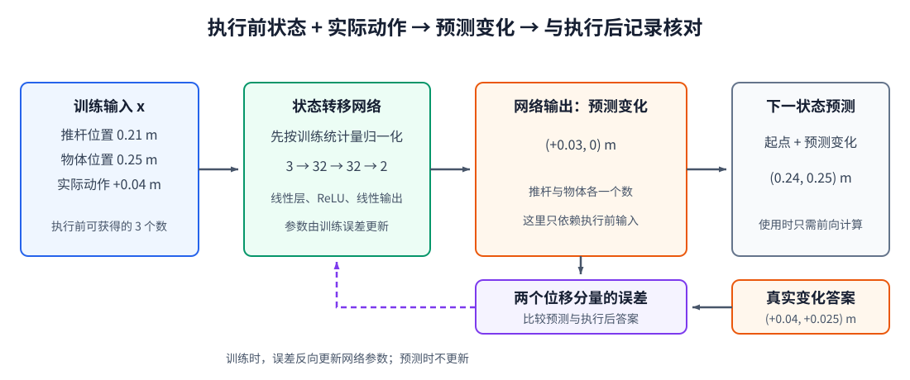

# 14-3 状态转移模型的训练

14-2 节已把连续记录整理成监督样本：输入是执行前的推杆位置、物体位置和实际采用的动作，答案是下一刻位置的变化。本节用一个小型神经网络把这些输入与答案连接起来。训练算法仍是第 02 章的“前向计算—比较误差—更新参数”；这里真正要看清的是网络为什么预测**变化量**、一次训练更新究竟改了什么，以及哪些数据问题会让低损失失去意义。

## 1. 为什么先预测变化量

对一维推物，状态 $s_t=(p_t,b_t)$，变化量 $\Delta s_t=s_{t+1}-s_t$。网络接收 $(p_t,b_t,a_t)$，输出推杆与物体各移动多少，再与当前状态相加，得到下一状态：

$$
\Delta\hat s_t=f_\phi(s_t,a_t),
\qquad
\hat s_{t+1}=s_t+\Delta\hat s_t.
$$

如果本周期没有接触，物体的正确变化量接近 0；一旦发生接触，它才会随推杆向右移动。预测变化量让网络直接学习“这一动作改变了什么”，而不是每次重新输出已经知道的当前绝对位置。这是一种便于本例学习的输出表示，并不保证在所有机器人任务里都优于直接预测下一状态。无论选择哪一种，训练答案和使用时的状态更新都必须遵守同一约定。

仍看样本 ②：输入 $(0.21,0.25,+0.04)$，正确变化量 $(+0.04,+0.025)$。若网络暂时预测 $(+0.03,0)$，那么它给出的下一状态是 $(0.24,0.25)$，而真实记录是 $(0.25,0.275)$。第一个误差说明推杆位移少预测了 $0.01$ m；第二个误差说明模型没预测到接触后物体应被推走。损失函数要同时比较这两项，而不是只看总位置是否“差不多”。

## 2. 三个输入数怎样经过网络得到两个输出数

配套 Notebook 使用的网络结构是“3 维输入 → 32 维隐藏层 → 32 维隐藏层 → 2 维输出”。训练集先给每个输入分量计算均值和尺度；每条样本按这套固定统计量归一化后，再进入两个带 ReLU 激活的隐藏层，最后由线性输出层给出两个变化量。线性层的权重、偏置由训练更新；ReLU 让网络能表达“尚未接触时物体不动、接触后才移动”这种不能用单个线性关系描述的变化。

<figure markdown="span">
  { width="1100" loading=lazy }
  <figcaption>图 14-3　执行前状态与实际动作形成三个输入数；网络预测两个位置变化量，与记录中的真实变化量逐项比较。误差用于更新网络参数，预测结果加回执行前状态才成为下一状态预测。（本教程绘制）</figcaption>
</figure>

图 14-3 中输入箭头不能反向理解：执行后的物体位置只用于制造训练答案，不进入本次预测网络的输入。图右侧的参数更新也发生在训练阶段；机器人实际使用模型预测动作后果时，只执行前向计算，**网络权重保持不变**。

## 3. 损失、归一化与一次参数更新

若一个训练批次包含 $B$ 条样本，可对推杆和物体两个变化量都计算均方误差：

$$
\mathcal L_{\mathrm{one}}=
\frac{1}{2B}\sum_{i=1}^{B}
\left[(\Delta\hat p_i-\Delta p_i)^2+
(\Delta\hat b_i-\Delta b_i)^2\right].
$$

分母 $2B$ 表示对两个输出分量和批次内所有样本取平均，不是模型需要学习的参数。一次更新取若干条样本，网络分别预测位移，计算与记录答案的差距，反向传播得到各层参数的更新方向，再由优化器调整参数。下一批通常重新抽样；训练次数增加，不意味着机器人在真实环境中又执行了同样多次动作。

Notebook 还把目标位移统一除以 $0.025$ m，避免输入、输出量级相差太远。因而训练图的纵轴是**缩放空间中的误差**，不能直接读成毫米或厘米；做物理检查时，要把网络输出乘回 $0.025$ m。输入均值和尺度只从训练轨迹计算，测试和使用阶段沿用这套数值，不能重新用测试集统计量调整模型。

## 4. 训练误差低，并不表示接触已经学好

若数据中大多数时刻推杆尚未碰到物体，网络只要总预测“物体不动”，就可能在许多样本上得到很小的物体位移误差。它却会在真正发生接触时失败。因此观察整体训练曲线下降只是第一道检查；下一节还要把接触与未接触的测试样本分开，并用同一起点下不同动作检验模型有没有使用动作条件。

此外，当前输入只记录两个位置和一段位移，没有速度、摩擦或物体旋转。若这些未记录因素会改变后果，再多训练也不能让模型仅凭 $(p_t,b_t,a_t)$ 唯一确定下一状态。这是**输入信息不足**，不应把它简单归咎为优化器没有训练好。下一节会把训练好的模型放到单步和连续多步使用中，观察这些局限如何显现。

[返回 14 导读](14-action-conditioned-world-model.md) · [继续阅读 14-4 单步预测与连续展开](14-4-one-step-and-rollout.md)
