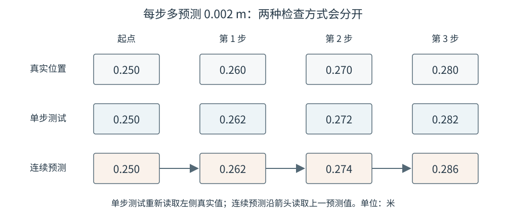

# 14-4 单步预测、连续展开与模型检验

14-3 节训练出的网络一次只回答“给定当前状态和动作，下一刻会怎样”。若机器人要比较一段候选动作可能带来的结果，就得多次调用它：先预测一步，再把预测结果送回模型继续预测。本节先建立可信的一步测试，再看连续展开为何更难；最后说明第 15 章怎样把同一训练关系搬到相机图像上。

## 1. 一步测试先检查接触与动作条件

一步测试使用一条**未参与训练的真实记录**：给网络执行前测得的 $s_t$ 和实际动作 $a_t$，得到 $\hat s_{t+1}$，再与执行后真实的 $s_{t+1}$ 比较。下一条测试样本仍从那条记录自己的真实执行前状态开始，不沿用模型上一次的输出。例如物体真实从 $0.250$ m 到 $0.275$ m，模型预测到 $0.270$ m，则这一样本的物体位置误差是 $0.005$ m，即 5 mm。

要知道 5 mm 是否有意义，先设一个不训练网络的参照：不论输入动作是什么，始终预测物体保持在当前 $b_t$。在未接触的样本 ① 中它恰好正确；在接触的样本 ② 中它仍预测 $0.250$ m，比真实位置低 $0.025$ m，即误差 25 mm。若模型在接触样本上只有 5 mm 误差，它在这条样本上优于“不动基线”。测试集里未接触样本可能很多，所以应分别报告两类样本数量与误差，不让大量容易预测的“不动”样本掩盖接触预测失败。

另一个检查是**固定状态，只换动作**。对 $s_t=(0.21,0.25)$ m，可把以下动作分别交给网络：

| 给定动作 | 按教学规则应看到的物体结果 | 用来检查什么 |
|---|---|---|
| 向左 $-0.01$ m | 仍在 $0.25$ m | 推杆离开，物体不应跟着退回 |
| 向右 $+0.01$ m | 仍在 $0.25$ m | 虽然靠近，但尚未达到接触间距 |
| 向右 $+0.04$ m | 到 $0.275$ m | 接触后应预测物体前移 |

若模型面对三种动作几乎给出相同的物体变化，它可能学会了训练数据中的平均运动，却没有真正利用动作输入。这里改变的是**模型输入的测试动作**；真正用于评测准确度的答案，仍须来自相应动作的真实执行记录或本教学环境已知的规则，不能凭网络输出自己证明自己正确。

## 2. 连续展开把自己的预测作为下一步输入

对一段已给定的动作 $a_t,a_{t+1},\ldots$，连续预测只有起点 $s_t$ 来自真实观测。模型预测第一步后，第二步不再取得真实的 $s_{t+1}$，而使用上一次给出的 $\hat s_{t+1}$：

$$
\hat s_{t+1}=F_\phi(s_t,a_t),
\qquad
\hat s_{t+2}=F_\phi(\hat s_{t+1},a_{t+1}).
$$

为看清误差怎样传递，另设一个刻意简化的算例：物体真实每步右移 $0.010$ m，模型却每步预测右移 $0.012$ m。从 $0.250$ m 出发，两种测试方式得到

| 时刻 | 真实位置 | 每次用真实位置的一步测试 | 只在起点用真实位置的连续预测 |
|---|---:|---:|---:|
| 起点 | 0.250 m | 0.250 m | 0.250 m |
| 第 1 步 | 0.260 m | 0.262 m | 0.262 m |
| 第 2 步 | 0.270 m | 0.272 m | 0.274 m |
| 第 3 步 | 0.280 m | 0.282 m | 0.286 m |

一步测试每次都从正确位置重新出发，所以误差始终为 2 mm。连续预测把先前多走的距离带到下一步，误差依次成为 2、4、6 mm。真实接触任务不一定这样整齐：位置稍有偏差，就可能让下一步的“尚未接触”被错判为“已经接触”，物体何时开始移动也会错开。

<figure markdown="span">
  { width="1000" loading=lazy }
  <figcaption>图 14-4　一步测试每次回到真实位置；连续预测从第二步起使用模型自己的上一结果。图中的数值与上表对应，说明相同的单步偏差可以在展开时累积。（本教程绘制）</figcaption>
</figure>

测试时应按“向前预测第 1、3、5 步”等不同距离分别记录位置误差，并特别标出接触发生前后；一个全程平均数可能掩盖模型在关键接触时刻的失准。连续预测是**使用已经训练好的模型检验效果**，不在每一步重新更新网络参数。若训练时就连续展开两步，让第 1 步预测进入第 2 步，再把两个结果都与记录比较，那才叫多步训练，例如

$$
\mathcal L_{\mathrm{two}}=
\lVert\hat s_{t+1}-s_{t+1}\rVert^2+
\lVert\hat s_{t+2}-s_{t+2}\rVert^2.
$$

这会让误差经两次相连的网络调用共同更新参数，但不保证训练数据之外的陌生接触和动作也准确。配套 Notebook **只做单步训练，再检验连续预测**，没有实施上式的多步训练。

## 3. 配套实践与视觉输入的下一步

实践 14-01 按本章顺序运行：先生成完整一维推物轨迹，核对相邻状态与实际动作如何配成样本；再训练“3 个输入数 → 2 个变化量”的小网络；最后分别查看接触/未接触误差、同一状态下不同动作的结果，以及真实位置、单步测试和连续预测的曲线。运行时可把图 14-2 的样本 ② 与 Notebook 打印结果逐项对照，再把本节表中的动作条件检查与 Notebook 的三种动作输出对照。Notebook 不是大型世界模型复现，也没有实现多步训练。

本章直接读取推杆和物体的位置，所以模型能用两个清楚的数表示当前与未来。真实机器人通常先得到图像 $I_t$，物体位置未必有现成标签。第 15 章仍保留本章的时间关系——**当前观测、两次观测之间采用的动作、下一次真实观测**——但会讨论不同的未来表示：先从图像提取可读位置、预测编码后的视觉表征，或生成未来画面。JEPA 式方法属于表征预测路线。无论表示方式如何变化，都要核对模型是否保留了接触与物体运动等对行动重要的变化；视觉上好看或特征误差很小，仍不等于候选动作的后果判断一定正确。

[返回 14 导读](14-action-conditioned-world-model.md) · [继续阅读第 15 章](15-visual-world-models.md)
