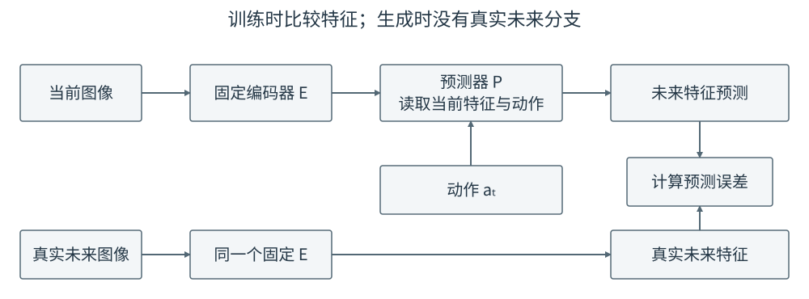

# 15-2 固定编码器的动作条件表征预测

15-1 已明确：训练输入是当前图像的特征和实际动作，答案是未来真实图像的特征。现在假设视觉编码器已经能够从图像中提取特征，本阶段不改它的参数。这样，当前图像和未来图像都经过同一个固定编码器，训练集中每张图像对应的特征答案也不会随着预测器的训练而变化。模型只须学习动作和未来特征之间的关系。

## 固定的是哪一部分，学习的是哪一部分

沿用推杆和 T 形物体的例子。当前图像经编码器得到 $z_t$，动作 $a_t$ 先被转换成与视觉特征能够共同计算的数字表示，再由预测器输出 $\hat z_{t+1}$。真实未来图像经**同一个**编码器得到 $z_{t+1}$。计算两者差距后，梯度只更新动作投影层和预测器，不更新视觉编码器。

<figure markdown="span">
{ width="1000" loading=lazy }
<figcaption>图 15-2　上方是预测路径：当前图像和动作进入预测器。下方是真实未来图像形成训练答案的路径。两处 $E$ 是同一个固定编码器；使用模型预测未执行动作时，右下方的真实未来图像不存在。（本教程绘制）</figcaption>
</figure>

所谓“动作投影”，只是把动作的原始数值映射到预测器使用的特征维度。例如关节控制命令有 7 个数，视觉图像块每块有 64 个特征数，可以用可训练的线性层把 7 维动作变成 64 维表示。投影层学的是**动作怎样进入预测器**，并不代替视觉编码器。具体模型也可能把历史几帧和多步动作一同交给预测器；图 15-2 先展示最容易核对的一步关系。

## 从特征误差到一次参数更新

若未来图像编码为 $N$ 个图像块、每块 $D$ 个特征数，预测误差可写为

$$
\mathcal L_{\mathrm{pred}}
=\frac{1}{ND}\sum_{n=1}^{N}\sum_{j=1}^{D}
\bigl(\hat z_{t+1,n,j}-z_{t+1,n,j}\bigr)^2.
$$

$n$ 指第几个图像块，$j$ 指该块的第几个特征数。例如 $N=16,D=64$，就比较 1024 对数值，再取平均。若只输出一个整体向量，可把 $N$ 看作 1。训练一次的顺序是：取当前图像、实际动作和未来真实图像；固定编码器分别产生当前与未来特征；预测器从当前特征与动作预测未来特征；比较差距；用第 02 章学过的反向传播更新预测器。未来图像在这里是**答案来源**，不能偷偷作为预测器的输入。

预测时则不计算误差，也不更新参数。给定同一当前图像，分别输入“向物体靠近”和“远离物体”的动作，便可得到两份未来特征。两份特征是否真的区分接触，还须通过真实记录检验；误差下降本身不等于模型理解了动作。

## DINO-WM 与视频编码器适配

[DINO-WM 原论文](https://arxiv.org/abs/2411.04983)采用预训练并固定的 DINOv2 视觉编码器，保留有空间位置的图像块特征，再用机器人交互轨迹训练动作条件预测器。这里应分清两次学习：已有视觉编码器从先前的视觉训练中获得特征；DINO-WM 阶段用动作和真实未来特征学习运动变化。不能把视觉编码器的预训练误称为已经学会了机器人动作后果。

类似地，[V-JEPA 2 原论文](https://arxiv.org/abs/2506.09985)区分视频表征预训练与机器人动作条件适配：视频阶段学习从视频内容预测表征，随后固定视觉编码器，并用带动作的机器人数据训练预测器。两种方法的具体编码器与预训练目标不同，15-2 把它们放在一起，只是因为**机器人动作预测阶段都可先固定已有视觉表示**，不是说它们是同一个模型。

这种路线的优点是未来特征答案稳定，训练不必同时解决“图像应该编码成什么”。边界也由此产生：如果固定编码器把“夹爪距杯子 2 毫米”和“已经碰到杯子”编码得几乎相同，那么只训练预测器不可能从相同输入特征中恢复这一区别。配套实践使用白色方块中心坐标充当固定编码器，让读者先核对当前图像、动作和真实未来图像怎样形成样本，并观察同一当前画面改变动作后预测怎样改变；它不是 DINO-WM 的模型复现。

若希望编码器自己从推动数据中保留接触、间隙等关键信息，就要让它参与训练。但训练答案同样由它产生，新问题也随之出现：模型可能把不同图像编码成几乎一样的数。15-3 专门处理这一问题。

[返回 15 导读](15-visual-world-models.md) · [继续阅读 15-3 联合训练与表征坍缩](15-3-joint-visual-learning.md)
