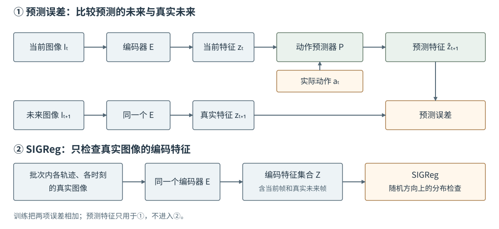

# 15-3 联合训练视觉编码器与预测器

15-2 固定视觉编码器，未来图像的特征答案始终不变。另一种做法是让编码器和动作条件预测器一起从机器人图像中学习：编码器可以逐渐保留对推动有用的视觉变化，但未来特征答案也会随着编码器而改变。本节先看为什么这会造成一个不合任务要求的低误差解，再以 LeWorldModel（LeWM）说明怎样同时约束预测能力与特征的区分能力。

## 为什么预测误差可能降到零却没有学到运动

设训练集中依次出现三张不同图像：推杆未接触 T 形物体、推杆刚接触物体、物体已被推开。一个有用的编码器应让这些情形至少在某些特征上不同。假设它分别给出 $(0.1,0.2)$、$(0.4,0.2)$、$(0.8,0.3)$，预测器才有机会学到接触前后不同的变化。

现在考虑一个错误做法：编码器对**所有**图像都输出 $(0,0)$，预测器对**所有**当前特征和动作也输出 $(0,0)$。于是每条样本中“预测的未来特征”和“真实未来图像编码出的特征”完全相等，预测误差可以为零；但模型再也分不清推杆是否接触、物体是否移动，同一起点输入相反动作也没有区别。这称为**表征坍缩**。这里的二维数字只展示这一错误解，并非 LeWM 的真实实验特征。联合训练时仅凭预测误差变小，无法排除它。

固定编码器的方式较少遇到这个**由本阶段的联合训练造成的**错误，因为编码器不随预测损失变动；但固定特征本身是否保留接触仍需检查。联合训练并非一定更好，它只是允许编码器根据机器人数据改变，同时要求训练机制防止上述无区分的答案。

## LeWM 的两项训练要求

[LeWorldModel（LeWM）论文](https://arxiv.org/abs/2603.19312)将下一刻表征预测误差与 SIGReg（Sketched Isotropic Gaussian Regularizer，随机投影各向同性高斯约束）配合使用。先分清两项分别检查什么：

$$
\mathcal L_{\mathrm{total}}
=\mathcal L_{\mathrm{pred}}+\lambda\mathcal L_{\mathrm{SIGReg}}.
$$

第一项针对一条条交互记录，比较预测器输出的未来特征 $\hat z_{t+1}$ 与**真实未来图像**经编码器得到的 $z_{t+1}$。它要求模型学会“给定当前画面和动作，未来特征会怎样变”。第二项不比较这两个值，也不直接检查预测器输出；它检查的是**一批真实图像经编码器得到的特征**。权重 $\lambda$ 由训练者设定，用于平衡这两个要求，而不是动作大小。

<figure markdown="span">
{ width="1100" loading=lazy }
<figcaption>图 15-3　上半部分比较预测的未来特征与真实未来图像的特征；下半部分检查一批真实图像经过编码器产生的特征分布。预测器输出不进入 SIGReg。（依据 LeWM 论文，本教程绘制）</figcaption>
</figure>

## SIGReg 检查哪些图像的特征

假设一个训练批次有多条推动轨迹，每条都包含相邻几个时刻的**真实拍摄图像**。同一个编码器逐帧处理它们：当前图像产生 $z_t$，真实未来图像产生 $z_{t+1}$。这些图像都是真实数据，所以它们的编码结果按时刻组成特征集合，进入相应时刻的分布检查。换句话说，SIGReg 并非只看“当前图像”或只看“未来图像”，也**不看预测器虚构的** $\hat z_{t+1}$。这一点与图 15-3 的上下两条路径对应：预测路径和真实图像编码路径有不同职责。

为何要看一批图像而不是一张？单张图像只给出一个特征，无法判断“不同接触状态是否被编码成不同数”。把多条轨迹的真实图像放在一起，才能看到这些特征是否全都挤在同一个位置。SIGReg 沿若干随机方向将高维特征投影成一列列数，再检查这些一维数字的分布是否接近规定的标准正态分布。如果所有图像都编码为同一个向量，投影后每列仍几乎只有同一个数，分布检查便不会通过。论文按时间位置检查批次中特征的分布；这里讲的是它阻止常数解的作用，不把一维检查简化成“每个维度方差不为零”这一不完整说法。

预测误差推动模型把图像变化和动作联系起来；分布约束阻止编码器把所有真实图像压成相同特征。两者合起来更新编码器，预测误差同时更新预测器。然而“特征整体不是常数”并不等于“每一个细小接触状态都被保留”。例如编码器可以很好地区分物体类别，却仍分不清推杆是否刚刚碰到边缘。这个不足要在 15-4 的任务检验中发现，不能只凭训练损失宣称解决。

LeWM 是**联合训练编码器的一种具体实现**，不是所有 JEPA 都采用 SIGReg。与 15-2 对照，真正改变的是训练期间编码器是否更新，以及如何防止它改变未来答案时产生无意义的低误差解。配套实践的编码器是手工固定的位置特征，因此**没有实现 SIGReg，也不能拿实践中的损失曲线当作 LeWM 的结果**。

[返回 15 导读](15-visual-world-models.md) · [继续阅读 15-4 未来画面生成与检验](15-4-generative-visual-futures.md)
