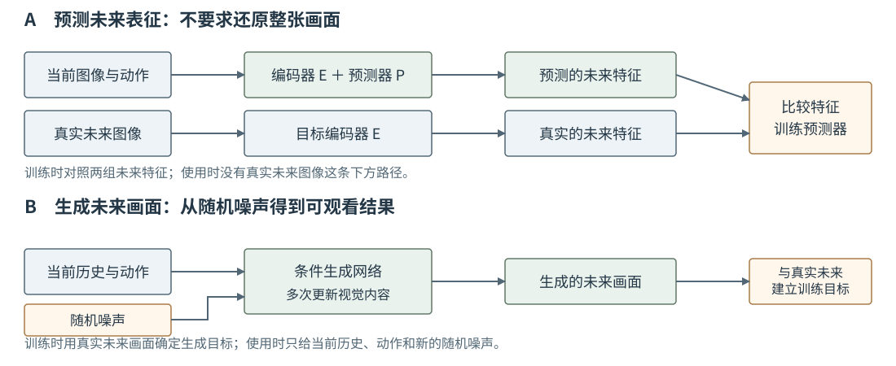
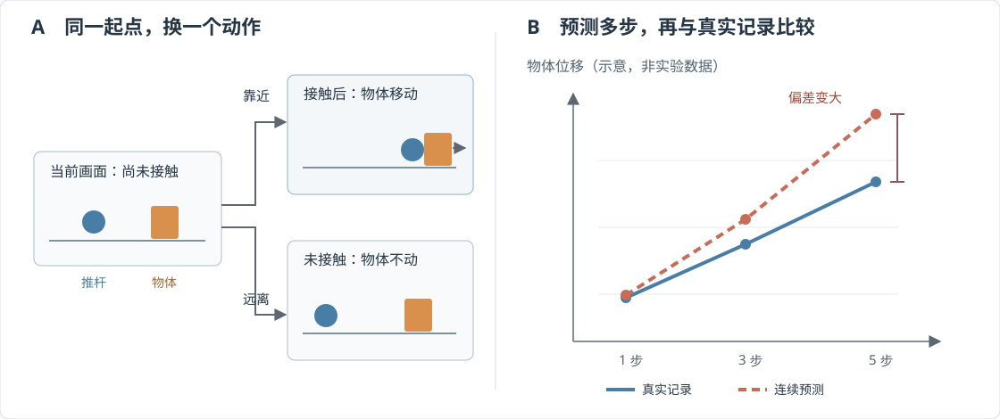

# 15-4 未来画面生成与视觉预测检验

15-2 和 15-3 的模型输出未来视觉**特征**，重点在于特征是否能够表示动作后的变化。若希望直接看到可能发生的画面，则需生成未来图像，或生成可解码成画面的压缩视觉内容。本节先说明它与第 12 章动作生成的共同点及关键区别，再用同一推动任务检查：无论预测的是特征还是画面，结果是否真的有助于判断动作后果。

## 生成对象从动作块换成未来视觉内容

第 12 章的生成式动作模型以当前情境为条件，从噪声生成**未来动作块**。本节的视觉生成模型则把历史图像与一段**已经给定的候选动作**作为条件，从噪声生成执行这段动作后可能出现的视觉内容。动作在前者是输出，在后者是输入；两者即使都使用 Diffusion 或 Flow Matching，也不能混为同一个任务。

例如我们已经记录了接下来的四帧真实图像及两次拍摄之间的四步实际动作。可先将四帧压缩为一个视觉数据块 $Y$，把四步动作记为 $A_t$。在最简单的 Flow Matching 教学形式中，从与 $Y$ 同形状的高斯噪声 $\epsilon$ 出发，在进度 $s\in[0,1]$ 构造

$$
u_s=(1-s)\epsilon+sY,\qquad v^*=Y-\epsilon.
$$

训练时，网络读取中间视觉数据 $u_s$、进度 $s$、当前及更早的真实图像 $I_{\leq t}$ 和实际动作序列 $A_t$，学习输出与 $Y$ 同形状的视觉变化速度 $v^*$。这里动作序列**不是**预测答案。使用时四帧真实未来还没发生，不能把 $Y$ 输入网络；模型从一份新噪声出发，反复查询速度网络，才得到一份可能的视觉未来。上式是为了看清输入与输出的线性路径示例，不代表所有视频世界模型都采用同一种压缩器或生成过程。

<figure markdown="span">
{ width="1100" loading=lazy }
<figcaption>图 15-4　上方直接预测未来表征，并与真实未来图像的编码结果比较；下方在历史图像和给定动作的条件下，从噪声生成未来视觉内容。两条路线都不在此处生成机器人动作。（本教程绘制）</figcaption>
</figure>

图 15-4 的上下两路有相同的时间配对：都需要真实发生过的当前观测、实际动作和未来观测。区别是预测结果的形式，以及未来不确定性怎样表达。推杆碰到杯子边缘后，杯子可能略微转动，也可能滑向一侧。只有一个确定输出的模型可能把两种结果折中；生成模型可从不同噪声分别取样，尝试给出不同结果。但随机取样**并不保证**样本都物理可行，更不保证模型正确理解了接触。若生成的是压缩表示，还需解码器才能显示画面，画面模糊也可能来自解码环节，而不全是未来预测出错。

## 检验动作、接触与连续预测

训练误差只说明模型在训练目标上接近答案。推动任务首先要检查的是动作是否真的影响了结果：固定同一张当前图像，分别输入推杆向物体移动和远离物体的动作。如果推杆尚未接触，远离动作不应使物体移动；若已经接触，向右动作应使预测的物体位置合理改变。这项对照能暴露“预测器不看动作”或“任何向右命令都被当作已推动物体”的问题。

随后使用**训练时未见过的完整轨迹**检查真实结果。先让模型从真实当前观测出发预测下一次观测，称为一步预测；再把上一步的预测结果作为下一次预测的输入，连续得到第 3、5 步等结果。后一种检查没有在每一步偷换回真实图像，因此能看见误差怎样累积。若模型把接触判断早了一步，从那一步开始预测的物体位置就可能持续偏离。比较不同距离的预测与真实记录，可以决定模型最多值得向前看多久，而不是只报一个跨所有步数的平均分。

<figure markdown="span">
{ width="1120" loading=lazy }
<figcaption>图 15-5　左侧固定当前画面、只换动作，检查模型是否区分接近与远离；右侧从同一真实起点连续预测，对照第 1、3、5 步的物体变化。曲线为误差传播示意，不是论文实验结果。（本教程绘制）</figcaption>
</figure>

图 15-5 左侧与右侧不能互相替代。模型也许能正确区分两个单步动作，却在连续展开时失去接触时机；也可能连续预测看似平滑，却对不同动作给出几乎相同的结果。若输出画面，还要单独核对物体位置、运动方向和接触状态，不能让大片正确背景掩盖物体错误。若输出特征，就看它能否区分这些任务状态，并与真实未来图像的编码结果比较。画面清晰度和特征均方误差各有用途，却都不是完整的控制能力证明。

配套实践 15-01 先让两个候选画面分别犯“背景错”和“物体位置错”，对比两种误差为何偏好不同候选；再训练固定手工位置特征上的一步动作条件预测器；最后展示两种清晰未来的像素平均为何不是合格的第三种结果。实践没有训练视频 Diffusion、Flow 或 LeWM。读图时应把它当作**判断预测目标与评价方法的教学对照**，而不是模型性能复现。

## 从预测未来到形成动作

本章的世界模型始终只回答“**给定**当前情境和动作，会出现什么未来”。它本身不负责提出动作。若外部搜索器提出若干候选动作，世界模型就可以分别预测后果，再按任务目标比较候选；[LeWM 论文](https://arxiv.org/abs/2603.19312)也利用这类模型预测与动作搜索的连接。候选如何搜索、执行一部分后何时重算，属于动作规划问题，不是训练视觉编码器的步骤。

第 16 章沿另一条连接路径前进：先由当前观测和目标形成**希望出现的未来计划**，再由动作模块将该计划变成命令。这里的动作条件预测器输入里已经有动作，所以不能不改变接口就把它直接当成第 16 章的未来计划生成模块。两章共同回答“未来与动作怎样接上”，但箭头方向不同。

[返回 15 导读](15-visual-world-models.md) · [继续阅读第 16 章](16-cascaded-world-action-model.md)
