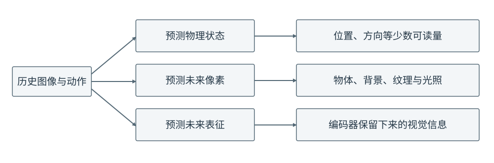

# 15 视觉世界模型：预测表征，还是生成未来画面？

第 14 章已从相邻交互记录学会“当前情况＋实际动作 → 下一时刻的变化”，但教学数据直接给出了推杆和物体的位置。相机不会自动报告这些坐标；它给出的是一张包含物体、桌面、阴影和遮挡的图像。视觉世界模型仍要学习动作造成的变化，只是必须先决定：**未来要表示成什么，训练时又怎样得到相应答案？**

本章沿用推动 T 形物体的例子。先比较物理状态、视觉表征和未来画面三种答案，再重点学习联合嵌入预测架构 JEPA（Joint-Embedding Predictive Architecture）的表征预测路线；随后用生成未来画面的路线作对照。两条路线都可能接收动作，但“有未来预测”不等于“已经会生成机器人动作”。

## 1. 同一次推动，可以预测哪些结果

设相机在推动前拍到图像 $I_t$，机器人在两次拍摄之间实际执行动作 $a_t$，随后拍到 $I_{t+1}$。动作和图像必须按这个时间顺序对应，否则网络可能把没有发生的移动归因于错误动作。根据希望模型交出什么结果，有三种常见的训练目标。

如果结果是物体中心与朝向，下一刻的答案就是几个可以直接解释的数。这延续了第 14 章，但需要数据中已有人或视觉算法提供这些坐标。如果结果是整张下一帧图像，答案就是 $I_{t+1}$ 的像素；模型除了物体运动，还要处理背景、遮挡和光照。如果结果是下一帧的视觉表征，先用编码器 $E$ 把图像变为一组数 $z_{t+1}=E(I_{t+1})$，再让预测器给出这组数。表征是编码器对图像的数字表示，也常称为**潜空间特征**；它可以是一个向量，也可以是保留空间位置的多组图像块特征。

<figure markdown="span">
{ width="1000" loading=lazy }
<figcaption>图 15-1　同一段推动记录可以提供三种不同的预测答案。图中的“未来表征”来自真实未来图像经过编码器计算，不是人工标出的物体坐标。（本教程绘制）</figcaption>
</figure>

表征并不等于 JEPA 独有的特征：任何视觉编码器都能输出表征。JEPA 特别强调**在表征空间中预测缺失或未来的内容，并与真实内容的编码结果比较**。视频 JEPA 的预训练阶段可以不使用机器人动作；要回答本章的推动问题，还需让一个动作条件预测器学习“执行这个动作之后”的未来特征。把这两个阶段混为一谈，会错误地以为模型只看过视频便知道特定机器人命令的效果。

选择表征仍要检查它保留了什么。只记住“这是一个 T 形物体”却忘记推杆与物体之间的距离，就无法判断下一步是否会接触；只看整图平均像素误差，大片不变背景又可能盖过很小却关键的物体位移。配套 Notebook 用移动小方块和背景变化把这两个问题具体显示出来；其中的特征是手工计算的示意量，**不是训练出的 JEPA 模型**。

## 2. JEPA 的数据流：谁产生预测，谁提供答案

先看最简的一步。当前图像 $I_t$ 经编码器得到 $z_t$；预测器读取 $z_t$ 和动作 $a_t$，输出对下一刻的估计 $\hat z_{t+1}$。真实下一帧 $I_{t+1}$ 也经编码器得到 $z_{t+1}$，用来核对估计是否接近：

$$
z_t=E_\psi(I_t),\qquad
\hat z_{t+1}=P_\phi(z_t,a_t),\qquad
z_{t+1}=E_\psi(I_{t+1}).
$$

例如推杆向右移动后，真实下一帧显示 T 形物体顺时针转了一点。训练时预测器看得到当前图像的编码和向右移动这个动作，看不到那张未来图像；未来图像只在计算训练误差时出现。使用模型预测一个尚未执行的动作时，真实未来图像根本不存在，也就只运行左侧的编码与预测路径。这与第 14 章“输入是当前状态和动作、答案是下一状态”是同一件事，只是状态由可读坐标换成了图像特征。

上述编码器、动作预测器和用于核对的未来特征，构成了本章所说的**动作条件 JEPA 式世界模型**的基本结构。式中的 $\psi$ 是编码器参数，$\phi$ 是预测器参数；两者是否一起训练，要由具体方法决定，不能从这条公式直接推断。为了看清一步预测，本节只写 $z_t$；实际模型也可以把多帧图像特征和对应动作一起输入，以区分“正向移动中”与“刚刚停下”等单帧看不出的情况。

若每帧得到 16 个图像块特征、每块 64 个数，预测器可以一次输出下一帧的 $16\times64$ 个数。Transformer 是实现预测器的一种方式：它读取各图像块、历史时刻和动作的数值表示，让这些信息交互，再由输出层逐位置给出未来特征。这里的输出是**未来视觉特征的预测**，不是第 12 章中动作生成网络预测的噪声或速度。

## 3. 固定编码器：只学习动作怎样改变已有特征

第一种训练方式是先准备一个视觉编码器，然后把它固定住。当前图像和真实未来图像都经过同一个固定编码器；预测器的输出与真实未来特征比较。训练误差可以写为

$$
\mathcal L_{\mathrm{pred}}
=\frac{1}{ND}\sum_{n=1}^{N}\sum_{j=1}^{D}
\bigl(\hat z_{t+1,n,j}-z_{t+1,n,j}\bigr)^2.
$$

这里 $N$ 是图像块数，$D$ 是每块的特征维度，$n,j$ 指明比较的是哪个位置、哪个特征数值。若只有一个整体向量，就把式子理解为对各分量求平均平方误差。一次训练更新会调整预测器以及动作进入预测器所用的投影层，不改变固定编码器。

<figure markdown="span">
{ width="1000" loading=lazy }
<figcaption>图 15-2　从上方读取当前图像和动作，得到预测；从下方编码真实未来图像，得到训练答案。两处 E 是同一个固定编码器，预测时没有下方的真实未来分支。（本教程绘制）</figcaption>
</figure>

[DINO-WM](https://arxiv.org/abs/2411.04983)是“固定已有视觉特征，再学习动作条件变化”的具体例子：它使用预训练并固定的 DINOv2 视觉编码器，保留图像块特征，训练预测器估计未来特征。它说明的是这一训练安排，不能仅因“预测特征”就把 DINOv2 视觉预训练本身叫作 JEPA。固定编码器让目标特征稳定，但也有明确边界：若原有特征没有记录细小间隙或接触变化，预测器无法通过自身训练让编码器补回这些信息。

## 4. 共同训练编码器：LeWM 怎样防止表征坍缩

现在不固定编码器，而是让它和预测器一起从图像数据中学习。这样做有一个特殊问题：训练答案也是编码器产生的。如果编码器改变了“真实未来图像”的特征，预测器要追赶的答案也会跟着改变。两者可能找到一种毫无用处却很容易取得低误差的做法。

看三张不同的图像：推杆还未接触物体、刚接触物体、物体已被推开。我们希望它们的特征不同，例如分别为 $(0.1,0.2)$、$(0.4,0.2)$、$(0.8,0.3)$，这样预测器才有机会区分接触前后。假如编码器不管看到哪张图都输出 $(0,0)$，预测器也始终输出 $(0,0)$，那么每条记录的“预测未来特征”和“真实未来特征”都完全相等，平方误差为零。但输入一个向右动作或向左动作，预测结果仍然一样。**不同场景被压成同一组数、特征失去区分能力，就叫表征坍缩。** 这个例子中的数字只用于展示错误解，不是论文测得的特征。仅看预测误差下降，无法排除这种情况。

[LeWorldModel（LeWM）原论文](https://arxiv.org/abs/2603.19312)用两项训练要求处理这个问题。第一项仍是从当前图像的特征和动作预测下一张图像的特征。第二项 SIGReg（Sketched Isotropic Gaussian Regularizer，可译为“随机投影各向同性高斯约束”）专门检查**当前这一批图像经编码器得到的特征**，包括批次中的多个时刻和多条轨迹；它不检查预测器输出的特征，也不要求某一张图像对应某个预先指定的坐标。

为什么要检查整批特征？单看一对图像的预测误差，无法知道编码器是不是给所有图像都取了同一个名字。把一批特征放在一起，才能看出它们在不同图像之间是否真的分散。SIGReg 事先规定一个参照：这些特征作为整体应接近各方向都有变化的标准高斯分布。如果全都落在 $(0,0)$，显然不符合这个参照；即使只沿一个方向变化、另一个方向始终相同，也仍与这个参照有差距。

高维特征难以直接检查，所以 SIGReg 重复做一件较容易的事：随机选一个单位方向，把这一批特征都投影到该方向，得到一列数字；再用一维正态性检验比较这列数字与标准正态分布。换多个随机方向重复检查，并把各方向的偏差汇总成训练惩罚。以二维特征为例，方向 $(1,0)$ 检查横向的分布，方向 $(0,1)$ 检查纵向的分布，斜向方向还能发现两维一起变化时的异常；论文实际使用许多随机方向，而非只检查这三条。若特征坍缩，任一方向得到的都会是几乎相同的数字，惩罚便无法靠“预测器也输出常数”消除。这个惩罚通过训练更新编码器，使它保留图像间的差别；同时，预测误差继续要求这些差别与动作之后的变化有关。SIGReg 限制的是**整批特征的分布形状**，不能单独保证每个细小接触状态都已被编码出来，后面仍要用动作选择任务检验。

<figure markdown="span">
{ width="1100" loading=lazy }
<figcaption>图 15-3　上方用当前特征和动作预测未来特征；下方用真实未来图像形成比较答案。图中从未来特征指向 SIGReg 的箭头只示意特征来源；实际分布检查会汇集批次内多个时刻、多个样本的编码器特征，再沿多个随机方向比较。预测误差和分布约束共同参与训练。（依据 LeWM 论文，本教程绘制）</figcaption>
</figure>

顺着图 15-3 读公式，就能区分两种误差：

$$
\mathcal L_{\mathrm{pred}}=\frac{1}{d}\sum_{j=1}^{d}(\hat z_{t+1,j}-z_{t+1,j})^2,
\qquad
\mathcal L_{\mathrm{total}}
=\mathcal L_{\mathrm{pred}}+\lambda\,\mathcal L_{\mathrm{SIGReg}}.
$$

第一项逐条比较“预测的未来特征”和“真实未来图像编码出的特征”；$d$ 是每条特征包含的数值个数。例如两维的真实答案为 $(0.2,0.7)$，预测为 $(0.3,0.6)$，两维各错 $0.1$；按式中两维平均平方误差计算，结果为 $0.01$。第二项把批次中的编码器特征送入上述随机方向检查，用多个一维分布的偏差形成 $\mathcal L_{\mathrm{SIGReg}}$。假设当前这批的预测误差为 $0.04$，分布约束为 $0.6$，人为设定权重 $\lambda=0.1$，总误差就是 $0.04+0.1\times0.6=0.10$。这些数字只演示如何合并两项，不是论文的实验结果。训练根据总误差调整编码器参数 $\psi$ 和预测器参数 $\phi$；$\lambda$ 控制两项对更新的相对影响，不是动作大小。

这里的图 15-3 解释的是 **LeWM 这一种共同训练方式**，不是说所有 JEPA 的网络和防坍缩方法都相同。前一节的 DINO-WM 固定编码器，不需要用同一种方法阻止编码器在此阶段坍缩。[V-JEPA 2](https://arxiv.org/abs/2506.09985)又是另一条具体路线：先通过遮住部分视频内容、预测其特征来预训练视频编码器，再固定该编码器，利用机器人视频和动作训练动作条件预测器 V-JEPA 2-AC。视频预训练与机器人动作预测是两个阶段，不能把没有动作的预训练任务当成已经学会了推动后的物理变化。

## 5. 另一条路线：生成可以观看的未来

表征预测器给出的是一组未来数字特征，不必还原成图像。另一类视觉世界模型则希望直接给出未来图像，或先生成压缩后的视觉内容，再用解码器还原成画面。继续看同一次推动：如果未来答案是一段图像，那么模型不仅要处理物体是否移动，还要安排物体在每帧中的形状、遮挡与背景。这样得到的结果容易由人观看，却不意味着接触位置和运动方向自然预测正确。

生成式方法与第 12 章的动作生成有相同的训练思路，但**生成对象换了**。以 Flow Matching 为例，原来干净数据是未来动作块；这里干净数据是记录中的未来图像或压缩视频表示。训练时知道真实未来，把它与随机噪声混合成中间状态；网络读取中间状态、生成进度、当前历史和实际执行的动作，学习怎样向真实未来的方向移动。使用时不存在真实未来，模型从新的随机噪声开始，反复调用网络得到可能的未来画面。若选择 Diffusion，网络可改为估计加进去的噪声；这也不改变“未来观测是生成对象、机器人动作是条件”的分工。

例如记录了接下来四帧及对应的四步实际动作，把四帧压缩后的视觉内容合写为 $Y$，四步动作写为 $A_t$。取一份与 $Y$ 同形状的随机噪声 $\epsilon$，在生成进度 $s\in[0,1]$ 上构造 $u_s=(1-s)\epsilon+sY$。一个最简单的训练目标是让网络根据 $(u_s,s,I_{\leq t},A_t)$ 估计方向 $Y-\epsilon$；网络输出与 $Y$ 同形状的视觉变化，而不是四步机器人动作。这里的直线路径只用来说明第 12 章的方法怎样更换生成对象，不代表所有视频世界模型都采用相同的视频编码器或生成路径。使用时四帧真实结果尚未发生，不能把 $Y$ 放入条件；给定当前历史和候选动作，从新噪声出发才能尝试生成它们各自的未来。

<figure markdown="span">
{ width="1100" loading=lazy }
<figcaption>图 15-4　两条路线都依据当前历史与实际动作学习未来。上方比较预测表征和真实未来的编码结果；下方从噪声生成未来视觉内容，并与真实未来建立训练目标。图中只画各自的数据职责，不把某一种具体论文的全部网络画成通用架构。（本教程绘制）</figcaption>
</figure>

同一个动作也可能出现不止一种后果。例如推杆触到杯子边缘时，杯子可能原地转动，也可能稍向右滑。若训练数据里这两种结果都出现，单个确定性输出可能把它们折中成一幅没有真正出现过的模糊画面；从不同随机起点生成多次，才有机会表示不同的未来。**有机会**不等于一定学到了两种接触结果，仍须对生成样本逐个核查。配套 Notebook 用明确规定的两种结果演示“两个清楚结果的平均图像可能反而不像任何真实结果”；它没有训练 Diffusion 或 Flow 视频模型，不能据此声称复现了生成式世界模型。

## 6. 预测结果能否支持机器人下一步行动

学会输出 $\hat z_{t+1}$ 或未来画面之后，还不能只凭训练误差说模型会控制机器人。回到推动 T 形物体的目的：如果左推与右推产生不同后果，模型在相同当前图像下输入这两个动作，预测也应合理地区分这两种后果；在尚未接触和已经接触的画面中，表征应保留判断接触所需的差别。否则下一单元就没有可靠依据比较动作候选。

一个直接的检查是把模型未见过的完整推动轨迹留作测试。先用真实当前图像和真实动作预测下一帧特征，与真实下一帧编码的特征比较；再从预测结果继续向前预测，观察物体接触前后错误是否增大。还要把**同一当前画面**分别配上不同候选动作，看预测如何改变。仅比较两张画面的整体像素差可能给出误导：配套 Notebook 中“物体到位但背景变亮”和“背景不变但物体没到位”两种结果，正是让读者看清评分依据可能背离任务。

两条路线还面临不同的检查重点。表征路线至少要检查：动作改变时未来特征是否合理改变；未来特征能否区分接触、移动方向和目标附近的状态；从预测特征继续预测多步时是否迅速漂移。生成画面路线除这些问题外，还要核对多次生成是否只是改变纹理，却把物体运动预测得一样；画面清晰度不能代替物体位姿和碰撞检查。如果后续希望比较候选动作，目标画面可先编码为 $z_g=E(I_g)$，再比较预测未来与目标的关系，但“特征距离小”仍不能直接证明物理上可达。

视觉表征预测与生成未来视频也不是同一个要求。若为了查看表征预测结果而另加解码器，解码图像的模糊可能来自解码器本身，不能立即全归罪于预测器。更重要的是：**本单元到此只学会“给定动作，估计未来”，还没有从目标自动求出动作。** 下一章将改变输入条件：从当前观测与目标形成一段未来计划，再讨论如何把计划转换成机器人动作。第 15 章的动作条件预测器不能原封不动地充当这种目标条件计划器。

## 配套实践：从像素比较到动作条件表征预测

- **15-01　表征预测与两种可能的视觉未来**

    先对比像素误差与任务相关特征给出的判断，再从当前图像、实际动作和真实未来图像构造表征预测训练样本；最后观察丢失位置的特征为何无用，以及两种真实未来的像素平均为什么不是合格的第三种未来。教学编码器是手工定义的，不是 JEPA 论文模型；最后的多未来图像由规则生成，不是训练得到的视频模型。

    

## 本章小结与下一章

第 14 章建立“当前情况＋动作 → 未来”的共同接口；本章把未来答案换成视觉表征或未来画面。JEPA 式路线主要预测真实未来的编码结果，生成式路线则从噪声获得可观看的未来内容；两者都要证明预测保留了与行动有关的变化。至此世界模型单元结束：机器人可以预演给定动作，却还不能凭任务目标直接产生可执行动作。下一章的[级联式世界动作模型](16-cascaded-world-action-model.md)将沿“目标 → 未来计划 → 动作”这条不同的数据流继续。
