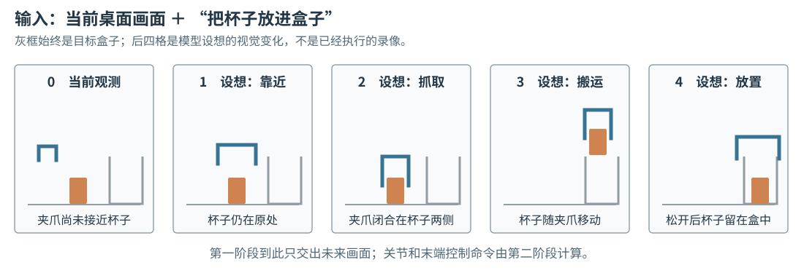

# 16-2 目标条件的未来计划生成

16-1 把级联式架构分成“形成未来”和“转换动作”两段。本节只看第一段。它要从当前观测与任务目标提出**下一段希望发生的视觉变化**，暂不决定机器人控制器中的数值。这样分开讲，是为了避免看到一段生成视频就误以为模型已经知道每个关节该怎样转动。

## 输入、训练答案与使用时的输出

设当前相机图像显示杯子在左、盒子在右，语言目标是“把杯子放进盒子”。观测历史还可能包含此前数帧图像：若夹爪正在移动，单张静止画面往往不足以判断它是否刚碰到杯子。第一阶段读取这些**已经发生**的观测及目标，生成一段**尚未发生**的未来计划。若训练资料是一条完整示范，模型可以把示范开头的观测、对应任务说明作为输入，把示范中随后真实拍摄的画面或其编码特征作为答案。使用时没有未来答案，只能依据当前情况和目标生成计划。

一条记录因此要区分三种画面：当前及更早的真实画面是输入；训练记录中接下来真实发生的画面是监督答案；使用时模型提出的后续画面是计划。三者不应在图中画成同一个箭头。尤其不能在实际推理时把训练记录的未来帧偷偷接入模型，否则就不是在预测。

## 两种中间表示：画面序列与特征序列

第一种表示是未来**画面序列**。连续生成的画面可以组成视频；只保留接近、夹紧、搬运和放置等重要时刻，则是较稀疏的关键帧。关键帧仍属于画面表示，不是与视频和特征并列的第三类。沿图 16-2 从左向右看：第一格是相机已经拍到的起点，后四格是模型设想的过程。它们回答“为完成任务，视觉上希望接下来发生什么”，不表示已经成功执行。

<figure markdown="span">
{ width="1100" loading=lazy }
<figcaption>图 16-2　左起第一格是已观测的起点，后四格是目标条件生成的未来计划：接近、闭合、搬运、放置。橙色为杯子，蓝色为夹爪，灰色为盒子；阶段顺序是示意，并非已经计算出的关节动作。（本教程绘制）</figcaption>
</figure>

假设后四格每隔 $0.2$ 秒对应一个时刻，第二阶段就能从相邻画面读取夹爪何时靠近、杯子何时开始跟随移动。如果只给最后“杯子已经在盒子里”的画面，接近方向和闭合时机仍未说明；如果帧间隔太大，短暂接触可能落在两帧之间。计划的**时间分辨率**因此决定了动作转换模块能从中看见多少关键变化。可观看画面也有代价：模型还要生成背景、遮挡和物体外观，而清晰画面并不自动意味着抓取路径可行。

第二种表示是未来**视觉特征序列**。图像先由编码器变成数字表示，第一阶段预测后续各时刻的特征，而非逐像素画出图 16-2。它可能减少对纹理等细节的建模，但第二阶段必须经过训练，学会读取**同一种特征**。例如特征若把“夹爪张开”和“已经闭合”表示得几乎一样，动作模块就无法从中恢复正确的闭合时刻。第 15 章强调的接触与物体位置检验，在这里直接决定中间接口是否可用。特征路线并不保证所有信息都保留；画面路线也不保证所有可见变化都物理可行。

## 任务目标如何改变计划

保持杯子和夹爪的当前画面不变，把目标改成“把杯子移到盒子右边”。如果第一阶段真正使用目标，未来计划应相应改变：接近杯子的起点可以相同，但放置位置及此前的搬运路径不能仍指向盒内。反过来，只改指令文字却始终生成同一段视频，说明目标没有有效进入计划模块。这个对照还不能证明计划安全；它只是检验目标条件是否起作用。

[UniPi 原论文](https://arxiv.org/abs/2302.00111)采用文字目标引导未来视频生成，随后才由另一模块从视频取得动作，是可观看画面接口的具体实例。内部视频生成可以采用第 12 章熟悉的生成式思路，但第 16 章的教学重点是**生成了什么、交给谁**，不是再次推导 Diffusion。下一节接过这段未来，具体追问怎样从画面或特征中得到机器人能执行的命令。

[返回 16 导读](16-cascaded-world-action-model.md) · [继续阅读 16-3 计划到动作的转换](16-3-plan-to-robot-action.md)
