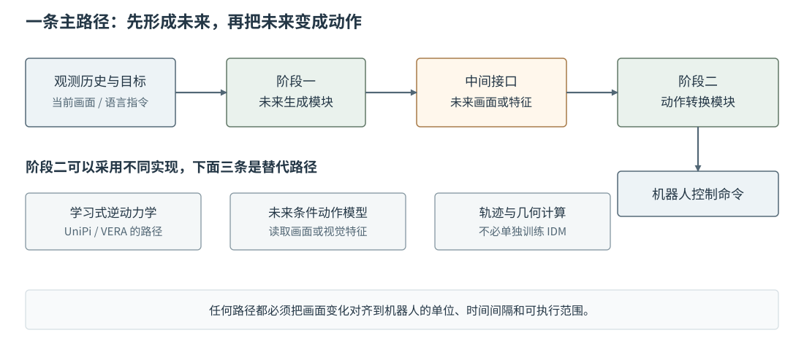

# 16-3 从未来计划到机器人控制动作

16-2 的第一阶段已经提出“夹爪接近杯子、闭合、搬运、放置”的未来画面或特征。但机器人控制器不接收一段视频作为命令。第二阶段必须将计划中的变化、当前机器人的状态和控制接口对应起来：从**希望看见什么**转为**下一步实际发送什么**。本节先用一段可手算的画面变化看清接口，再介绍学习式与几何式转换的区别。

## 画面中的位移不等于机器人动作

假设计划的两帧中，蓝色夹爪中心从横向像素 12 移到 22。两帧相差 10 个像素，这是**图像坐标的变化**，还不是机器人末端位移。若在一个特意简化、已标定的平面区域里，局部比例恰好是每像素 $0.002$ 米，这段变化才可暂时换算成 $0.02$ 米的横向移动。真实相机有透视、深度和不同坐标系，同样的 10 个像素通常不能处处用同一比例换算；还需知道相机相对机器人的位置和夹爪的深度。

接下来要问控制器接收什么：是末端位姿目标、关节角目标、关节速度，还是位移增量？若控制器接收关节角，就不能直接发送 $0.02$ 米；还需通过机器人运动学求出可达的关节配置，并检查关节范围与碰撞。若计划显示夹爪在下一帧闭合，开合命令还要按控制器的离散或连续语义另行给出。画面中的“看起来到了”与实际可执行之间，隔着坐标、单位、时间间隔和机器人机构这几层转换。

配套实践 16-01 故意只计算第一层：从四张教学画面读取夹爪横向像素中心，再相减得到三段**像素/计划步**位移，以及下一帧的夹爪开合状态。它不把像素位移冒充真机命令。图中第一段蓝块从 12 到 22，对应 10 像素；这个可核对的数帮助读者先理解“画面序列 → 数值动作”的方向。

## 学习式转换：逆动力学模型的职责

逆动力学模型（Inverse Dynamics Model，IDM）学习回答：“已知当前真实观测和希望到达的下一观测，在当前机器人状态下该采取什么动作？”训练资料来自真实交互，例如一条记录包含执行前画面 $I_t$、那段时间实际发送并执行的动作 $a_t$、执行后画面 $I_{t+1}$。模型把两个真实画面与必要的本体状态作为输入，以记录里的 $a_t$ 为动作答案。这与第 14 章从“当前＋动作”预测“未来”的箭头方向不同。

使用时，IDM 的第二个视觉输入换成**第一阶段生成的计划画面**。例如相邻计划帧显示夹爪从杯子左侧靠近并闭合，IDM 根据当前观测、计划变化和本体状态给出控制量。这里有一道必须正视的落差：IDM 训练时通常看的是两张真实记录画面，使用时却会看到一张或多张生成画面；若生成的夹爪穿过杯子或画面与真实相机差异很大，它可能输出不可执行动作。逆动力学也不是把前向世界模型的公式简单倒过来；同样的画面变化，可能由多组不同关节动作实现，必须借助本体状态和动作约束选择。

级联式架构**不要求**第二阶段一定是 IDM。它可以是直接读取整段未来特征和当前本体状态的动作生成网络，也可以是由视觉追踪、相机标定、逆运动学和控制器组成的几何链路。[AVDC 论文](https://arxiv.org/abs/2310.08576)展示了利用生成视频中的稠密对应关系，再以几何方法计算动作的路线；[VERA 项目](https://vera.csail.mit.edu/)使用针对机器人本体训练的雅可比逆动力学模型（J-IDM）。这些名称指的是**不同的转换实现**，不是一个级联系统必须依次调用的多个模块。

<figure markdown="span">
{ width="1100" loading=lazy }
<figcaption>图 16-3　中间接口是未来画面或特征；其下方列出的逆动力学、特征到动作模型和几何转换是替代路径，不是连续执行的三个步骤。最终动作仍要匹配当前机器人状态与控制接口。（本教程绘制）</figcaption>
</figure>

沿图 16-3 只选一条下行路径读：若选 IDM，就训练画面变化到动作的映射；若选几何路径，就追踪画面中的运动，再做坐标变换与运动学计算。两条路径都需明确机器人本体信息：同一段夹爪运动换到另一台机械臂，关节数、工作空间、夹爪控制值和频率可能不同。未来计划可以提供“要去哪里”的线索，动作转换模块仍须回答“这台机器人怎样去”。

## 转换结果怎样核对

核对不能止于“动作数值已经输出”。先核对单位与时间：计划帧的时间间隔是否对应动作块执行长度，图像中的方向是否与机器人坐标系一致。再核对约束：关节目标是否可达，速度和夹爪命令是否在控制器接受范围内。最后执行一小段，拿真实新观测与计划对应时刻比较；若杯子没被抓住，不能因为画面计划漂亮便判定转换成功。这最后一步把本节的动作接口接到 16-4 的完整系统循环。

[返回 16 导读](16-cascaded-world-action-model.md) · [继续阅读 16-4 UniPi 与执行反馈](16-4-unipi-and-feedback.md)
