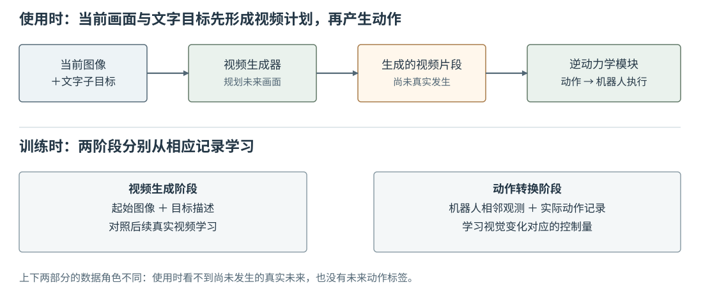

# 16-4 UniPi 案例与执行反馈

前三节分别回答了级联式系统的结构、未来计划与动作转换。本节沿一个具有代表性的实例把它们串起来，再看执行以后为什么必须重新读取真实观测。[UniPi 原论文](https://arxiv.org/abs/2302.00111)采用文字目标引导未来视频生成，再用独立的逆动力学模块从视频提取控制动作。这里用它说明级联的两段职责，而不把它的视频生成网络细节当作所有级联式世界动作模型的共同标准。

## 沿 UniPi 的两段数据流读一次杯子任务

起点是当前画面与“把杯子放进盒子”的文字子目标。视频生成模块首先提出未来画面：夹爪靠近杯子，接触并夹紧，杯子跟随移动，最后停在盒内。若改为“把杯子移到盒子右侧”，期望的视频过程也应改变。到这一步，输出仍是**画面计划**，还没有某台机械臂的关节命令。接着，逆动力学模块读取计划中相邻时刻的视觉变化，结合执行时的当前情况，输出能交给控制器的动作。这才完成“目标 → 未来 → 动作”的级联。

<figure markdown="span">
{ width="1100" loading=lazy }
<figcaption>图 16-4　按 UniPi 的两阶段主路径重绘：上方是使用时从当前画面、文字目标到视频计划，再到动作的顺序；下方区分视频阶段和动作转换阶段所需的训练记录。图中没有把真实未来画面误画成使用时的输入。（依据 <a href="https://arxiv.org/abs/2302.00111">UniPi 原论文</a>，本教程绘制）</figcaption>
</figure>

图 16-4 上下两部分应分开读。上方是**使用时**：未来由视频生成模块提出，再交给动作转换模块。下方是**训练时**：视频生成模块从画面及任务描述学习什么未来与目标相符；逆动力学模块则需要带机器人动作的记录，学习视觉变化与控制量之间的关系。因此，能从大量没有动作标签的视频学到“任务过程可能怎样看起来”，不等于已经知道特定机械臂该发送什么关节值。UniPi 原论文还讨论了视频生成的时间层级等设计，图 16-4 只保留本章需要的两阶段接口。

16-3 提过的 [VERA](https://vera.csail.mit.edu/) 也呈现先视频计划、再将画面变化转换为机器人动作的主干，但采用适应该机器人本体的 J-IDM。它与 UniPi 的共同点在于**计划和动作转换分开**，并非两者网络相同。几何式转换的 AVDC 也属于另一种第二阶段选择。理解三者时应先抓住图 16-3 的共同接口，再看各自选用了什么动作转换方法。

## 一段计划执行后，计划与事实可能分开

设视频计划的第二个搬运时刻里，夹爪和杯子都到了横向位置 34；机器人实际执行前两步后，夹爪到了 34，杯子却因打滑只到了 30。位置 34 是上一轮**设想**，位置 30 是刚由相机重新**看到**的事实。若继续把旧计划中“杯子已经在 34”的画面作为起点，下一个动作可能过早松开夹爪。合理的顺序是：先执行计划前面一小段；读取新相机画面和本体状态；仍以原任务为目标重新形成未来；再把新计划转换成下一段动作。

这里的重新观察，不是说未来模块具有“自动纠错”的魔力。如果生成视频始终把滑动的杯子画在错误位置，新一轮仍可能失败。反馈的作用是让系统有机会用真实新观测替代旧设想，再次计算。配套实践 16-01 正好构造了这个对照：原计划杯子在像素 34，实际观测杯子在 30。学生应指出下一轮哪张画面能作事实输入，而不只是说两张图“看起来不同”。

## 分段检查级联系统

当完整任务失败时，先按两段接口定位，而不要只用“生成视频是否清晰”判断。若计划已把夹爪画得穿过杯壁，问题首先在未来计划的物理合理性；若计划的接触顺序正确，动作却把画面中的小位移变成超出关节范围的命令，应检查动作转换、坐标标定和单位；若两段离线看起来都合理，实际执行后杯子仍滑动，则要看传感器反馈与重新规划能否处理偏差。不同问题的修正位置不同，不能靠提高单一画面指标替代整条链路的检查。

配套 Notebook 用明确写出的规则构造未来画面，并从画面中的蓝色夹爪位置计算像素位移。它**没有训练**视频生成器或 IDM，也没有控制真实机械臂；最后一组“计划画面与实际观测”的对照只用于确定数据角色。按小章阅读时，可先运行画面部分对应 16-2，再运行位移转换对应 16-3，最后运行换目标和执行偏差部分对应本节。

级联式架构在使用时明确保留“未来计划 → 动作转换”这一中间接口。第 17 章将改变这一安排：从同一段真实交互中共同学习未来预测与动作生成，但不规定每次输出动作前都先生成一段完整视频。先记住本章的比较基准：两项能力如何训练、使用时是否必须显式经过未来计划，以及计划偏离真实观测后怎样处理。

[返回 16 导读](16-cascaded-world-action-model.md) · [继续阅读第 17 章](17-joint-world-action-model.md)
