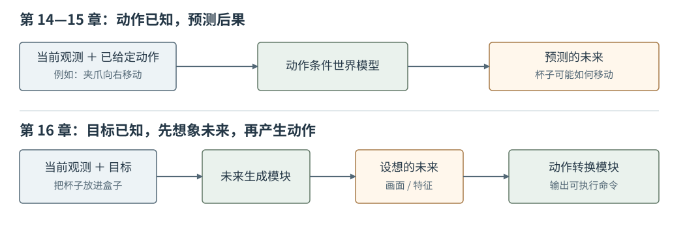
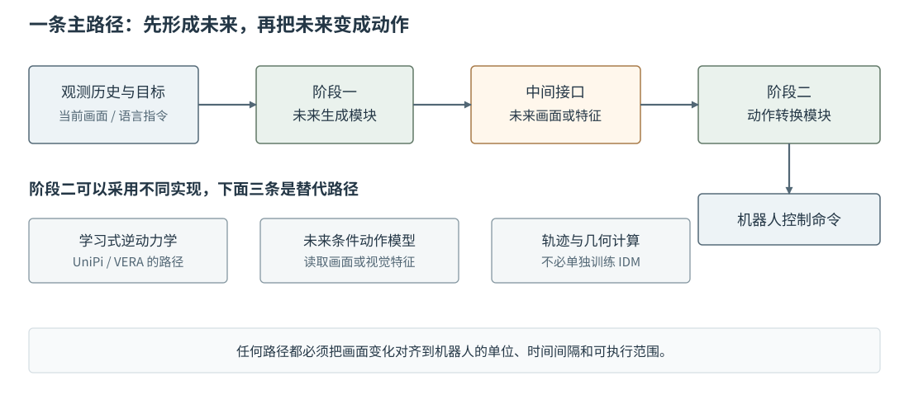
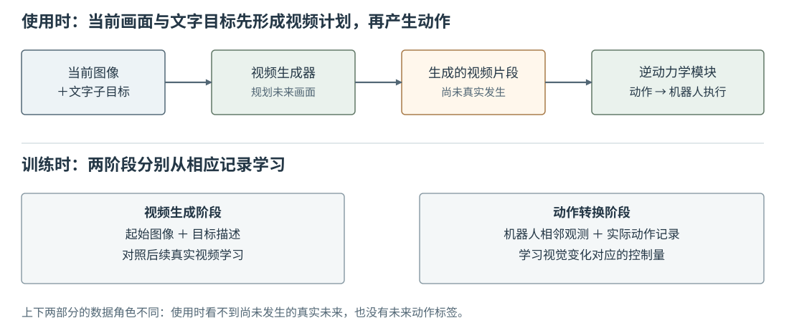

# 16 级联式世界动作模型：从未来规划到动作执行

第 14 章让世界模型回答“已经决定执行这个动作，下一刻会发生什么”；第 15 章进一步说明，这个未来可以是物体状态、视觉表征，也可以是画面。可是机器人接到“把杯子放进盒子”的任务时，手里并没有一串现成动作供模型预测。它首先需要确定杯子、夹爪和盒子**应当怎样变化**，再把这种变化转成自己的控制命令。级联式世界—动作模型（Cascaded World–Action Model，简称级联式 WAM）用两个相接的模块完成这件事：前一个模块形成未来计划，后一个模块依据计划产生动作。

全章沿用桌面杯子的例子。相机看到杯子位于盒子左侧，任务指令是“把杯子放进盒子”。为了把架构讲清，假定相机还能看到夹爪；实际系统通常还会读取关节状态、夹爪开合和相机标定信息。本章不把某一种论文的网络细节写成所有级联式模型的规定，也不把训练逆动力学模型作为单独主题。

## 1. 从动作条件预测到未来引导动作

第 14、15 章的动作条件预测可简写为

$$
(o_t,a_t)\xrightarrow{F_\phi}\hat o_{t+1}.
$$

这里 $o_t$ 是当前观测，$a_t$ 是**已经给定**的动作，$F_\phi$ 估计该动作造成的后果。训练时用真实执行后记录的 $o_{t+1}$ 核对预测；使用时可以换一个候选动作，再预测它的后果。这是一种有用的世界模型接口，却没有直接回答“在没有候选动作时，怎样完成杯子任务”。

级联式 WAM 改变了提问顺序。先把当前观测历史 $o_{\le t}$ 与任务目标 $g$ 交给未来生成模块 $G_\psi$，得到计划中的未来 $\tilde o_{t+1:t+H}$；再由动作转换模块 $D_\omega$ 读取这段未来，以及当前观测和必要的机器人本体状态 $q_t$，给出动作块 $\hat a_{t:t+H-1}$：

$$
(o_{\le t},g)\xrightarrow{G_\psi}\tilde o_{t+1:t+H}
\xrightarrow[\,o_t,q_t\,]{D_\omega}\hat a_{t:t+H-1}.
$$

$H$ 是本轮计划覆盖的时间长度；波浪号表示**设想的未来**，不表示已经发生的真实观测。两式的区别不只是箭头方向：第一式的动作是预测器的输入；第二式的动作是整个系统最终要交给机器人执行的输出。第 15 章讲过的视觉编码与视频生成方法，为理解未来表示提供了基础，但一个按“已知动作预测画面”训练的网络，不能不改变条件输入就直接充当“按任务目标生成计划”的 $G_\psi$。

<figure markdown="span">
{ width="1050" loading=lazy }
<figcaption>图 16-1　上行对应第 14、15 章：动作已知，求未来；下行对应本章：目标已知，先形成未来计划，再求可执行动作。两行的“未来”都不是已经发生的真实结果，但承担不同的数据角色。（本教程绘制）</figcaption>
</figure>

沿图 16-1 下行读杯子任务：未来生成模块可以画出夹爪接近杯子、夹紧、移动到盒子上方、松开的画面；动作模块才把画面中的运动翻译为具体控制量。这里的“级联”说的是**两个阶段的输出与输入相接**，并不是先预测若干候选动作的后果，再给候选打分。候选搜索属于另一类使用世界模型的方法，不是理解本章架构的前提。[WAM 架构综述](https://arxiv.org/abs/2605.12090)将“先产生未来视觉计划，再由独立动作模块解码指令”列为级联式路线。

## 2. 第一阶段：形成面向任务的未来表示

未来生成模块收到的是当前情境与目标，而不是下一步真实图像。杯子任务中的 $g$ 可以来自语言指令，也可以包含目标图像或目标物体位置。观测历史让模块知道杯子和夹爪先前怎样运动；只用一张静止图像，可能无法判断夹爪是否已经抓稳。生成结果可以是连续的画面、相隔较远的关键帧，也可以是编码后的未来特征。选择哪一种，取决于第二阶段究竟需要读取什么。

先看容易观看的视频形式。假设计划每隔 $0.2$ 秒给出一帧：第一帧夹爪靠近杯子，随后夹爪闭合，再把杯子移向盒子，最后在盒子上方松开。视频交给动作模块时，不只表达“终点正确”，还传递了接近、抓取、搬运与放置的先后关系。如果只生成一张杯子已经在盒子里的终点图，动作模块无法从这张图唯一确定应从哪侧接近、何时闭合夹爪。另一方面，视频帧间隔如果太大，关键的接触过程仍可能丢失。因此“输出是视频”不等于动作信息已经足够。

生成模块通常通过观察真实视频学习画面与任务的对应关系。训练时可以给它一段视频的起始观测和相应任务描述，以后续真实画面作为学习目标；使用时后续画面尚未发生，只能根据当前观测与目标生成。视频生成内部可以采用 Diffusion 等方法，第 12 章已经讨论过从噪声逐步生成数据的基本思路；这里生成的对象换成了未来视觉内容。第 16 章关注的是它**向动作模块交出什么**，不再重复推导生成算法。[UniPi 原论文](https://arxiv.org/abs/2302.00111)正是以当前图像和文字子目标生成未来视频，再把视频交给下一模块。

若输出改为未来视觉特征，画面未必能被人直接观看，但可以节省逐像素生成的工作。代价是动作模块必须学会读取同一种特征：若编码器把“夹爪张开”和“夹爪闭合”编码得几乎一样，第二阶段无法从特征中恢复正确的开合时刻。无论用画面还是特征，生成的未来还要符合当前场景——不能把桌上没有的杯子画进来，也不能让物体在相邻帧中无缘无故穿过夹爪。

## 3. 第二阶段：把未来转换为机器人动作

一段视频仍然不是机械臂命令。画面告诉我们夹爪似乎从杯子左侧移动到杯口上方，却没有直接给出机器人控制器要接收的关节目标、末端位姿或夹爪开合值。动作转换模块需要同时核对计划中的**前后变化**与当前机器人的实际状态，再输出与机器人动作接口一致的数值。例如动作接口若规定每 $0.2$ 秒接收一次末端位移和开合命令，输出就必须遵守这个时间间隔和单位；不能把像素位移直接当作米或弧度。

一种转换办法是学习逆动力学模型（Inverse Dynamics Model，IDM）。它要回答的不是“执行某动作后会怎样”，而是“从当前观测变到指定的下一观测，可能需要什么动作”。真实机器人记录里的相邻观测与其间实际执行的动作，可以为这种映射提供示例。本章只需要理解它在接口上的职责：给它计划中的相邻画面及必要的机器人状态，它输出一段控制量。相同的画面变化未必只对应一种动作，而且生成画面不一定能真实执行，因此逆动力学并不是把第 14 章公式机械地倒过来。

IDM 也不是唯一选择。若计划画面足以追踪夹爪或物体的位置，可以先提取空间轨迹，再结合相机标定、逆运动学和控制器求出动作；也可以训练直接读取未来视觉特征的动作模型。前者不要求单独训练一个 IDM，后者即使是学习得到的，也不必采用“相邻两帧回归动作”的 IDM 形式。[AVDC 原论文](https://arxiv.org/abs/2310.08576)展示了从生成视频提取稠密对应关系、再通过几何计算得到机器人动作的路线。三种办法共同解决的是同一个接口问题：**把计划中的视觉变化转换为与具体机器人相容的控制量**。

<figure markdown="span">
{ width="1100" loading=lazy }
<figcaption>图 16-2　未来生成与动作转换是两个不同职责。中间的视觉计划可以是画面或特征；下方列出三种转换路径，它们是替代实现，不表示一次推理必须同时经过三条路径。动作输出还要匹配机器人本体状态与控制接口。（本教程绘制）</figcaption>
</figure>

图 16-2 的中间接口是整个系统最容易被误读的地方：未来画面不是动作监督标签，也不是执行后的真实录像，而是第一阶段提供给第二阶段的计划。若要更换机器人，未来生成模块未必需要完全重训，但动作转换模块往往必须适应新机器人的关节、夹爪和控制频率。VERA 正是这一分工的实例：它保留视频规划器，单独训练针对机器人本体的雅可比逆动力学模型（J-IDM）；“雅可比”联系到基础篇第 07 章的机器人运动学，但 J-IDM 是 [VERA 的具体设计](https://vera.csail.mit.edu/)，不是级联式 WAM 的必备部件。

## 4. UniPi：沿一条完整路径理解级联架构

[UniPi](https://arxiv.org/abs/2302.00111)适合作为本章的贯穿实例，因为它把“未来视频”和“动作转换”清楚地分开。现在重新从杯子任务的起点走一遍。机器人先取得当前画面，文字给出眼下要完成的子目标；视频生成器以此为条件，产生一段描绘任务过程的画面。接下来，独立的逆动力学模块读取生成画面，预测低层控制动作。机器人执行动作后取得新观测，再据此继续完成任务。图 16-3 只画这条主路径；UniPi 原论文还包含视频生成的时间层级等设计，不应将简图当作原论文全部网络结构。[UniPi 官方介绍](https://research.google/blog/unipi-learning-universal-policies-via-text-guided-video-generation/)

<figure markdown="span">
{ width="1100" loading=lazy }
<figcaption>图 16-3　依据 UniPi 论文中的两阶段数据流重新绘制。上方展示使用时的先后顺序；下方说明两阶段在训练时分别依赖什么记录。图中没有把真实未来误画为使用时可读取的输入。（依据 [UniPi 原论文](https://arxiv.org/abs/2302.00111)，本教程绘制）</figcaption>
</figure>

读图时先沿上方走：**任务目标影响视频怎样生成，生成视频影响动作怎样产生**。如果指令改为“把杯子移到盒子右边”，当前图像可以不变，计划中的未来运动和最终动作却应改变。再看图下方的训练资料：视频生成器需要看到“起点、目标描述、后续真实视频”之间的对应；UniPi 的动作转换模块则使用带动作记录的数据学习视频变化与控制量的对应。这两部分的数据来源与训练任务不同，不能因为前者从大量没有机器人动作标签的视频学会了生成画面，就断言整个系统已经知道某台机械臂该发送哪几个关节命令。[UniPi 官方介绍](https://research.google/blog/unipi-learning-universal-policies-via-text-guided-video-generation/)也明确将小型 IDM 作为与视频规划器分开的任务适配模块。

图 16-3 使用的是 UniPi 的 IDM 路线，并不推翻上一节的其他转换方式。VERA 同样呈现“先视频规划、再转换动作、最后取得新观测”的主干，只是动作转换器采用适应该机器人本体的 J-IDM。[VERA 项目架构](https://vera.csail.mit.edu/)因此，本章选择 UniPi 来教学**级联的共同结构**，而不是要求所有模型都复制 UniPi 的网络或 VERA 的 J-IDM。

## 5. 级联接口的适用条件与实际执行

第一阶段和第二阶段各自给出看似合理的结果，不代表串起来一定成功。假如视频规划器画出了夹爪穿过杯壁的路线，动作模块不可能忠实执行一个物理上不存在的抓取；假如视频合理，但动作模块误读了相机尺度，把画面中 $2$ 厘米的移动译成末端移动 $20$ 厘米，真实杯子也不会沿着计划走。检查系统时应分别问：计划是否符合目标且具有可行的接触顺序？动作是否符合机器人单位、边界和控制周期？执行后的真实变化是否接近计划中的变化？不能只看生成视频是否清晰。

即使三项都经过离线检查，实际执行仍可能因为杯子滑动或遮挡偏离视频。级联式系统通常不必一次执行完生成的全部动作：先执行前面一小段，取得真实新观测，再从这个**真实起点**生成下一段未来并转换为新动作。这里的反馈只说明两个模块怎样在机器人上反复使用；它不是本章额外引入的候选动作评分算法。上一轮设想的画面若与相机新看到的杯子位置不同，下一轮应以新画面为准。[VERA 项目图示](https://vera.csail.mit.edu/)明确画出了视频计划、J-IDM、执行与重新观察构成的循环。

本章配套实践只用一组人工规定的二维画面模拟“未来视频”，再从画面中的夹爪轨迹提取简单末端位移。它特意采用**不训练 IDM 的几何转换**，帮助检查两阶段的输入与输出，不宣称复现 UniPi、AVDC 或 VERA。学生可以观察：改变任务目标会先改变计划，再改变动作；生成视频即使看起来合理，也必须与真实执行后的观测核对。

## 配套实践：从未来画面提取动作

- **16-01　未来计划与动作转换**

    从当前画面和任务目标构造一段可观看的教学计划，再读取计划中的夹爪位置，计算每一步末端位移；最后比较设想位置与受到扰动后的真实位置。实验中的画面生成和动作转换都是明确写出的简化规则，不是已训练的世界动作模型。

    

## 本章小结

第 14、15 章从**已给定动作**出发学习未来；本章从**任务目标**出发，先生成未来画面或特征，再通过独立模块把计划转为可执行动作。学习式 IDM、J-IDM、其他动作模型和几何计算都是第二阶段可能采用的实现，级联式架构本身并不要求其中某一种。它的关键优势是两段职责清楚，关键困难也是两段之间的接口：能想象的未来，未必能被具体机器人忠实完成。
