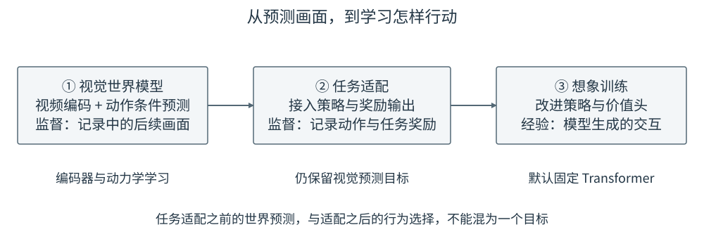
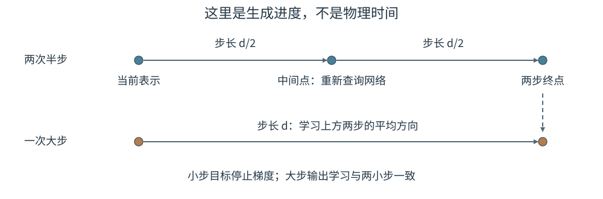
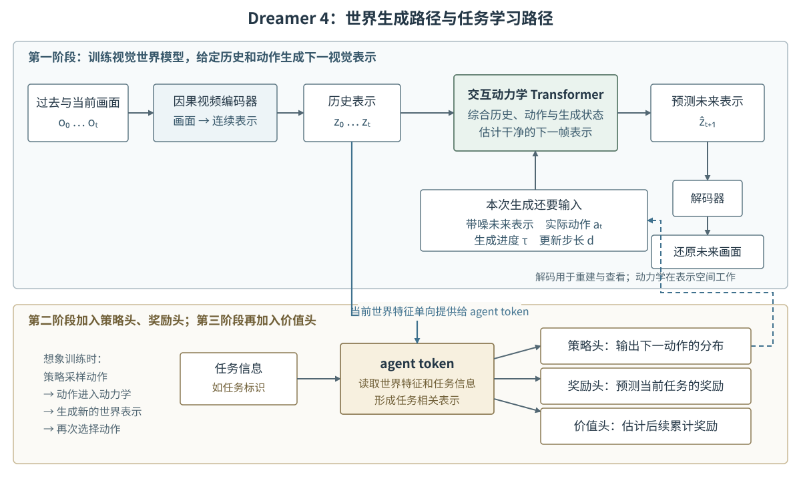
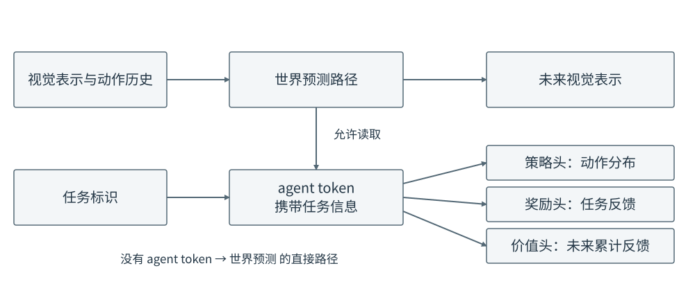

# 17 Dreamer 4：在生成的世界中学习策略

第 16 章让世界模型在机器人行动前比较候选：预测几段动作的后果，选出一段，执行一小部分，再重新观察。Dreamer 4 提出了另一种使用预测结果的方式：先让策略在世界模型生成的经历中反复学习，等策略训练好，再根据当前输入直接选择动作。本章沿着[Dreamer 4 原论文](https://arxiv.org/abs/2509.24527)的训练顺序，回答三个相连的问题：怎样从视频学会生成未来？怎样让模型知道任务并产生动作与奖励？怎样把生成的经历变成策略更新？

论文的主要验证场景是 Minecraft。下面沿用前几章的推物任务解释信息如何流动，推物示例不是论文中的机器人实验；配套 Notebook 也只演示其中可以在 CPU 上看清的机制。

## 1. 先看整个训练顺序

设一段真实记录包含连续画面 $I_1,I_2,\ldots$，部分记录还保存相邻画面之间执行的动作 $a_t$。任务训练数据进一步提供任务标识 $q_t$ 和奖励 $r_t$，例如“把物体推到目标区”以及该步的任务反馈。Dreamer 4 依次完成三个阶段，后一个阶段使用前一个阶段学到的能力。

| 阶段 | 此时已有的能力 | 本阶段用什么数据学习 | 结束后多了什么能力 |
|---|---|---|---|
| ① 预训练视觉世界模型 | 原始视频 | 视频；学习动作影响时还需与视频对齐的动作 | 把画面压缩成表示，并在给定历史和动作后生成下一表示 |
| ② 接入任务 | 已能生成未来的世界模型 | 带任务、动作和奖励的真实记录 | 根据任务提出动作，并预测任务奖励 |
| ③ 想象训练 | 世界模型、初始策略和奖励预测 | 从真实记录起点出发，由模型和策略共同生成后续交互 | 改进策略，并学习估计后续累计奖励 |

<figure markdown="span">
{ width="1000" loading=lazy }
<figcaption>图 17-1　按时间顺序读三个训练阶段。第一阶段学习画面及其变化，第二阶段利用真实记录中的动作和奖励接入任务，第三阶段让策略在模型生成的未来中改进。图中的箭头表示前一阶段的模型能力进入下一阶段。（依据 Dreamer 4 论文，本教程绘制）</figcaption>
</figure>

此时先只记住阶段之间的依赖关系。第一阶段尚未加入任务 token、策略头或价值头；模型要先学会“世界如何变化”。能生成未来以后，第二阶段才增加用于行动和评价的部分。第三阶段利用已学到的生成能力进行策略训练。

## 2. 第一阶段的第一步：把视频压缩成可生成的表示

原始相机画面有大量像素。若动力学模型每向前生成一帧都直接处理整张高分辨率图像，计算会很重。Dreamer 4 先训练一个论文称为 **causal tokenizer** 的视频编码与解码模块。本章称它为**因果视频编码器**：它把画面 $I_t$ 压缩成连续数字表示 $z_t$，解码器则尝试从 $z_t$ 还原画面。“tokenizer”在这里处理的是视频，不是把汉字切成词；它输出的表示也不是动作 token。

编码器为什么要“因果”？想象推杆在第 20 帧刚接触物体。我们要利用截至第 20 帧的画面预测第 21 帧。如果编码第 20 帧时偷偷看了第 21 帧，那么后来即使预测准确，也不能说明模型学会了动作造成的变化。因果结构让当前表示只能读取当前和过去画面。训练编码器时，论文还随机遮住一些图像块，让它通过其余内容重建画面；这样压缩后的表示需要保留足以恢复物体、背景和运动的视觉信息。

这一部的训练答案是记录中**已有的画面**，目标是让解码重建接近画面。它尚未回答“若换一个推动动作，未来会怎样”：动作条件预测由下一步的动力学模型学习。编码器先把视频变成较短的表示序列，动力学模型再在这些表示上工作。[论文的因果视频编码器部分](https://arxiv.org/html/2509.24527#S3.SS1)给出了编码、遮挡重建和解码的具体设计。

## 3. 第一阶段的第二步：用 Flow Matching 学会生成下一帧

第 15 章的视觉预测器接收当前特征和动作，直接给出一个未来特征。Dreamer 4 也要预测动作之后的未来，但采用生成式训练：同一历史和动作下，未来表示从随机噪声出发，经过若干次修正得到。先看**一个环境时刻**，把真实下一帧经编码器得到的干净表示记为 $z_{t+1}$，把一份随机标准高斯噪声记为 $\epsilon$。在训练时随机选一个生成进度 $\tau\in[0,1]$，构造中间表示：

$$
x_{\tau}=(1-\tau)\epsilon+\tau z_{t+1},
\qquad \epsilon\sim\mathcal N(0,I).
$$

$\tau=0$ 时只剩噪声，$\tau=1$ 时就是干净的未来表示；例如 $\tau=0.5$ 是这两者各占一半。这里的 $t$ 指视频从第几帧到第几帧，$\tau$ 指**生成同一帧**时从噪声走向干净表示的进度。训练时随机抽取 $\tau$，不要求这一批比上一批大；只有实际生成一帧时，进度才从 $0$ 逐步走向 $1$。

这与第 12 章学过的 **Flow Matching（流匹配）** 接上了。对固定的 $\epsilon$ 与 $z_{t+1}$，沿上述直线每前进一个单位进度，方向或“速度”就是 $z_{t+1}-\epsilon$。训练数据已经知道这两个端点，所以能够给网络提供学习方向。Dreamer 4 的实现为了减少长视频逐帧生成时的误差累积，让动力学 Transformer **直接输出干净未来表示的估计** $\hat z_{t+1}$，再根据当前中间表示换算出生成速度：

$$
\hat z_{t+1}=F_\phi(z_{\leq t},a_t,x_\tau,\tau,d),
\qquad
\hat v_\tau=\frac{\hat z_{t+1}-x_\tau}{1-\tau},
\quad \tau<1.
$$

这里 $z_{\leq t}$ 是截至当前的视觉历史，$a_t$ 是两帧之间的动作，$d$ 是这次生成准备前进的进度长度。Transformer 将历史表示、动作、带噪的未来表示以及 $\tau,d$ 的数字编码一同处理，再由输出层给出与未来表示同形状的 $\hat z_{t+1}$。干净的真实 $z_{t+1}$ 只用于构造带噪输入和计算训练误差；网络不会在输入端直接拿到干净答案。**Flow Matching 指这里学习从噪声走向数据的生成方向；Dreamer 4 的具体网络输出采用干净表示形式。** 最小生成步长的训练可直接比较 $\hat z_{t+1}$ 与真实 $z_{t+1}$；由上式换算的 $\hat v_\tau$ 则用于生成时更新中间表示。[论文的 Flow Matching 与动力学部分](https://arxiv.org/html/2509.24527#S3.SS2)分别说明了训练方向和干净表示输出的选择。

只学很小的生成步长，会使生成一帧需要多次调用 Transformer。论文进一步使用 **shortcut forcing（捷径式生成训练）**：网络除了知道当前位置 $\tau$，还知道本次要走的步长 $d$。最小步长由真实未来表示提供学习依据；较大的步长用两个连续的半步构造目标，让网络学会用一次较大的更新接近两次较小更新的结果。注意第二个半步要在第一个半步走到的中间点重新查询网络，它不是把第一次方向重复使用两遍。

<figure markdown="span">
{ width="1000" loading=lazy }
<figcaption>图 17-2　横向是生成同一帧时的进度，不是机器人执行了两步。两次半步先到中间点、再重新求方向；大步学习与其一致的更新，从而减少生成一帧所需的网络调用。（依据 Dreamer 4 的 shortcut forcing，本教程绘制）</figcaption>
</figure>

用一个数看清目标怎样形成：从 $x_\tau=0.2$ 出发，若第一个半步长度为 $0.25$、预测速度为 $0.8$，中间点就是 $0.2+0.25\times0.8=0.4$；在 $0.4$ 重新查询后，第二个半步速度若为 $0.4$，终点便是 $0.4+0.25\times0.4=0.5$。两段的平均速度为 $0.6$，所以一次长度为 $0.5$ 的大步应学到从 $0.2$ 到 $0.5$ 的更新。这只是说明捷径目标如何计算；真实网络训练还需要对不同画面、噪声和进度反复取样。论文用前述干净表示输出与速度之间的换算实现这一目标，不能把这个数字例子误读为网络只输出一个速度数值。

生成时从噪声开始，用网络给出的方向多次更新 $x_\tau$，得到第 $t+1$ 帧的表示；论文的默认设置是每帧四次网络调用。得到这一帧后，才把它放进视觉历史，继续生成第 $t+2$ 帧。**一帧内部的生成进度 $\tau$** 与 **视频向前发展的时刻 $t$** 因而形成两个嵌套循环。没有动作标注的视频仍可帮助模型学习一般画面变化；要可靠预测“指定动作造成什么后果”，还必须使用画面与动作对齐的记录。到这里，第一阶段完成：模型可以在给定历史和动作后生成未来，但尚不知道某个任务想要什么结果。

## 4. 第二阶段：让世界模型接入任务、动作和奖励

第一阶段的生成器知道“这样操作后可能出现什么”，却不会自己判断该选择哪个动作。第二阶段使用带任务、实际动作和奖励的记录，为它增加任务相关输出。任务信息在论文中是送进网络的数字嵌入，不要求一定是一句自然语言；推物示例中的“推到左目标区”和“推到右目标区”可以先表示为两个任务标识。

**agent token 在这一阶段才加入。** 它是动力学 Transformer 内的一组任务相关数字向量，能够读取当前世界特征和任务嵌入。策略头根据它预测记录中的动作分布，奖励头根据它预测任务奖励。策略头先通过模仿记录中的动作建立可用的初始行为，奖励头则学会给任务结果打分。与此同时，论文仍继续训练视觉预测目标，以保留第一阶段学到的生成能力。价值头尚未用于这一阶段的想象训练，它在第三阶段才加入。

现在再看最终系统的总览图，就能知道每个模块何时出现。上半部分是第一阶段建立的世界生成路径；下半部分在第二阶段接入任务、策略头和奖励头，第三阶段再加价值头。策略产生的动作会进入下一次世界预测。图中把三个阶段完成后的模块放在同一张图上，是为了显示最终数据流，不能理解成第一阶段已训练了所有模块。

<figure markdown="span">
{ width="1100" loading=lazy }
<figcaption>图 17-3　Dreamer 4 完成三个阶段后的总体数据流。上半部分先预测动作之后的视觉表示；第二阶段加入下半部分的任务信息、策略头和奖励头；第三阶段再加入价值头，并把策略采样的动作送回世界模型生成后续经历。（依据 Dreamer 4 论文，本教程重新绘制）</figcaption>
</figure>

总图中最容易看错的是任务信息的方向。任务 token 可以读取世界特征，用来决定当前任务下该采取什么动作；世界预测路径不能反过来读取任务 token。假如画面和动作完全一样，只把任务从“推到左边”改成“推到右边”，物体的物理运动不应凭任务名称改变。任务先影响策略选出的动作，动作再影响世界模型生成的后果。图 17-4 单独画出这一条信息边界。

<figure markdown="span">
{ width="1000" loading=lazy }
<figcaption>图 17-4　世界特征可被 agent token 读取，任务信息不能直接改写世界预测。图中的价值头属于第三阶段；第二阶段先用真实记录训练策略头和奖励头。（依据 Dreamer 4 论文，本教程绘制）</figcaption>
</figure>

这一阶段仍主要学习记录里出现过的行为。假如示范者每次都从右边绕开障碍，策略头可以学会模仿右绕，却不会只凭动作标签自己发现另一条更好的路径。下一阶段才让它在世界模型内部尝试动作，并根据预测到的任务反馈改进。

## 5. 第三阶段：在想象的交互中改进策略

想象训练从真实记录中的一段画面历史开始，先得到可信的起点。之后模型与策略轮流工作：策略从当前世界特征和任务中取出一个动作；世界模型按照这个动作生成下一帧表示；奖励头评估生成的结果；策略在新的表示上再选动作。如此展开一段轨迹。除最初的历史外，这段轨迹中的后续画面和奖励都是模型预测出来的，不能当作新增的真实环境记录。

设推物任务的一条两步想象轨迹预测奖励依次为 $0.2$ 和 $0.4$，第二步之后价值头估计还能获得 $0.5$，折扣系数为 $\gamma=0.9$。这里的折扣使越远的反馈在当前决策中权重越小。该起点的简化回报目标是

$$
G=0.2+0.9\times0.4+0.9^2\times0.5=0.965.
$$

前两项来自模型生成的两步奖励，末项是价值头对未继续生成部分的估计。若价值头原先对这个起点只预测 $0.7$，两者相差 $0.265$：这条想象轨迹比当前预期好。价值头学习估计后续累计奖励。论文实际使用结合不同预测长度的回报；策略更新采用论文所称的 PMPO 方法：按“结果高于预期”和“结果低于预期”分组，分别增加或降低对应动作的概率，更新主要依据差值的正负，而不是让数值特别大的差值支配全部训练。上式只是便于逐项核算的两步教学例子。

为什么还要保留训练前策略的冻结副本作**行为参考**？假设世界模型没见过把推杆猛地撞向桌边的动作，却错误预测它会立刻把物体送到目标。新策略如果只追逐模型给出的高奖励，可能反复选择这种危险动作。行为参考限制新策略偏离数据中已有动作过远，减轻利用世界模型错误的倾向，但不能替代实际环境验证。论文在第三阶段默认固定动力学 Transformer，主要更新策略头和新增的价值头；奖励预测及世界生成此时为想象训练提供反馈。

这解释了本章与第 16 章的不同用途。第 16 章的 CEM 在**每次行动前**改变当前候选动作；Dreamer 4 在**训练阶段**让策略经历大量模型生成的后果，从而改变策略参数。训练完成后，策略根据当前输入直接给出动作，不必在每个控制周期重新运行 CEM。两种办法都可能受到世界模型错误的影响，只是错误进入决策的环节不同。

## 6. 把论文放回机器人任务，怎样验证学到了什么

论文在 Minecraft 中验证了从离线记录预训练、接入任务、再进行想象训练的路线。把同样的数据流用于机械臂时，必须重新确认三个环节。首先，固定当前画面、替换动作，检查生成的未来是否真实地反映了接触、物体移动和夹爪状态；只看生成画面是否好看，不足以判断动作条件是否正确。其次，比较奖励头对成功、失败和碰撞的判断是否与实际任务一致；模型给出高奖励，不等于物体真的安全到位。最后，使用未参与训练的场景比较策略训练前后的真实成功次数、约束违规和决策耗时，才能判断想象训练是否带来了可执行的改进。

机械臂常用连续关节位置、末端位姿或速度指令，必须按第 11—13 章的动作定义与物理单位处理；论文的 Minecraft 动作接口不能直接搬来。接触时极小的位置和力觉变化也可能决定成败，视觉生成的相似性并不能自动保证接触预测准确。这里需要独立的真实任务检查，才能把世界模型中的“可能成功”与机器人执行中的“确实成功”连起来。

## 配套实践：生成一步，想象一段，再更新策略

- **17-01　生成步长与想象中的策略学习**

    第一部分区分环境时刻与同一帧的生成进度，并核对两个小步如何构成一个大步目标；第二部分让简化策略与世界规则产生想象轨迹，逐项计算奖励、回报和策略更新。Notebook 使用明确写出的教学函数，帮助读者核对本章的数据关系，不是 Dreamer 4 的视频模型复现。

    

## 单元小结：预测怎样转化为行动

第 14 章从真实交互记录学习“动作造成什么变化”，第 15 章把预测对象换成视觉表征。第 16 章在行动前利用预测后果搜索和选择动作；本章则沿 Dreamer 4 的顺序，先学会生成动作后的未来，再接入任务，最后让策略在模型生成的交互中改进。两条路线都依赖可信的动作条件预测，也都要用真实任务检查最终效果。至此，单元一完成了从学习世界变化到让预测参与行动的讨论；后续单元的主题和章节结构仍需单独确定。
