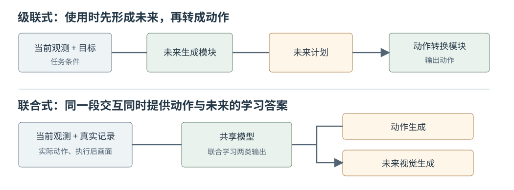
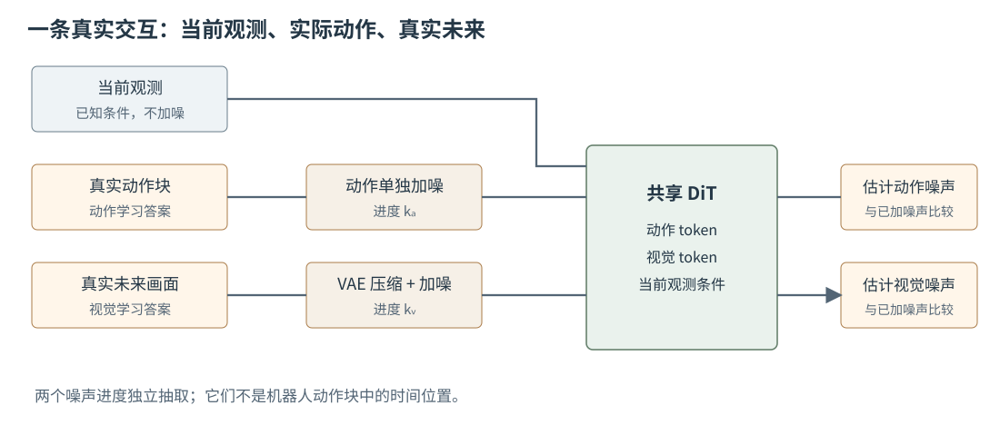
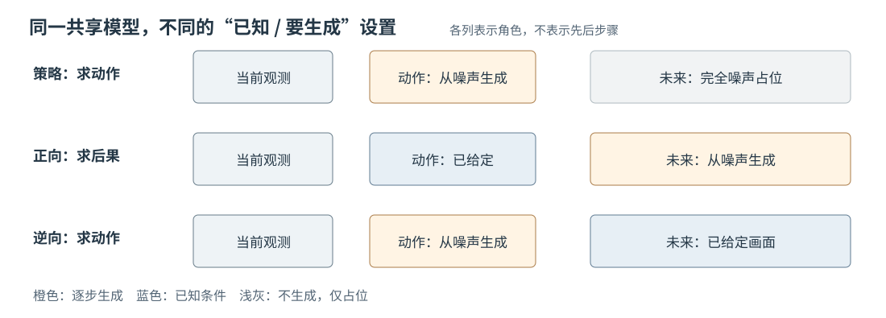

# 17 联合式世界动作模型：未来预测与动作生成的统一建模

第 16 章的 UniPi 把任务分给两个相接的模块：先依据目标生成未来视频，再由另一个模块把视频转换为动作。这种安排容易看清每一步的职责，却也留下一个问题：从同一段机器人交互中，能否让“动作应当是什么”与“动作之后会看到什么”共同参与一个模型的学习？本章以 [Unified World Models（UWM）](https://arxiv.org/html/2504.02792) 为主线回答这个问题，并在末尾用另一种联合架构作对照。

这里的**联合**指动作与未来视觉的信息在训练中相互联系，不等于使用时一定要先生成一段视频。为了保持与第 14、15 章一致，本章用“推杆推动桌面物体”作为例子：当前相机画面中推杆在物体左侧，机器人实际向右推动，随后相机拍到物体向右移动。

## 1. 级联与联合：区别在哪里

第 16 章的级联路径是“当前观测与目标 → 未来计划 → 动作”。未来计划是两个模块之间可辨认的中间结果。若第一模块画错了接触顺序，第二模块即使准确读取视频，也可能产生错误动作。

联合式路线从另一处出发：训练记录里，当前观测 $o_t$、实际执行的动作块 $a_{t:t+H-1}$ 与执行后的未来画面 $v_{t+1:t+H}$ 本来就是相互对应的。一个模型同时学习这两类输出，使用时再决定哪一类已知、哪一类要生成。图 17-1 将**训练时怎样组织能力**与**推理时怎样调用能力**分开画出；级联和联合并不是“两个模块”和“一个模块”的简单数量比较。[UWM 原论文](https://arxiv.org/html/2504.02792)将动作生成与未来视觉生成放进同一套扩散 Transformer，但并未规定每次输出动作前都必须先完成视频生成。

<figure markdown="span">
{ width="1050" loading=lazy }
<figcaption>图 17-1　上方沿用第 16 章的级联接口；下方表示本章的联合训练。下方两个输出同时参与学习，但使用时可以只生成动作，也可以在给定动作后生成未来。（本教程绘制）</figcaption>
</figure>

不要因此把两种路线写成互斥的产品标签：系统可以联合训练内部表示，部署时仍分阶段调用；也可以分别训练模块，再在运行时紧密配合。本章的分类只帮助辨认**学习关系与数据接口**，具体系统还要看其训练目标和实际推理流程。

## 2. 一条交互记录提供哪两种学习答案

设相机在推动前拍到 $o_t$，控制器接着执行长度为 $H$ 的动作块 $a_{t:t+H-1}$，相机记录对应时段的后续画面 $v_{t+1:t+H}$。这里为说明时间对齐而用相同的 $H$ 标记两段；具体模型的动作长度与取样画面数可以不同。这条记录至少包含两个能核对的问题。第一个是“在这样的当前画面下，示范者用了什么动作”，答案是实际动作块；第二个是“执行这段动作后，画面怎样变化”，答案是后续真实画面。两种答案必须来自**同一段时间对齐的交互**。若把上一段推动的动作误配到下一段画面，模型就会被要求学习错误的动作—后果关系。

本章把未来画面记为 $v$，而不是直接把它写成物体坐标。与第 15 章一样，它可以先被视觉编码器压缩为数值表示；但 **UWM 的具体视频支路使用可解码的 VAE 图像潜变量**，以便最后还原画面，不能把它直接称为 JEPA 的表征。动作块则由多个时间位置的控制数值组成，例如每一步的末端位移和夹爪命令。每个时刻的数值会变成模型可处理的动作向量；文字“向右推”只是教学解释，并非网络直接计算的字符串。

有些视频只拍到了运动，没有记录机器人动作。这类数据仍可教模型观察“当前画面之后通常会出现怎样的画面”，却**不能凭空提供真实动作标签**。UWM 利用独立的视觉噪声进度，在训练时让缺失的动作支路保持完全噪声状态，从无动作标注的视频学习视觉变化；有动作标注的机器人数据则提供两类答案。[UWM 论文的方法与训练部分](https://arxiv.org/html/2504.02792)

## 3. UWM 的共享网络怎样接收动作与未来画面

理解架构时先区分三份信息。**当前观测** $o_t$ 是已知条件，始终告诉模型推杆和物体目前在哪里。**动作支路**承载待学习或已给定的动作块。**未来视觉支路**承载待学习或已给定的后续画面。训练动作支路与视觉支路时，会分别向它们加入已知的随机噪声；当前观测不充当被去噪的答案。

UWM 用视觉编码器处理当前画面；用冻结的 VAE 将未来画面压缩成图像潜变量 $v$，再切成可送入 Transformer 的视觉 token；动作块经小型网络投影为动作 token。两种 token 进入共享的 Diffusion Transformer（扩散 Transformer，DiT）交换信息，最后分别由输出层给出**动作噪声估计**与**视觉潜变量噪声估计**。它们不是同一个数，也不是把视频像素直接接到机器人控制器。图 17-2 按数据角色简化了 [UWM 论文的网络结构](https://arxiv.org/html/2504.02792)；论文还使用扩散进度条件化与辅助的 register token，这些细节不改变图中的主数据流。

<figure markdown="span">
{ width="1100" loading=lazy }
<figcaption>图 17-2　UWM 训练的数据流简图。当前观测是条件；真实动作与真实未来先各自加噪，再转成 token；共享 DiT 后有两个不同的噪声预测结果。两种噪声进度可以不同。（依据 <a href="https://arxiv.org/html/2504.02792">UWM 原论文</a>，本教程绘制）</figcaption>
</figure>

这里的“两个噪声进度”尤其重要。假设同一条记录中，动作被加到接近完全噪声，未来画面只受到少量噪声，模型便能练习“未来大致已知时，动作可能是什么”；下一次可以把视觉加得很重、动作留得较清楚，练习“给定动作后，未来可能是什么”。**噪声进度描述的是一次去噪任务有多难，不是机器人执行到第几秒。**动作块里的第 3 步仍是实际时间顺序，不能与“第 3 个扩散噪声步”混为一谈。

## 4. 联合训练：一次样本怎样形成两项误差

仍取那条“向右推”的真实记录。首先读出当前观测 $o$、干净动作块 $a$ 与真实未来的视觉潜变量 $v$。随后分别随机选择动作噪声进度 $k_a$ 和视觉噪声进度 $k_v$，再各抽一份标准高斯噪声 $epsilon_a$、$epsilon_v$。按第 12 章的加噪思路，构造带噪输入：

$$
a^{(k_a)}=\sqrt{\bar\alpha_{k_a}}\,a+\sqrt{1-\bar\alpha_{k_a}}\,\epsilon_a,
\qquad
v^{(k_v)}=\sqrt{\bar\alpha_{k_v}}\,v+\sqrt{1-\bar\alpha_{k_v}}\,\epsilon_v.
$$

$\bar\alpha$ 由事先设定的噪声日程计算，不是网络此时预测的结果。网络接收 $o$、两份带噪输入及各自的进度，给出 $\hat\epsilon_a$ 与 $\hat\epsilon_v$。因为刚才加入的两份噪声是我们亲自抽取的，训练答案已经知道，可以逐项比较：

$$
(\hat\epsilon_a,\hat\epsilon_v)
=F_\theta\bigl(o,a^{(k_a)},v^{(k_v)},k_a,k_v\bigr),
\qquad
\mathcal L=\lambda_a\lVert\hat\epsilon_a-\epsilon_a\rVert_2^2
+\lambda_v\lVert\hat\epsilon_v-\epsilon_v\rVert_2^2.
$$

$F_\theta$ 在 UWM 中由共享 DiT 与两条输出支路组成；$\lambda_a$、$\lambda_v$ 是预先选定的两项误差权重，不是推杆力度。训练按总误差更新共享网络及相关输出层。**一次迭代并不需要先把视频去噪成完整画面，再拿画面训练动作**；它同时比较两份已知噪声。由于 $k_a$ 和 $k_v$ 独立抽取，模型在大量迭代中会见到“动作清楚／视觉模糊”“视觉清楚／动作模糊”等组合。这正是下一节切换使用方式的基础。[UWM 原论文训练目标](https://arxiv.org/html/2504.02792)

只看两项训练误差下降，还不能证明模型掌握了因果关系。若训练记录里的背景总与动作方向一起变化，模型可能借背景猜测动作；若动作与后续画面时间对不齐，视觉预测也可能变成对平均运动的猜测。第 14 章要求的未见轨迹测试和“同一当前画面换动作”的检查，在这里仍然适用。

## 5. 同一个模型怎样回答三种不同的问题

训练完成后，不改共享网络，只改变两条支路中哪条**作为已知条件**、哪条**从随机噪声逐步生成**，就能问出不同问题。表中的“保持完全噪声”表示这一支路不提供具体的已知值，也不表示模型已经生成了真实视频。[UWM 原论文推理方式](https://arxiv.org/html/2504.02792)

| 要问的问题 | 动作支路 | 未来视觉支路 | 得到什么 |
|---|---|---|---|
| 当前画面下，可以怎样行动？ | 从噪声逐步生成 | 保持完全噪声，不先生成视频 | 动作块；相当于策略用法 |
| 给定这个动作，随后可能看到什么？ | 放入已知的干净动作 | 从噪声逐步生成 | 未来画面；相当于动作条件预测 |
| 想达到指定未来画面，可能需要什么动作？ | 从噪声逐步生成 | 放入指定的未来画面 | 动作块；相当于逆动力学用法 |

第一行最容易被误解。机器人只有当前画面时，动作支路开始于随机噪声并反复去噪；视觉支路虽然仍有随机噪声占位，却不必先把它去噪为完整视频。模型借共同训练学过的动作—未来关联来产生动作，因此**联合训练不等于级联推理**。第二行把实际选定的动作留在输入中，视觉支路生成可能后果，与第 14、15 章的问题相接。第三行中的“指定未来”必须来自某个额外来源，例如人给出的目标画面或另一模块形成的计划；UWM 本身并不会把任意中文指令自动变成这个画面。

<figure markdown="span">
{ width="1100" loading=lazy }
<figcaption>图 17-3　从左到右分别是策略、动作条件预测和逆动力学用法。深色表示已给定，橙色表示从噪声生成，浅灰表示仅保留完全噪声占位。图中没有把“目标文字”误画成 UWM 可直接接收的指定未来。（依据 <a href="https://arxiv.org/html/2504.02792">UWM 原论文</a>，本教程绘制）</figcaption>
</figure>

图 17-3 还解释了“统一”究竟统一了什么：不是把三个不同问题写成一句模糊口号，而是让它们复用**同一组经过动作与视觉联合训练的参数**。输入与输出角色仍然不同。生成未来可以帮助检查一个候选动作，却不自动保证动作安全；生成动作之后仍需遵守第 07、12 章的单位和边界检查。

## 6. 联合路线能带来什么，还需要检查什么

UWM 的共享网络是一种具体实现，不是所有联合式 WAM 的固定模板。[Unified Video Action（UVA）](https://unified-video-action-model.github.io/)也让视觉生成与动作生成共同学习，但采用共享表示、相对独立的生成支路；其策略推理可以跳过完整视频生成。这个对照说明：**共同训练视觉与动作**是一种学习关系，**是否先生成可观看视频**是部署时的数据流，两者不能划等号。两篇工作使用的架构与训练安排各异，不宜仅凭一个“联合”标签推断计算成本或任务成功率。

评价时至少分开看三件事。第一，动作生成是否完成未见过的推动任务，动作单位、边界和碰撞是否合格；第二，在给定同一当前画面与不同动作时，预测未来是否随动作合理改变，尤其能否辨认接触前后；第三，实际决策是否来得及——只运行动作支路与同时生成视频的耗时不可混报。若声称视觉学习改进了动作能力，还应与仅学习动作的版本在**同样任务与数据划分**下比较，而不是只展示未来画面更清晰。UWM 原论文报告的是其具体数据和任务上的结果，不等于联合式模型在任意机器人上必然优于级联式模型。[UWM 实验与局限](https://arxiv.org/html/2504.02792)

本章配套实践使用一维推物的教学数据：一条记录同时包含当前间隙、动作与下一时刻物体位置；学生会把动作和未来位置分别加噪，观察两个噪声进度可以独立变化，并读懂三种使用方式分别固定、生成什么。它不训练 UWM 的 DiT，也不把教学中的物体坐标冒充未来视频潜变量。这样做的目的是把数据接口和训练目标看清，再回到原论文理解大型视觉—动作模型。

## 配套实践：同一条交互记录中的动作与未来

- **17-01　联合训练与三种推理接口**

    用可核对的一维推动记录构造动作与未来两份学习答案；分别设置噪声强度，查看输入怎样改变；最后用三种接口图核对“已知”“生成”和“仅占位”的区别。本实验是 UWM 数据流的教学简化，不复现其视觉编码器或 DiT。

    

## 本章小结

第 16 章把“未来计划”和“动作转换”接成两个阶段；第 17 章把真实交互中的**动作**与**动作后的未来**作为共同学习对象。UWM 用共享 DiT 和独立的动作、视觉噪声进度实现这一点，因而同一模型可按条件切换为动作生成、未来预测或逆动力学。联合式不要求每次行动前都先生成完整视频，也不自动解决语言目标、物理约束或推理延迟；这些问题必须在具体部署与评测中继续核对。
