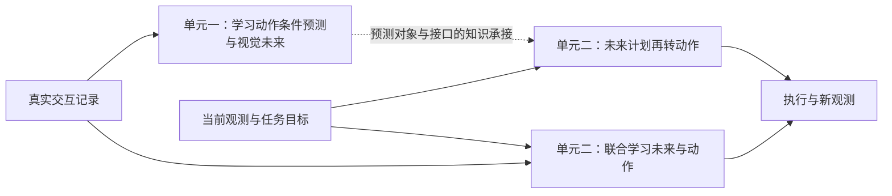

# 高级篇：从预测世界走向世界—动作模型

核心问题：

> 机器人怎样从交互中学到动作造成的变化，再把对未来的预测用于形成和选择可执行的动作？

进阶篇已经建立“观测与历史 → Context → 动作生成 → 部分执行 → 新观测”的闭环，却没有让模型在执行前预测动作的后果。高级篇先学习世界模型：给定当前情境和动作，估计未来会怎样变化；再学习世界—动作模型：当机器人收到任务目标时，未来与动作如何在同一系统中配合。这里把“级联式”和“联合式”作为两种组织方式，不把某一篇论文的网络结构当成唯一答案。

## 本阶段要打通的能力

```text
真实交互中的观测—动作—后果
→ 学习动作条件的状态或视觉预测
→ 将未来预测与任务目标联系起来
→ 级联地转换为动作，或联合学习未来与动作
→ 回到真实反馈检查模型的判断
```



虚线表示课程知识的承接，不表示第 16 章必须直接复用第 14 章训练出的同一个网络；第 17 章的联合模型也不以先训练好独立世界模型为前提。

## 单元一：从交互经验到未来预测

第 14 章先用可读的物体和机器人状态回答“动作与后果如何配成训练样本”，再检查一次预测与连续预测；第 15 章把预测对象换成图像，比较在视觉表征空间预测与生成未来画面。两章研究的都是**动作已给定时，未来怎样变化**，还没有解决“只给任务目标，动作从哪里来”。

| 章节 | 要补上的缺口 |
|---|---|
| [14 动作条件世界模型](14-action-conditioned-world-model.md) | 从[预测对象](14-1-action-conditioned-prediction.md)、[交互样本](14-2-transition-dataset.md)、[状态转移训练](14-3-state-transition-learning.md)到[单步与连续展开](14-4-one-step-and-rollout.md)：怎样对齐实际执行的动作与前后观测，并判断模型是否学到变化？ |
| [15 视觉世界模型](15-visual-world-models.md) | 从[视觉预测目标](15-1-visual-prediction-targets.md)、[固定编码器](15-2-frozen-visual-encoder.md)、[联合训练编码器](15-3-joint-visual-learning.md)到[未来画面生成](15-4-generative-visual-futures.md)：预测视觉表征与生成可观看的未来画面，各自学到、交出什么？ |

单元一把世界模型的输入、训练答案和预测结果说清楚。第 16 章从这里改变提问方向：任务给出了目标，却没有给出下一步真实动作，系统必须让未来信息参与动作产生。

## 单元二：从未来预测到机器人动作

第 16 章先建立清楚的两阶段接口：根据当前观测和目标形成未来计划，再把计划转换为机器人动作，并用执行反馈修正。第 17 章以此作对照，研究是否能利用同一批交互记录共同训练未来预测与动作生成；联合训练不等于每次生成动作前都必须先输出完整视频。

| 章节 | 要补上的缺口 |
|---|---|
| [16 级联式世界动作模型](16-cascaded-world-action-model.md) | 从[级联结构](16-1-cascaded-architecture.md)、[目标条件的未来计划](16-2-goal-conditioned-future-plan.md)、[计划到控制动作](16-3-plan-to-robot-action.md)到[UniPi 与执行反馈](16-4-unipi-and-feedback.md)：未来画面或特征怎样成为中间计划，并由另一个模块转成机器人动作？ |
| [17 联合式世界动作模型](17-joint-world-action-model.md) | 从[联合建模的数据](17-1-joint-modeling-interface.md)、[UWM 共享架构](17-2-uwm-shared-architecture.md)、[双支路训练](17-3-joint-diffusion-training.md)到[推理接口](17-4-inference-and-evaluation.md)：同一条交互怎样同时监督动作与未来，使用时又怎样分别调用两种能力？ |

级联式强调**未来计划交给动作模块**这一使用时的接口；联合式强调**未来与动作共享训练**以及训练后的不同调用方式。两者都需要真实交互验证，不能仅凭生成画面清晰或训练误差降低，断定机器人会完成任务。

## 学完高级篇应该能解释

- [x] 一条“当前观测—实际执行动作—下一次观测”记录怎样变成世界模型训练样本；
- [x] 单步预测与连续展开各检验什么，为什么预测越远越需要重新核对真实反馈；
- [x] 预测视觉表征和生成未来画面的训练目标、输出形式与局限有何不同；
- [x] 级联式模型怎样从任务目标形成未来计划，再把计划转换成具体机器人的动作；
- [x] 联合式模型怎样从同一条交互学习未来与动作，为什么联合训练不必等同于串行生成；
- [x] 面对一条新任务，怎样区分“预测动作后果”和“根据目标生成动作”这两个方向。

## 配套实践索引

本篇每章配有一份主线教学 Notebook。建议先读对应小章，再从章节中的实践卡片打开 Colab；课程页面和 Notebook 会保留在不同标签页。教学实验使用简化数据和小模型，用来核对输入、答案与输出，不代表复现 UniPi、UWM 或大型视觉世界模型。

| 章节 | 配套实践 | 主要观察内容 |
|---|---|---|
| [14 动作条件世界模型](14-action-conditioned-world-model.md) | 从交互记录到动作条件预测 | 对照[14-2](14-2-transition-dataset.md)与[14-3](14-3-state-transition-learning.md)核对动作与前后状态，再用[14-4](14-4-one-step-and-rollout.md)观察连续预测 |
| [15 视觉世界模型](15-visual-world-models.md) | 表征预测与两种可能的视觉未来 | 对照[15-2](15-2-frozen-visual-encoder.md)、[15-3](15-3-joint-visual-learning.md)和[15-4](15-4-generative-visual-futures.md)区分像素误差、表征保留的信息及多种未来 |
| [16 级联式世界动作模型](16-cascaded-world-action-model.md) | 从未来画面到机器人动作 | 对照[16-2](16-2-goal-conditioned-future-plan.md)、[16-3](16-3-plan-to-robot-action.md)和[16-4](16-4-unipi-and-feedback.md)，追踪目标、计划、动作和实际反馈 |
| [17 联合式世界动作模型](17-joint-world-action-model.md) | 联合训练与三种推理接口 | 对照[17-1](17-1-joint-modeling-interface.md)、[17-3](17-3-joint-diffusion-training.md)与[17-4](17-4-inference-and-evaluation.md)，区分两份训练答案和推理时已知、待生成的变量 |

## 本阶段结束后留下的问题

读完高级篇，应能解释世界模型怎样学习未来，以及级联式、联合式世界动作模型怎样把未来与行动连起来。要把这些理解带入真实开源项目，仍需回答：

- 项目数据中的观测、动作、目标和执行反馈，与教程中的接口是否同义、同频并正确对齐？
- 论文描述的训练目标，在具体代码中由哪些模块和数据字段实现？
- 离线预测或生成结果改善以后，完整任务中的执行表现是否也改善？

这些问题进入[实践项目](../projects/index.md)继续验证；项目复现应以对应仓库的版本、数据和运行说明为准。
