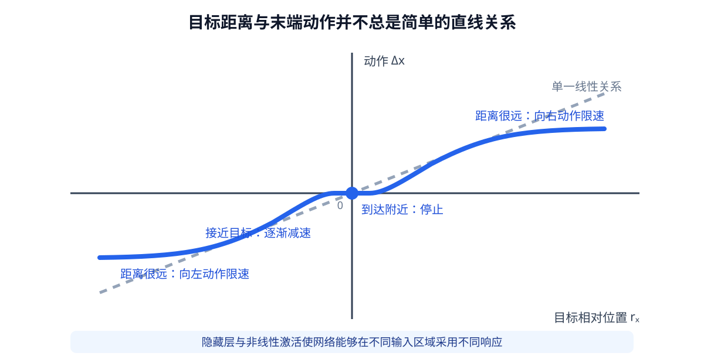
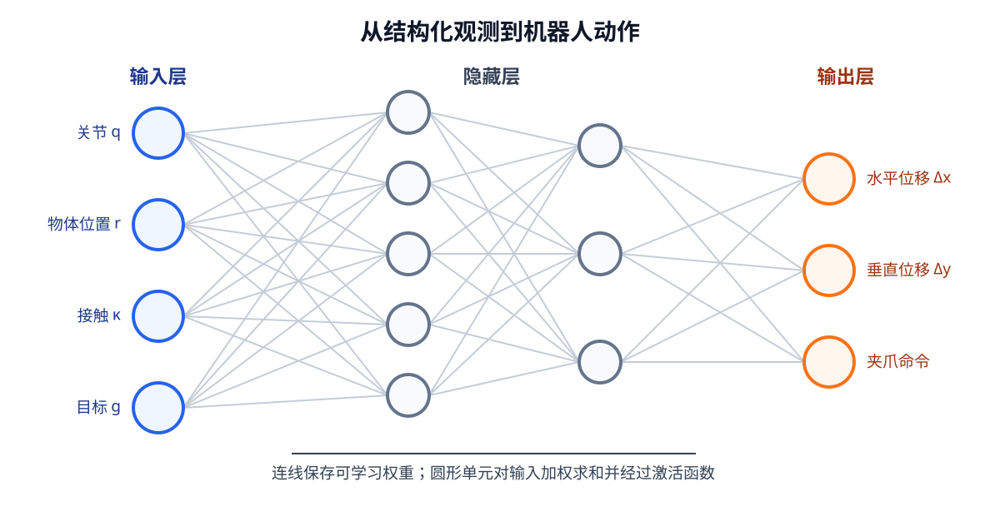
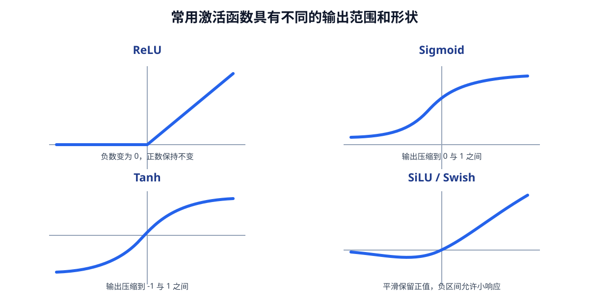
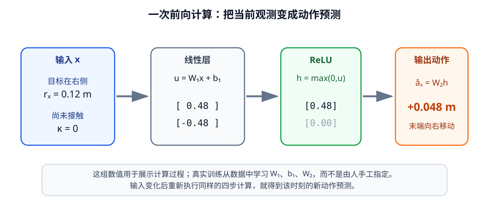

# 02-2 神经网络的前向预测与非线性

02-1 已把学习任务固定为“结构化观测 $x_t$ → 示范动作 $a_t$”。现在先不讨论参数怎样变好，只看**给定一组参数时，网络如何算出一份动作预测**。这称为前向计算。它在训练前、训练中和训练后都按相同结构运行；训练改变的是层内参数的数值，而不是每条样本都重新编写一套计算规则。

## 从线性关系到需要分段的动作关系

最简单的可学习层是 $\hat a=Wx+b$。若输入有 $D_{\mathrm{in}}$ 个数，动作有 $D_{\mathrm{out}}$ 个数，权重矩阵 $W$ 的形状是 $[D_{\mathrm{out}},D_{\mathrm{in}}]$，偏置 $b$ 的形状是 $[D_{\mathrm{out}}]$。参数 $\theta$ 包括这些权重和偏置。权重控制输入分量如何影响输出分量；一个权重通常不能单独解释为“识别杯子”，因为完整行为由许多参数共同产生。

在空旷桌面上，目标相对末端的水平距离 $r_x$ 与水平动作 $a_x$ 可能近似成比例。但一条无限延伸的直线不能同时满足远处限速、靠近时减速、到达后停止。下面的教学动作关系说明同一个输入量为什么需要不同工作区域：

| 目标相对位置 $r_x$ | 希望的动作 $a_x$ | 控制含义 |
| ---: | ---: | --- |
| $-0.30$ m | $-0.05$ m | 远处向左，但不能超过单步范围 |
| $-0.03$ m | $-0.015$ m | 近处向左，小幅接近 |
| $0$ | $0$ | 已到达，保持停止 |
| $0.03$ m | $0.015$ m | 近处向右，小幅接近 |
| $0.30$ m | $0.05$ m | 远处向右，但不能超过单步范围 |

<figure markdown="span">
{ width="1000" loading=lazy }
<figcaption>图 02-1　目标距离与动作不总是一条直线：远距离要限幅，近距离要减速，到达后要停止。图为教学控制关系，不是从真实机械臂测得的策略。（本教程绘制）</figcaption>
</figure>

把多个**没有激活函数**的线性层串起来也解决不了这一点，因为 $W_2(W_1x+b_1)+b_2$ 仍可整理成一个新的线性变换。要让网络对不同输入区域作不同响应，层与层之间需要非线性变化。

## 隐藏层与激活函数各做什么

最小的两层网络可写为 $h=\sigma(W_1x+b_1)$，$\hat a=W_2h+b_2$。输入 $x$ 对应第 01 章数据契约中的字段；隐藏层 $h$ 将输入重新组合；输出 $\hat a$ 的每个位置对应一项动作含义。若动作接口是七维，输出层必须明确哪一维是哪个方向或夹爪命令，不能只说“网络输出七个数”。

<figure markdown="span">
{ width="1000" loading=lazy }
<figcaption>图 02-2　输入节点对应结构化观测的数值，隐藏节点对加权输入作非线性变换，输出节点对应动作契约中的字段。连线上的权重与各层偏置是可训练参数。（本教程绘制）</figcaption>
</figure>

常用激活函数 ReLU（Rectified Linear Unit，修正线性单元）定义为

$$
\operatorname{ReLU}(u)=\max(0,u)
=\begin{cases}u,&u>0,\\0,&u\leq0.\end{cases}
$$

它保留正值，将零和负值变为零。例如 $[-1,-0.2,0,0.3,1]$ 经过 ReLU 后变成 $[0,0,0,0.3,1]$。一个隐藏单元先按权重组合输入，再经 ReLU 决定该组合是否在当前样本上产生正响应。许多这样的单元组合，才可能形成图 02-1 中不同区域的动作规律。ReLU 在正区间的梯度是 1、负区间为 0；若某单元对训练数据长期落在负区间，它可能很难再从误差中得到有效调整，这也是其局限之一。

并非所有位置都必须使用 ReLU。下表只比较进入某个单元的数值 $u$ 怎样变换；隐藏层如何变换，与最终动作应处于什么范围是两个问题。

| 激活函数 | 输出形式 | 适合先记住的特点 |
| --- | --- | --- |
| ReLU | $\max(0,u)$ | 正区间保留、负区间置零；常用于隐藏层 |
| Sigmoid | $1/(1+e^{-u})$ | 压到 $0$～$1$；可表示二分类概率或门控值 |
| Tanh | $\tanh(u)$ | 压到 $-1$～$1$；适合有正负方向的有界响应 |
| GELU | $u\Phi(u)$ | 平滑地调节保留比例；常见于 Transformer |
| SiLU | $u\operatorname{Sigmoid}(u)$ | 平滑且允许小的负响应 |

$\Phi$ 是标准正态分布的累积分布函数，本章无需计算它。先从曲线辨认各函数在负值、零附近和大正值处怎样响应即可。

<figure markdown="span">
{ width="1000" loading=lazy }
<figcaption>图 02-3　不同激活函数对同一个输入数值的保留、压缩或抑制方式不同；曲线形状会影响隐藏单元的响应。（本教程绘制）</figcaption>
</figure>

连续动作回归的输出层可以保持线性，也可在**训练与使用保持同一表示**的前提下用 Tanh 输出归一化的 $[-1,1]$ 动作。若直接在输出层使用 ReLU，负方向的动作会被截成零。分类任务又有不同约定，例如二分类可把 Sigmoid 输出解释为概率。输出层不是越复杂越好，而要与动作数据契约和损失函数相匹配。

## 手算一次动作预测

为了把图 02-2 落到具体数字，只取完整输入中的两个分量：目标相对末端的水平距离 $r_x$，以及是否已经接触的信号 $\kappa$。约定向右为正，当前 $x=[0.12,0]^{\mathsf T}$，表示目标在右侧 $0.12$ 米、尚未接触。取一组**仅用于演示计算**的参数：

$$
W_1=\begin{bmatrix}4&-1\\-4&-1\end{bmatrix},\quad
b_1=\begin{bmatrix}0\\0\end{bmatrix},\quad
W_2=\begin{bmatrix}0.1&-0.1\end{bmatrix},\quad b_2=0.
$$

第一层先得 $u=W_1x+b_1=[0.48,-0.48]^{\mathsf T}$；ReLU 使第二个值变成零，故 $h=[0.48,0]^{\mathsf T}$；输出层得到 $\hat a_x=W_2h+b_2=0.048$ m。正号表示向右，数值略小于教学例子的单步上限 $0.05$ m。若把 $r_x$ 改为 $-0.12$ m，两隐藏单元的角色互换，输出变为 $-0.048$ m；若 $\kappa$ 变为 1，这组参数会压低两个单元的响应。

<figure markdown="span">
{ width="1060" loading=lazy }
<figcaption>图 02-4　当前距离和接触信号经线性层、ReLU 与输出层，变成有方向和单位的末端位移。数值对应正文中的手算过程。（本教程绘制）</figcaption>
</figure>

这些参数是手工挑选来帮助读图的，尚未通过数据学习。前向计算本身不改参数；刚初始化的网络也能运行，却不一定给出合理动作。真实训练将使 $W$ 与 $b$ 根据许多示范样本不断变化。输入数值也要按训练集统计量统一尺度，并在验证与实际使用时复用相同变换；否则米、弧度和较大的力读数可能以不合理的比例影响网络。

实践 02-01 会分别展示图 02-1 的线性与分段关系、图 02-3 的激活曲线和图 02-4 的逐层计算。运行后先核对每张图的输入、坐标和输出单位，再进入 02-3 的参数学习。

[返回 02 导读](02-how-neural-networks-learn.md) · [继续阅读 02-3 损失与参数更新](02-3-loss-gradient-and-update.md)
