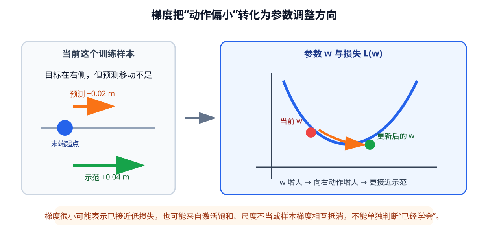

# 02-3 预测误差怎样更新网络参数

02-2 的手算展示了**当前参数**怎样把观测变成动作。为了让预测逐渐接近示范，训练程序还需知道预测错了多少、哪些参数改变会使错误变小。本节沿同一个机械臂水平到达任务，依次说明损失、梯度、反向传播和优化器；它们不是四种互不相干的方法，而是一次参数更新的连续步骤。

## 损失把“预测错了”写成可计算目标

对一条二维末端位移示范，设真实动作 $a=[0.04,0.00]^{\mathsf T}$ m，模型预测 $\hat a=[0.02,0.01]^{\mathsf T}$ m。第一维少向右移动 $0.02$ m，第二维却多移动 $0.01$ m。若对两个分量计算均方误差，这条样本的损失是

$$
\frac{(0.02-0.04)^2+(0.01-0.00)^2}{2}
=0.00025\ \mathrm{m}^2.
$$

分母 2 是这条动作的**两个分量**，不是机器人做了两次动作；若只计算平方误差之和，数值则为 $0.0005\ \mathrm{m}^2$。两种约定只差固定系数，却会改变损失数值与等效更新尺度，报告结果时不能含糊地只写“MSE”。对一个含 $B$ 条样本、每条有 $A$ 个同尺度连续动作分量的批次，可明确写成

$$
\mathcal L(\theta)=\frac{1}{BA}
\sum_{i=1}^{B}\sum_{j=1}^{A}
\bigl(f_\theta(x^{(i)})_j-a^{(i)}_j\bigr)^2.
$$

真实动作向量可能混有米、弧度和夹爪命令。若未经处理就平均，数值范围大的字段容易主导损失；通常先按训练集统计量统一尺度，或为不同字段设计明确权重。若输出是“抓取成功/失败”这样的类别，学习目标也不同，常用交叉熵比较预测概率和真实类别。**损失函数不只是训练完后的评分器**：参数会沿着减小它的方向变化，所以它规定模型优先修正哪些错误。只比较逐步动作数值的损失，并没有直接要求机器人避障或完成抓取。

## 梯度在一个机械臂例子里表示什么

暂时将输入和动作都归一化，只保留一个参数 $w$。目标在右侧时取输入特征 $x=1$，示范动作 $a=0.4$，模型输出 $\hat a=wx$。若当前 $w=0.2$，预测只有 $0.2$，虽方向正确却移动不足。用单分量平方损失计算，$\mathcal L=(wx-a)^2=0.04$，其对 $w$ 的梯度为

$$
\frac{\partial\mathcal L}{\partial w}=2(wx-a)x=-0.4.
$$

负号的实际含义是：在当前样本与当前参数附近，**稍微增大 $w$ 可以减少“向右移动不足”的错误**。若学习率 $\eta=0.1$，按 $w\leftarrow w-\eta\,\partial\mathcal L/\partial w$ 更新，得到 $w=0.24$。同一输入再次前向计算，预测便从 $0.20$ 到 $0.24$，比原来更接近示范 $0.40$。这里不是让网络直接把 $w$ 设为答案；多条样本会对同一参数提出不同约束，训练须在它们之间反复调整。

<figure markdown="span">
{ width="1030" loading=lazy }
<figcaption>图 02-5　当前预测向右移动不足，局部梯度为负，按负梯度更新会增大参数，使下一次预测向示范靠近。图只展示单参数的一步变化。（本教程绘制）</figcaption>
</figure>

梯度绝对值较大，表示在当前数据和参数附近，这个参数的一点变化会明显改变损失；**梯度小不等于机器人已学会**。预测接近示范时梯度可以小；某参数在这条输入上根本不起作用时也可以小；ReLU 通路关闭时误差信号可能到不了更早的权重；一个 batch 中左右目标要求相反更新时，平均梯度也可能互相抵消。必须连同预测误差、未见数据表现和任务结果判断，不能只看梯度大小。

学习率控制沿梯度方向一次走多远。过大可能越过较好的参数位置，使损失反复震荡；过小则可能进展很慢。负梯度给的是**当前附近**减小损失的方向，不承诺一步走到所有场景都最好的模型。

## 反向传播与优化器怎样完成一次更新

多层网络的误差在输出端，参数却分布在所有层。前向计算按 $x\rightarrow h\rightarrow\hat a\rightarrow\mathcal L$ 得到损失；反向传播利用复合函数的求导关系，从损失往回计算每个参数对它的影响。它不是把示范动作复制给每个隐藏单元，也不是让网络“倒着预测一个动作”。例如上面的向右移动不足，会先影响输出层，再传到产生“目标在右侧”响应的隐藏层权重；本次没有激活的通路可能得到零梯度。

优化器读取这些梯度并实际修改参数。最基本的随机梯度下降按负梯度方向更新；Adam 等方法还利用历史梯度调整步幅，但都不会替模型补充缺失的物体位置或任务目标。一次训练迭代的顺序是固定的：

~~~mermaid
flowchart LR
    B["取一个 batch"] --> F["前向计算动作"]
    F --> L["与示范比较损失"]
    L --> G["反向传播梯度"]
    G --> U["优化器更新参数"]
    U --> B
~~~

batch 是一次更新共同使用的样本集合。不同样本的梯度汇合，让更新反映一批数据而非一条偶然示范。把整个训练集使用一遍称为一个 epoch；通常要经历多个 epoch。可在每个 epoch 打乱样本的**排列**，却不能打散单条样本的输入与动作，也不能改变一段时间窗口内部的顺序。不同 batch 的难度不同，损失无需每一步严格下降，应关注一段训练过程的总体趋势。

实践 02-02 会亲手执行上述顺序，观察同一网络在多次更新后动作预测如何变化。运行时分别看预测、总损失与更新后结果，确认损失下降来自参数改变，而不是把示范动作直接放进了网络输入。

[返回 02 导读](02-how-neural-networks-learn.md) · [继续阅读 02-4 泛化与闭环检验](02-4-generalization-and-closed-loop.md)
