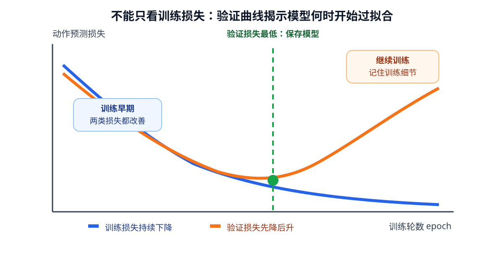

# 02-4 从训练损失到真实任务表现

02-3 说明了参数为何能够沿着损失下降的方向调整。但低训练损失只回答“模型多贴近已经用于训练的示范”，还没有回答“换一条轨迹、换一个杯子位置后是否仍能行动”，更不能直接回答“机械臂能否在连续执行中完成抓取”。本节沿训练数据、未见数据和闭环任务三个层次检查学习结果。

## 未见轨迹怎样检验泛化

**泛化**是把训练中学到的关系用于未参与参数更新的新情境。数据通常分为训练集、验证集和测试集：训练集计算梯度，验证集用于比较训练设置和选择保存哪一轮参数，测试集留到开发基本完成后作最终检查。若反复根据测试集结果调整网络，测试集便逐渐不再“未见”。

机器人样本还带有强烈的时间关联。同一个 episode 的相邻画面可能只差几毫米；若先切成时间步，再将相邻步骤随机分入训练和验证，两边实际上分享了同一段运动。验证损失看似很低，也未必说明模型能面对新的物体布局。更可靠的做法是先按完整 episode、场景或物体组合分组，再把各组分配给训练、验证和测试，最后分别切出窗口。第 01 章记录的 episode 标识在这里派上用场。

输入和动作的归一化统计量、缺失值填补规则也只从训练集计算，再原样用于验证与测试。如果先查看全部数据才决定均值或尺度，未见数据的信息已经提前进入训练过程。时间错位、补齐位置误当真值，同样可能制造“低损失”的假象。

## 欠拟合与过拟合的不同迹象

训练集和验证集损失都高，可能是训练不足、网络表达能力不足，也可能是输入缺少决定动作的关键变量。若同一个输入 $q_t$ 对应左右两个相反目标，第 02-1 讨论过：增加训练轮数无法从不存在的信息中推断答案。这种未学到任务关系的情况常称**欠拟合**，但诊断时应继续区分究竟是模型、数据还是任务定义问题。

若训练损失继续下降，验证损失却停止改善甚至上升，模型可能开始记住训练场景的偶然细节，称为**过拟合**。例如训练集中红杯子总出现在桌面右侧，模型学到“右移”而不是“根据当前杯子相对位置移动”；换到左侧布局便失败。增加场景变化、限制不必要的模型复杂度或根据验证损失及时停止训练可以帮助改善，但也不能代替正确的观测字段。

<figure markdown="span">
{ width="1000" loading=lazy }
<figcaption>图 02-6　训练损失持续下降时，验证损失仍可能转而上升。图中的最低验证点提示应保存哪一轮参数，而不是只取最后一个 epoch。（本教程绘制）</figcaption>
</figure>

图 02-6 前段两线共同下降，说明模型逐渐抓住训练集和未见轨迹的共同规律；后段训练线仍降、验证线升，说明继续贴合训练记录不再帮助新轨迹。曲线只提供诊断线索，不会告诉我们具体是背景捷径、时间泄漏还是输入缺失造成了问题，必须回到样本与预测结果检查。

## 离线动作误差与闭环任务不能互相替代

离线检查把真实观测交给模型，看预测动作与某条示范有多接近。这有助于发现数值方向、单位、夹爪字段或特定情境中的异常。可是机械臂执行一步后，下一步输入会来自**模型自己刚造成的真实局面**，不再保证与示范轨迹相同。很小的位置偏差可能被后续观察纠正，也可能让夹爪恰好错过杯沿；逐步动作误差相同的两种策略，闭环完成率可能不同。

还要注意示范可能有多种合理解。若杯子前方有障碍，从左侧绕和从右侧绕都可能成功；逐点比较模型与其中一条示范，会把另一条合理路线评成高误差。反过来，把左右两条动作简单平均，虽然数值上可能接近各自的一部分，却可能正好撞上障碍。因此应同时看未见轨迹上的动作误差、动作是否越界、闭环到达率、抓取成功率和碰撞情况，而不能只用一个训练 MSE 给机器人能力下结论。

训练与使用还存在计算行为差别。训练时要保存中间结果以计算梯度，并允许优化器更新参数；验证与实际使用时只做前向预测，通常应关闭训练专用的随机行为和统计量更新。否则同一输入在验证和控制时可能得到不一致输出。模型输出即使经过归一化，也必须按第 01 章的数据契约恢复物理单位，再交给控制器。

## 将本章的学习链连回第 01 章

完整过程从按时间记录的 episode 开始：选择执行前可用的观测和目标，配上同一时刻实际执行的示范动作；按 episode 划分数据；仅用训练集确定数值缩放；网络前向得到预测；损失比较预测与答案；反向传播和优化器更新参数；最后在未见轨迹及闭环任务中检查结果。

~~~mermaid
flowchart LR
    T["时间对齐的轨迹"] --> S["输入与动作样本"]
    S --> D["按 episode 划分"]
    D --> M["前向预测与参数更新"]
    M --> V["未见轨迹验证"]
    V --> R["闭环任务检查"]
~~~

任何一环出错，训练仍可能在形式上顺利下降。02-02 的实践同时展示训练曲线、未见位置的动作预测和简化闭环到达过程；读图时应分清哪一幅只说明参数正在贴合训练样本，哪一幅才检查模型能否在新的起点继续行动。

本章暂时借用数据集中现成的物体和目标位置，尚未说明相机图像如何提供这些信息。下一章从图像的数据结构和视觉编码器入手；随后还会讨论视觉表征怎样学习，以及语言目标怎样进入模型。

[返回 02 导读](02-how-neural-networks-learn.md) · [继续阅读第 03 章](03-vision-encoding.md)
