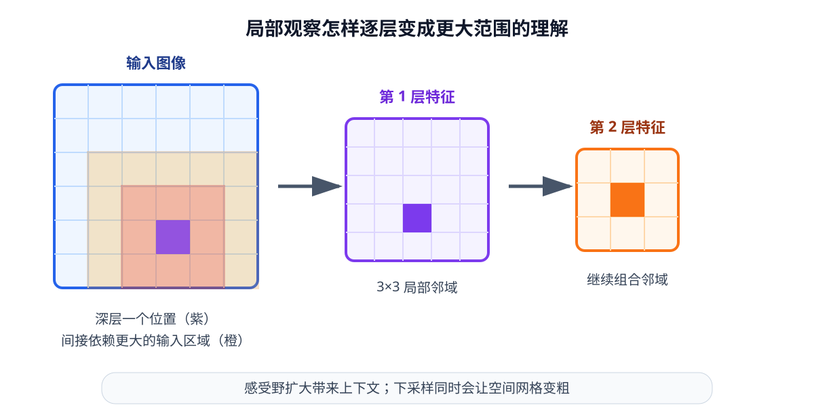

# 03-2 卷积与多层视觉特征

03-1 确定了图像张量和坐标的含义。现在假设目标杯子占据画面中的一小片区域：网络要先辨认这片区域与周围像素的颜色、边界和形状差别，才能进一步判断位置。卷积神经网络（Convolutional Neural Network，CNN）通过反复读取局部窗口来形成这样的特征。

## 一个卷积核怎样产生一个数

先看单通道图像。取某个 $3\times3$ 像素窗口，按相同位置与一组 $3\times3$ 权重逐项相乘，再把九个乘积相加，得到输出特征图中的**一个位置**。例如某窗口只有正中央像素为 $1$，其余为 $0$；若卷积核正中央权重为 $2$，其余为 $0$，该位置的输出就是 $2$。把同一组权重移到图像其他位置重复计算，便得到整张特征图。这组可学习权重称为卷积核；它会在训练中依照损失调整，并非每个像素位置各自训练一套。

RGB 图像有三个输入通道，一个输出通道的卷积核便包含三组空间权重，还可加偏置。若同时学习 16 个输出通道，就能得到 16 张特征图。一个简写是

$$
Y_{c_o,h,w}=b_{c_o}+\sum_{c_i,u,v}K_{c_o,c_i,u,v}\,X_{c_i,hS+u-P,wS+v-P}.
$$

$c_i$、$c_o$ 分别是输入与输出通道；$u,v$ 在卷积核的小窗口内移动；$S$ 是窗口每次跨过的格数，称为**步幅**；$P$ 表示边缘补出的格数，称为**填充**。超出原图的格子按所选填充规则处理，常见零填充只是其中一种。读公式时抓住“局部取值、加权求和、在各处复用权重”即可；具体运算可在实践 03-01 中逐格查看。

~~~mermaid
flowchart LR
    I["RGB 图像 B×3×H×W"] --> C1["浅层卷积 颜色与边界"]
    C1 --> C2["中层卷积 局部纹理与轮廓"]
    C2 --> C3["深层特征 更大范围的组合"]
    C3 --> F["空间特征图 B×D×H'×W'"]
~~~

图中“浅层像边缘、深层像物体”是理解层级组合的直观说法，并不保证某一个通道只表示某一个人能命名的概念。能否辨认杯子，最终还取决于训练数据与目标。

## 步幅、填充与输出尺寸

以单个空间维度为例，输入大小 $H_{\mathrm{in}}$、卷积核大小 $K$、步幅 $S$、填充 $P$、膨胀率 $D_k$ 时，输出大小为

$$
H_{\mathrm{out}}=\left\lfloor\frac{H_{\mathrm{in}}+2P-D_k(K-1)-1}{S}+1\right\rfloor.
$$

本章取常见的 $D_k=1$。一张 $32\times32$ 图像经 $3\times3$ 卷积，取 $P=1,S=1$ 时仍是 $32\times32$；把步幅改成 $2$，输出成为 $16\times16$。若不填充且步幅为 $1$，输出是 $30\times30$，因为靠边位置放不下完整窗口。宽度方向同样计算。**通道数由使用多少个输出卷积核决定，空间大小则由输入、核、步幅和填充共同决定**，两者不应混淆。

下采样减少了后续计算量，也让一个深层特征对应原图中更大的区域；但 $16\times16$ 网格不再直接保留 $32\times32$ 的全部位置差别。最大池化取局部最大响应，平均池化取局部平均值，带步幅卷积也可用于下采样。它们都在汇总邻域，方式不同，不能把空间尺寸变小看成没有代价的压缩。

## 网络加深后，一个特征能看到多大范围

**感受野**是一个特征值在原输入中可能受哪些位置影响的范围。步幅为 $1$ 的第一层 $3\times3$ 卷积只直接看 $3\times3$；第二层再做一次 $3\times3$ 卷积，它的一个位置可间接依赖原图 $5\times5$ 的区域。第三层继续扩大。这个范围描述的是“可能传来信息”，不意味着范围内每个像素都同样重要。

<figure markdown="span">
  { width="1000" loading=lazy }
  <figcaption>图 03-1　浅层只组合相邻像素；后续层再组合浅层结果，因此一个深层位置可利用更大范围的图像信息。方格之间的连接说明感受范围，不表示每条连接的权重相同。（本教程绘制）</figcaption>
</figure>

扩大范围对分辨物体有帮助：一个红色小块可能是杯身，也可能是桌上的标记；查看其邻近轮廓后，判断更有依据。但定位还需要保留它**出现在哪里**。如果连续下采样使杯子只落在最后特征图的一个格子内，精确边界就不容易从该格子直接恢复。因此多层 CNN 常保留不同尺度的特征：浅层网格较细，深层汇集更多上下文。

| 层级示例 | 输出形状 | 对定位的意义 |
| --- | --- | --- |
| 浅层 | $[B,64,H/2,W/2]$ | 网格细，较容易区分相邻边缘 |
| 中层 | $[B,128,H/4,W/4]$ | 将局部颜色与轮廓组合起来 |
| 深层 | $[B,256,H/8,W/8]$ | 能结合更大范围，但位置网格更粗 |

这只是形状示例，不是所有 CNN 的固定配置。特征金字塔的基本思路就是让下游有机会同时使用不同尺度，避免只靠最后一张粗网格完成识别和定位。

## 非线性与残差连接在这里做什么

第 02 章已说明，只有线性变换的多层网络仍可合并为一个线性变换。CNN 也会在卷积之间加入 ReLU 等非线性，使不同局部组合产生不同响应。一个简化卷积块写为 $X^{(l+1)}=\sigma(\operatorname{Conv}(X^{(l)};K^{(l)})+b^{(l)})$。卷积负责混合邻域信息，激活函数负责非线性响应；参数仍由第 02 章介绍的损失与反向传播学习。

很深的网络还常用残差连接 $Y=X+F(X)$：一条路径传递原输入，另一条路径学习在原输入上还需修正什么。相加要求形状相容；通道数或分辨率变化时，旁路也须转换。残差连接帮助深层网络训练，但并不自动保证保留抓取任务需要的精确位置。

实践 03-01 不直接训练 CNN，而是手工滑动卷积核，先观察“局部窗口 → 特征图位置”的对应关系，再比较步幅和填充造成的尺寸变化。运行图像后，请指出输入图中的一处边缘，对应输出的哪一片响应，以及改变步幅后哪些细小位置差别不再出现。

下面的轻量示意可先用来观察卷积核如何在网格上移动。高亮窗口每移动一次，就对应输出特征图中的一个新位置；若无法加载动态示意，静态说明和实践 03-01 仍可独立阅读。

  
静态说明：高亮一个输入局部窗口，逐项乘以卷积核并求和，得到输出特征图中的一个位置；窗口随后按步幅移动。

卷积块已经产生空间特征图。下一节要决定：下游模块应该得到整张图的一个概括，还是继续得到带位置的多个特征？

[返回 03 导读](03-vision-encoding.md) · [继续阅读 03-3 视觉编码器的输出表示](03-3-visual-encoder-outputs.md)
