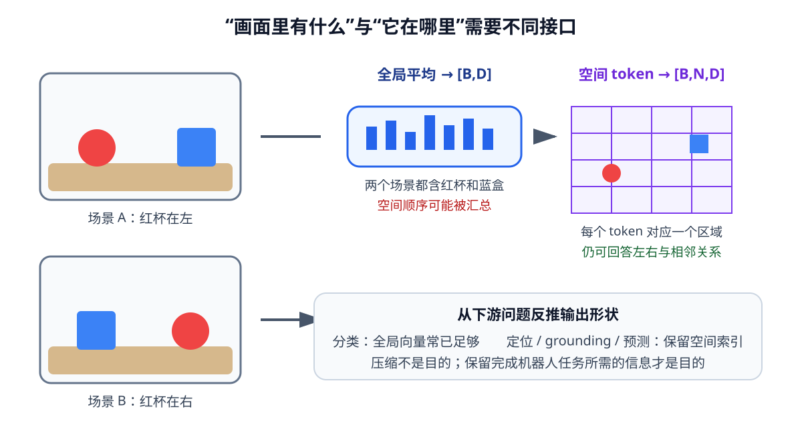

# 03-3 视觉编码器的输出表示

03-2 的 CNN 输出仍是一张较小的网格：每个位置有一组特征数值，网格位置与输入图像区域保持对应。下游任务并不一定都要读取整张网格。只判断“画面里有没有杯子”时，可以汇总整幅图；要抓住右侧的杯子时，若位置在汇总中被抹掉，后续动作模块便缺少依据。本节比较三种常见输出接口。

## 全局向量：给整张图一个概括

设 CNN 特征图为 $F\in\mathbb R^{B\times D\times H'\times W'}$。一种全局汇总方法是对每个通道的所有空间位置取平均：

$$
z^{\mathrm{global}}_{b,d}=\frac{1}{H'W'}\sum_{h=1}^{H'}\sum_{w=1}^{W'}F_{b,d,h,w}.
$$

结果为 $[B,D]$。若要判断“桌面上是否有杯子”，一个向量常可作为分类头的输入；每个通道整体响应有多强，是分类可利用的信息。但平均之后，原来的行、列索引不再直接传给下游。对于两幅都含红杯和蓝杯、只是左右位置互换的图，简单空间平均有可能得到相近结果。实际网络也可能通过边界、位置编码或特殊通道保留一部分位置信息，所以不能断言所有全局向量必然无法定位；应检查采用的编码器和训练目标是否真的保存了所需位置。

## 空间特征图：让位置继续可读取

不做全局汇总，直接交出 $F$，下游便可按网格位置访问特征。例如形状为 $[B,32,16,16]$ 时，每张图有 $16\times16$ 个位置，每个位置是一组 32 维数值。一个定位读出头可以利用这些数值判断哪些位置属于红杯，并把网格上的判断转换为原图坐标。

网格位置只是**近似对应**输入区域。一个特征可能受到周围更大感受野影响；步幅、填充、缩放和裁剪也影响其与原图像素的映射。若要在原图上画出杯子中心，必须使用完整预处理约定，不能只把网格索引乘以一个固定比例，就默认得到了精确相机坐标。

<figure markdown="span">
  { width="1040" loading=lazy }
  <figcaption>图 03-2　同一幅画面可汇总成全局向量，也可保留为带位置的多组特征。要回答“红杯在哪里”，下游必须能从接口中取回位置线索；图中的位置对应只是示意，具体精度取决于编码器和预处理。（本教程绘制）</figcaption>
</figure>

## 视觉 token：把多个图像区域交给后续网络

将 $H'\times W'$ 个网格位置依次展开，令 $N=H'W'$，可把空间特征图整理成 $[B,N,D]$：每个位置的一组 $D$ 维数值就是一个视觉 token。**token 在这里是区域特征向量，不是一个汉字，也不是人工写好的“杯子”标签**。它可以是 CNN 特征图的一个位置，也可以直接由原图的一个小图像块生成。

后一种方式先把图像切成 $P\times P$ 的 patch。若 $H,W$ 都能被 $P$ 整除，块数为 $N=(H/P)(W/P)$。例如 $64\times64$ 图像取 $P=8$，得到 $8\times8=64$ 个块。每块的 RGB 数值共有 $3P^2$ 个，再经一层可学习线性映射变为 $D$ 维 token。这里的线性映射与第 02 章的线性层一样，参数由训练更新，不是手工把“第 5 块是杯子”写进网络。若图像尺寸不能整除 $P$，实现中还要约定裁剪、填充或其他处理方式。

把区域按顺序排成一列后，模型还需知道每个 token 原先位于哪一行、哪一列，因此通常会加入位置编码。第 09 章会解释 Attention 怎样在这些 token 之间交换信息；此处只要明确：**视觉 token 保留可供继续读取的区域特征和位置来源，全局向量则先把区域汇总了。**

| 下游问题 | 优先考虑的输出 | 需要保留什么 |
| --- | --- | --- |
| 画面中是否存在杯子 | 全局向量 $[B,D]$ | 整图类别线索 |
| 杯子中心位于哪里 | 空间特征图或视觉 token | 对象与位置的对应 |
| 杯子边界覆盖哪些像素 | 较细的空间特征图，必要时结合浅层特征 | 密集的边界信息 |
| 按语言指令读取目标区域 | 带位置的视觉 token | 不同区域可被分别读取 |

这张表不是“某任务只能用某一种结构”的硬规则。关键是从任务反推接口：若任务要区分左杯与右杯，下游至少须能从编码结果中恢复这种差别。03-4 会用一个可计算的定位任务检查，而不是仅凭输出形状推断表示已经有用。

[返回 03 导读](03-vision-encoding.md) · [继续阅读 03-4 用目标定位检验视觉编码](03-4-object-localization-and-checks.md)
