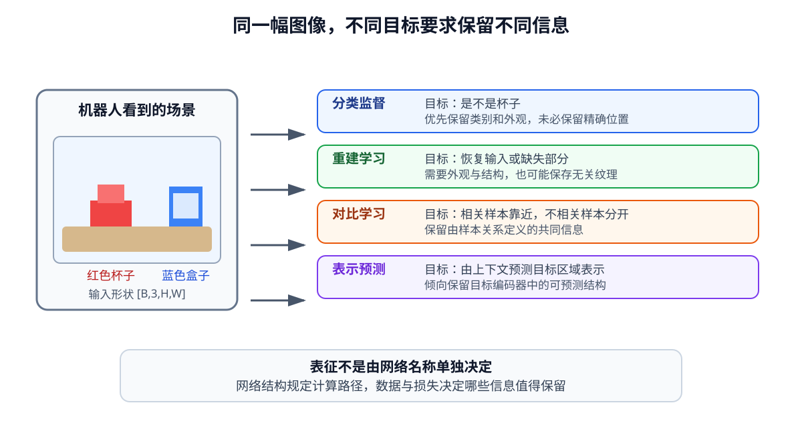

# 04-1 视觉表征与训练目标

第 03 章的定位实验里，CNN 的空间特征最终能用于预测杯子中心，是因为训练时不断把预测位置与真实位置比较，再用误差调整编码器参数。同一套 CNN 若改成判断桌布颜色，也会通过训练得到特征，但其中未必还容易读出杯子坐标。本节先说明这种差异从何而来，再为后面比较重建、对比和预测式学习建立共同尺度。

## 特征的形状不能说明特征的内容

设编码器将图像 $I$ 转成表示 $z=E_\theta(I)$。若 $z\in\mathbb R^D$，$D$ 只说明有多少个数；它不告诉我们这组数是在记录杯子的形状、桌面纹理还是目标位置。即使两种编码器都输出 128 维向量，也不等于第 1 维到第 128 维有相同含义。训练过程中真正决定参数改变方向的，是输入数据、模型结构和损失函数共同提出的要求。

以“把红杯放入盒子”为例，判断画面是否有杯子只需保留辨认杯子的线索；预测杯子中心必须保留位置；重建整张画面还要处理桌布、光照和阴影。三种任务都能让训练损失下降，却不能互相代替。

<figure markdown="span">
  { width="1120" loading=lazy }
  <figcaption>图 04-1　同一图像经过不同训练目标，编码器被要求保留的信息也不同。图中是训练要求的对照，并非保证某种方法一定会丢弃或完整保存某项信息。（本教程绘制）</figcaption>
</figure>

| 训练时要求完成的事 | 至少应保留的线索 | 仍可能缺少的线索 |
| --- | --- | --- |
| 判断是否出现杯子 | 杯子外观 | 精确位置和朝向 |
| 预测杯子中心 | 目标身份与二维位置 | 杯子离相机多远 |
| 恢复整张图像 | 可还原的颜色、纹理和结构 | 哪些变化与抓取最相关 |
| 使相关画面接近 | 正样本共享的内容 | 被增强视为无关的变化 |
| 根据可见区域预测隐藏表示 | 可从上下文预测的结构 | 目标编码器未保留的细节 |

表中的“仍可能缺少”不是必然缺少。它提醒我们：某个损失没有明确要求的信息，不能仅凭训练成功就断定已经可靠保存。

## 监督训练如何把位置写进表征

在第 03 章的杯子定位中，编码器 $E_\theta$ 产生特征，位置读出头 $H_\phi$ 给出坐标 $\hat p=H_\phi(E_\theta(I))$。真实中心 $p$ 与预测 $\hat p$ 之间的误差经过读出头回传到编码器，所以网络逐渐把有助于定位的图像差别写入特征。分类、分割或姿态标注也能提供明确监督，但各自规定的是不同的答案。

训练目标明确，不代表网络一定使用了我们期望的证据。假设所有训练图像中，红杯只出现在深色桌布、蓝杯只出现在浅色桌布。若任务是判断杯子颜色，桌布便成了一条简单的“捷径”：利用背景也能降低分类损失。换桌布后，预测会出错。若任务是定位杯子，而训练集中杯子总在画面左侧，网络同样可能记住固定位置。应分别改变背景和杯子位置，查看预测是否跟随真正的目标，而不是只看训练准确率。

对机器人来说，还要问：后续动作需要的是颜色、二维位置、三维距离，还是接触状态？只给“是否有杯子”的标签，不会自动教网络保留全部答案。这也是为什么不能脱离任务宣布一种表征“最好”。下面几节将讨论没有逐张位置标签时，怎样从图像自身或图像之间构造训练要求。

[返回 04 导读](04-visual-representation-learning.md) · [继续阅读 04-2 重建式表征学习](04-2-reconstruction-ae-vae-mae.md)
