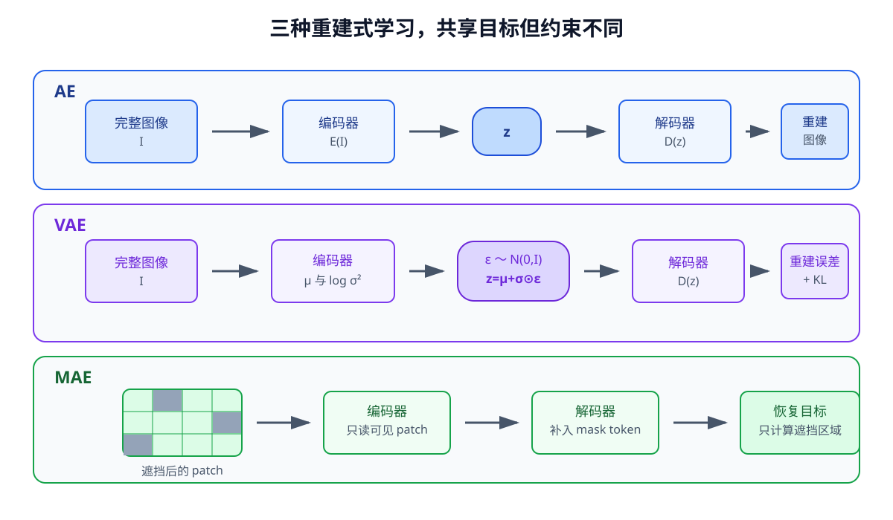

# 04-2 重建式表征学习：AE、VAE 与 MAE

04-1 的位置监督需要事先知道每张图里杯子在哪里。机器人会积累更多没有这类标签的图像。重建式学习从图像自身构造答案：让编码器提取中间表示，再要求另一个模块用它恢复原图或缺失区域。三种常见安排是 AE、VAE 和 MAE；它们共享“从图像得到训练信号”这一点，但对中间表示的要求并不相同。

## AE：把完整图像压缩后再恢复

自编码器（Autoencoder，AE）包含编码器 $E_\theta$ 和解码器 $D_\phi$：

$$
z=E_\theta(I),\qquad \hat I=D_\phi(z).
$$

假设输入是 $64\times64$ RGB 图像，编码器将其压成较短向量 $z$，解码器再生成一张同样大小的图像 $\hat I$。训练比较每个像素的预测值与原值，例如用均方误差 $\mathcal L_{\mathrm{AE}}=(BCHW)^{-1}\sum_{b,c,h,w}(\hat I_{b,c,h,w}-I_{b,c,h,w})^2$。损失同时更新编码器与解码器；使用时若只需要视觉特征，通常取编码器的输出，不必每次再把图像解码回来。

压缩形成一个信息瓶颈，但瓶颈不会自行辨别“杯子位置重要、桌布纹理不重要”。若桌布占大多数像素，准确恢复背景也能显著降低像素误差。反过来，重建图略模糊也不等于杯子位置一定丢失：可能是解码器未能把已保存的信息画清楚。应把重建效果与后续位置读取分开检查。

## VAE：编码器先给出潜变量的分布

普通 AE 对一张图通常给出一个确定向量。变分自编码器（Variational Autoencoder，VAE）改为先输出两组数：潜变量的均值 $\mu(I)$ 与方差（实现中常保存对数方差）。以对角高斯为例，写成

$$
q_\theta(z\mid I)=\mathcal N\bigl(\mu_\theta(I),\operatorname{diag}(\sigma_\theta^2(I))\bigr).
$$

可以把它理解为：同一幅图像不再只对应一个潜在点，而是对应一片由均值和尺度描述的区域。训练从这个分布取一个 $z$，再交给解码器。为了让随机抽样不阻断参数更新，用**重参数化**把步骤改写为

$$
\epsilon\sim\mathcal N(0,\mathbf I),\qquad z=\mu_\theta(I)+\sigma_\theta(I)\odot\epsilon.
$$

$\epsilon$ 是独立抽取的标准高斯噪声，$\mathbf I$ 表示单位协方差矩阵；它不是当前图像的观测，也不是模型要预测的结果。给定一次 $\epsilon$ 后，$z$ 仍按普通可微运算依赖 $\mu$ 和 $\sigma$，重建误差便能回传给编码器。例如某一维均值为 $0.5$、标准差为 $0.2$，本次噪声值为 $-1$，该维取样就是 $0.3$；下一次噪声不同，潜变量也可能不同。[VAE 原论文](https://arxiv.org/abs/1312.6114)用这一做法使随机潜变量能够参与梯度训练。

VAE 的训练不止要重建，还要限制每张图给出的潜变量分布不能任意散开。一种常见教学写法是

$$
\mathcal L_{\mathrm{VAE}}=\mathcal L_{\mathrm{recon}}+\beta D_{\mathrm{KL}}\bigl(q_\theta(z\mid I)\,\|\,p(z)\bigr),
$$

其中先验 $p(z)$ 通常取标准高斯，$D_{\mathrm{KL}}$ 衡量编码器给出的分布与先验有多不同，$\beta$ 控制这一约束相对于重建项的强度。先验的用途是让使用阶段能够从一个已知分布抽取 $z$；若训练分布完全无约束，随意从标准高斯取样可能落到解码器未见过的区域。这个带权损失是教学中常见的变体，$\beta$ 不必固定为 1；具体重建项也取决于图像的概率假设。

$\beta$ 过大时，编码器可能让不同图像的 $q_\theta(z\mid I)$ 都过于接近先验，解码器逐渐不依赖 $z$，不同杯子位置被恢复得相似，这称为**后验坍缩**。这与“输出分布表达了真实物理不确定性”是两回事。检查时应同时看重建、KL 项和潜变量是否随杯子位置变化，不能只看总损失。$\beta$ 太小则可能重建得较好，却失去设定先验的作用。

## MAE：只让编码器看见一部分图像

掩码自编码器（Masked Autoencoder，MAE）先把图像切成 patch，再遮挡其中一部分。编码器只处理可见块；较轻的解码器收到这些编码结果和遮挡位置的占位表示，尝试恢复被遮挡块的像素。训练损失只计算被遮挡位置，而不是要求编码器照抄它已经看见的区域。若一张图分为 16 块、隐藏其中 8 块，编码器只凭剩下 8 块形成信息，解码器再补出隐藏块。[MAE 原论文](https://arxiv.org/abs/2111.06377)采用可见 patch 进入编码器、遮挡块由解码器恢复的非对称结构。

简写的遮挡损失为 $\mathcal L_{\mathrm{MAE}}=|\mathcal M|^{-1}\sum_{i\in\mathcal M}\|\hat x_i-x_i\|_2^2$，其中 $\mathcal M$ 是被遮挡块的集合。隐藏太少，任务可能过于容易；隐藏太多，又可能只剩猜测。即使模型恢复了杯子的轮廓，它仍可能花大量能力处理背景纹理，所以也须检验编码结果中能否读取杯子位置。

<figure markdown="span">
  { width="1160" loading=lazy }
  <figcaption>图 04-2　从上到下分别看三条信息路径：AE 用确定表示恢复完整输入；VAE 从分布采样并额外约束潜变量；MAE 只编码可见块并恢复遮挡块。比较时先看编码器实际看到了什么，再看损失核对哪部分答案。（本教程绘制）</figcaption>
</figure>

| 方法 | 编码器的输入 | 中间表示 | 解码与训练要求 |
| --- | --- | --- | --- |
| AE | 完整图像 | 确定的向量或特征图 | 恢复完整图像 |
| VAE | 完整图像 | 从条件分布抽取的 $z$ | 恢复图像，同时约束潜变量分布 |
| MAE | 可见 patch | 可见区域的特征 | 重点恢复遮挡 patch |

实践 04-01 在人工桌面图像中训练 AE、VAE 和一个**像素级简化遮挡模型**。它帮助理解三类损失，但这个教学模型不是原论文按 patch 构造的 MAE。先看三条各自的训练曲线是否稳定，再看单张重建，最后冻结编码器读取目标中心。三种损失的数值尺度不同，不应把“哪条曲线更低”当作方法排名。

重建学习把每张图自身当作答案。下一节换一个角度：如果两张图片在任务上表达同一情境，能否直接要求它们的表示接近？

[返回 04 导读](04-visual-representation-learning.md) · [继续阅读 04-3 对比式表征学习](04-3-contrastive-representation.md)
