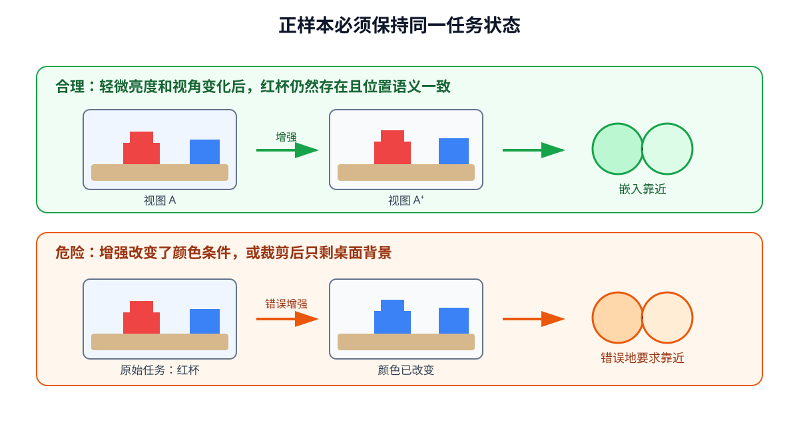

# 04-3 对比式表征学习与样本关系

04-2 让模型从一张图像的内容构造重建答案。另一种选择是不要求恢复每个像素，而是利用**两次观测之间的关系**：哪些画面在当前任务上应当被视为相近，哪些画面需要区分？对比学习用这种关系训练编码器。它有机会减少对背景细节的依赖，也可能因为配对规则不当，恰好丢掉机器人最需要的目标差别。

## 先确定什么叫“同一情境”

在本章的人工桌面任务中，让同一个红色目标保持在画面坐标 $(u,v)$，分别生成深色与浅色背景，得到两张视图 $I$ 和 $I^+$。我们希望它们的表示接近，因为此处任务是读取目标位置，背景变化不应改变答案。它们称为一对**正样本**。另取目标位置明显不同的视图，作为需要区分的对比项。这里的配对规则是教学设定，不等于真实机器人所有时间相近的画面都应相同。

把图像送进同一个编码器及可选投影头后，得到 $z$ 与 $z^+$。用余弦相似度比较两组向量：

$$
\operatorname{sim}(z_i,z_j)=\frac{z_i^{\mathsf T}z_j}{\|z_i\|_2\|z_j\|_2}.
$$

相似度接近 1，表示方向接近；接近 0 表示方向近乎正交。训练可让每个 $z_i$ 在一批候选里更容易匹配到自己的 $z_i^+$。一种典型的对比损失是

$$
\mathcal L_i=-\log\frac{\exp(\operatorname{sim}(z_i,z_i^+)/\tau)}{\sum_{j\in\mathcal C_i}\exp(\operatorname{sim}(z_i,z_j)/\tau)},
$$

其中候选集合 $\mathcal C_i$ **包含正确配对**及其他样本，温度 $\tau$ 控制相似度差异在比较中有多显著。分子增大，表示正样本更容易匹配；其他候选相似度过高会增大分母，训练便会推动模型区分它们。这里“其他样本”是计算上的对比项，不代表语义上必然完全不同。

## 增强规定了模型应忽略哪些变化

正样本可以由两次数据增强产生，但“增强”不是天然安全的标签。若两张图只改变亮度与轻微背景纹理，且目标清楚可见，让表示接近是合理的。若任务指令是“抓红色杯子”，却把红色改成蓝色并仍作为正样本，模型就会受到“颜色不重要”的训练信号。若随机裁剪把杯子完全裁掉，两张视图甚至不再含有同一个任务对象。

<figure markdown="span">
  { width="1120" loading=lazy }
  <figcaption>图 04-3　先核对两张视图是否仍有同一任务答案，再把它们作为正样本。背景可以改变，但若颜色或位置正是任务条件，就不能无条件要求模型忽略它们。（本教程绘制）</figcaption>
</figure>

时间也不能简单当作配对依据：杯子还未移动的相邻两帧可能相近；夹爪碰到杯子前后，虽然只隔一帧，接触状态却已改变。机器人要用表征决定下一步动作，便不能把这种变化全部压成“同一情境”。

## 训练相似度改善以后，还要检查什么

如果一批图像里恰有两个不同样本的目标位置相同，它们被放进彼此的分母，训练却可能推动它们分开。这类**误把相关样本当作对比项**的问题，不能只靠增加 batch 大小消除。反过来，只看正样本靠近也不够：所有图像若都输出同一向量，正样本当然接近，表示却失去区分能力。包含合适对比项的训练目标可阻止最简单的常数解，但仍要检查模型是否学到背景或采集批次等无关差别。

对比学习得到的是按配对规则组织的特征空间，不是已解出的物体状态。接下来的检验至少包括：同一位置、不同背景是否仍相近；不同位置是否能分开；冻结编码器后，简单读出头能否恢复杯子坐标。实践 04-02 会把这几项和预测式模型放在一起比较，但其对比模型的表现不能脱离数据配对规则单独解释。

第 05 章会让图像与文字成为跨模态的相关配对。在那之前，本章还要看另一种不直接恢复像素、也不主要依赖其他样本对比的办法：预测被遮挡区域的**表示**。

[返回 04 导读](04-visual-representation-learning.md) · [继续阅读 04-4 预测式表征学习](04-4-predictive-representation-jepa.md)
