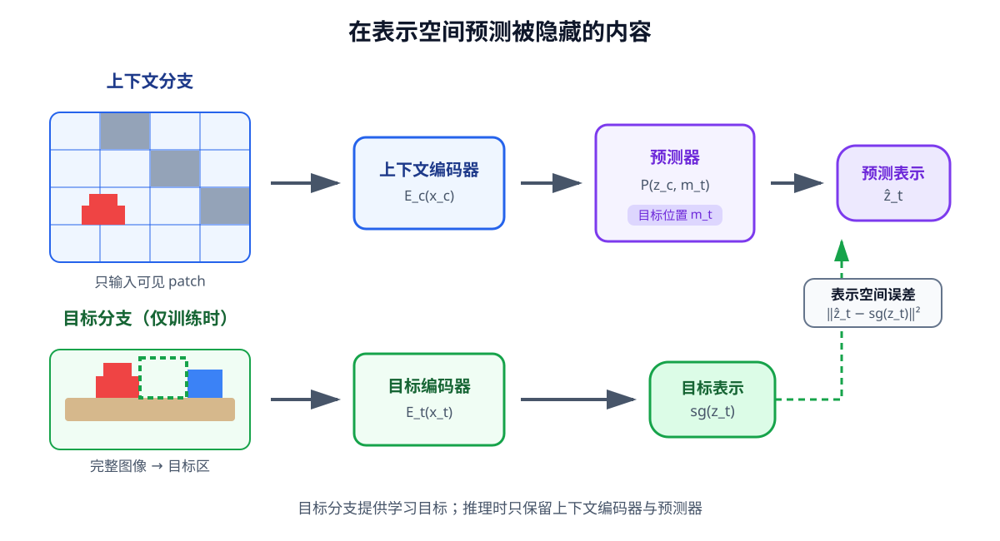

# 04-4 预测式表征学习与 JEPA

前两节分别要求恢复图像细节、组织样本之间的相似关系。现在提出第三种训练问题：桌面图像中有一块被遮住，模型能否根据可见的杯身、桌沿和其他区域，预测隐藏区域的**特征**？它不必把杯子表面的每个像素画出来，但必须形成与目标区域表示相近的结果。这是联合嵌入预测架构（Joint-Embedding Predictive Architecture，JEPA）的基本思路。本节先讲图像内的预测，不把它误当成动作后的未来预测。

## 训练时，答案从哪里来

取一张完整的训练图像，先指定一个上下文区域和一个目标区域。上下文编码器 $E_c$ **看不到目标区域的像素**，只能把可见部分变成特征 $z_c$。目标编码器 $E_t$ 在训练时读取包含目标的真实图像，并取出目标位置的特征 $z_t$，作为要预测的答案。预测器 $P$ 接收 $z_c$ 与目标的位置提示 $m_t$，输出 $\hat z_t$。位置提示告诉模型“预测哪一块”，不提供那块的真实像素或真实特征。[I-JEPA 原论文](https://arxiv.org/abs/2301.08243)采用从同一图像的上下文预测目标块表示的安排。

可以把一次训练写成：

$$
z_c=E_c(x_c),\qquad z_t=\operatorname{select}_{m_t}(E_t(I)),\qquad \hat z_t=P(z_c,m_t).
$$

$x_c$ 是去掉目标区域后的可见输入；$\operatorname{select}_{m_t}$ 表示从目标编码器产生的特征中取出指定区域。实际模型可能一次预测多个目标块；本节只用一个目标块看清数据流。训练比较预测与目标特征，例如 $\mathcal L=\|\hat z_t-\operatorname{sg}(z_t)\|_2^2$，其中 $\operatorname{sg}$ 表示**停止梯度**：本次误差先更新上下文编码器和预测器，不直接把目标分支的答案也沿这条路径改掉。I-JEPA 的目标编码器可通过上下文编码器参数的缓慢移动平均更新，这与“目标编码器永远固定”不同；JEPA 这一类方法的具体稳定机制也不必完全相同。

<figure markdown="span">
  { width="1120" loading=lazy }
  <figcaption>图 04-4　读图时先看上路：可见块经上下文编码器、预测器得到目标位置的预测特征。再看下路：训练中的完整图像经目标编码器提供该位置的真实特征，停止梯度使它不会被这一次预测误差直接改写。两路比较的是特征，不是像素。（本教程绘制）</figcaption>
</figure>

这里的目标编码器读取完整图像再选取目标区域特征；图 04-4 下路用虚线框标出被选作答案的位置，不表示训练时要让上下文编码器看到那里的像素。使用阶段不再有可拿来核对的“真实隐藏特征”，只使用上下文编码器及所需的预测器。

## 为什么不预测像素，也不能保证学到任务信息

若隐藏区域的桌布纹理无法从周围准确猜出，逐像素恢复会把这类误差计入训练；表示预测则取决于目标编码器保留什么。如果目标特征更多反映物体形状和空间结构，预测器可把能力用于这些信息。不过，这只是可能的收益，不是 JEPA 名称自带的保证。若目标编码器把“夹爪张开”和“夹爪已闭合”编码得几乎一样，预测误差再小也无法支持需要辨认接触时刻的机器人任务。

另一种危险是**表征坍缩**：所有图像都变成同一向量，预测器也总输出它，表示误差便可能很小，却无法区分杯子位置。目标编码器更新方式、遮挡范围和其他防退化设计都影响这一点。04-5 会用不同样本特征的变化和任务读取检查，而不是只看预测损失是否下降。

实践 04-02 的教学模型让在线编码器读取被随机遮挡的图像，预测一个缓慢更新的目标表示，并加入简化的维度方差约束。它只说明“上下文特征 → 预测目标特征”的训练关系，**不是**原论文 I-JEPA 的图像块架构、遮挡策略或完整防坍缩实现。运行时先看两种方法各自的损失，再看同场景跨背景相似度、圆心位置误差和特征标准差，不应拿损失的绝对数值直接比较方法优劣。

本节预测的是**同一幅图像中不可见区域的特征**，不是“机器人做了动作以后会出现什么”。动作条件未来预测还需要按时间配对真实前后观测，并将实际动作 $a_t$ 交给预测器，例如 $\hat z_{t+1}=F(z_t,a_t)$。进阶篇先准备时间与动作接口，高级篇再系统讨论这种世界模型。现在先回到更近的问题：这些特征能否为当前机器人任务所用？

[返回 04 导读](04-visual-representation-learning.md) · [继续阅读 04-5 任务检验与使用](04-5-evaluation-and-use.md)
