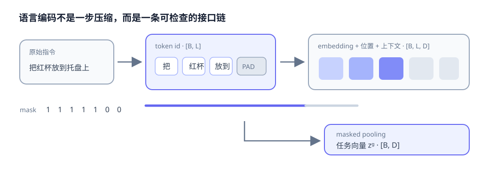

# 05-1 文本数值化与批处理

人可以直接理解“把红色杯子放到托盘上”；神经网络起初只收到一段字符串。本节建立语言输入的数据链：分词器确定离散单元，词表给它们编号，嵌入层把编号变成可学习向量，位置与有效位则告诉后续模型“哪个 token 在哪里、哪些位置只是补齐”。这些约定一旦错位，后面的任务学习即使能够运行，也可能在读错指令。

## 从字符串到 token id

分词器（tokenizer）把文本切成 token，再按词表映射为整数 $w_1,\ldots,w_L$。$L$ 是这条指令的 token 数，词表大小为 $V$，每个 id 位于 $0$ 到 $V-1$。例如教学词表可以把“把 / 红色 / 杯子 / 放到 / 托盘”映射为 $[5,17,24,8,31]$；**这些数字只是词表中的地址**，编号 24 并不比编号 17 更重要，也不意味着两词语义相距 7。

切分粒度会改变序列长度和未知词处理方式。字符切分可能把“红色”分成“红”和“色”；词级切分可把“红色”保留为一个单元，但遇到新组合更容易出现未知词；子词方法用可复用片段兼顾词表大小与覆盖能力。子词的边界不一定符合人的直观词边界，因此阅读模型输入时应查看**实际 tokenizer 输出**，不能按空格或汉字数猜 token 数。

| 粒度 | “红色杯子”的示意切分 | 主要取舍 |
| --- | --- | --- |
| 字符 | 红 / 色 / 杯 / 子 | 较少整词未知，但序列更长 |
| 词 | 红色 / 杯子 | 直观，却依赖词表覆盖 |
| 子词 | 红 / 色杯 / 子等可能结果 | 由训练得到的词表决定，可复用片段；示意切分并非固定规则 |

`[UNK]` 可代表词表未覆盖的单元；`[BOS]`、`[EOS]` 可表示序列起止；`[PAD]` 用于长度补齐；有的模型还使用 `[CLS]` 汇总整句或 `[SEP]` 分隔片段。每个符号的具体用途要以所选模型为准。尤其不能让大量新物体名称都落到同一个 `[UNK]`，却还期待模型区分它们。预训练模型的词表、分词规则与嵌入矩阵必须配套保存，更换 tokenizer 不是只换一道文字预处理。

## id 经过嵌入层才成为可学习向量

设词嵌入矩阵 $W_{\mathrm{emb}}\in\mathbb R^{V\times D}$，查表得到第 $i$ 个 token 的 $D$ 维向量 $e_i=W_{\mathrm{emb}}[w_i]$。若一次输入 $B$ 条、每条补到 $L$ 个位置，id 张量形状为 $[B,L]$，嵌入后为 $[B,L,D]$。第 02 章的训练机制会更新矩阵中被使用的向量，使其适应训练目标；向量的几何关系来自训练，不来自 id 的大小。

只查表还不知道词序。“把杯子放到盘子上”和“把盘子放到杯子上”包含近似的词，操作对象与目标却互换。常见做法是将位置向量 $p_i$ 加到 token 向量上，得到 $h_i=e_i+p_i$。位置向量可学习，也可按固定规律生成；本章重点是它让后续编码器能辨别第几个位置，而不是要求读者先计算正弦位置编码的每个分量。位置本身仍不足以完成理解：模型还要结合周围 token，分清“红色”修饰哪个物体。第 09 章会解释 Attention 如何做这种跨位置的信息读取。

## 补齐、mask 与截断怎样影响答案

并行处理时，通常把同一批指令补到相同长度。下面用教学词级切分说明；真实分词器可能切出不同数量的 token。

| 指令 | 补到长度 6 的 token | 有效位 mask |
| --- | --- | --- |
| “拿起红杯” | `[拿起, 红, 杯, PAD, PAD, PAD]` | $[1,1,1,0,0,0]$ |
| “把蓝杯放到托盘” | `[把, 蓝, 杯, 放到, 托盘, PAD]` | $[1,1,1,1,1,0]$ |

mask 中的 1 表示真实 token，0 表示只为补齐而加入的位置。若要把 token 表示 $z_i$ 汇总成一个句向量，可用带 mask 的平均：

$$
z_g=\frac{\sum_{i=1}^{L}m_i z_i}{\sum_{i=1}^{L}m_i}.
$$

例如三个有效 token 的一维表示分别是 $1,2,3$，补齐位的表示都是 $9$。不看 mask 而对六个位置直接平均，会得到 $(1+2+3+9+9+9)/6=5.5$；只对有效位置平均则为 $2$。真实嵌入是多维向量，但同样的污染会发生在每一维。mask 不只服务平均池化：使用 Attention 时也要防止后续位置读取 padding，训练损失也不能把补齐位置当答案。

若指令超过设定的最大长度，还要截断。截断不是无害的加速手段：“把红杯放进盒子，但不要碰蓝杯”若尾部被截去，安全约束就消失了。系统应记录最大长度与截断方向，检查关键对象、否定词和约束是否仍在输入中；无法保留完整任务语义时，不应假装指令已经正常编码。

<figure markdown="span">
  { width="1040" loading=lazy }
  <figcaption>图 05-1　沿箭头核对四次变换：文字被切为 token、编号经查表变成向量、位置和上下文形成 token 表示、mask 使补齐位不进入任务汇总。图中的句向量是可选输出，后续也可以保留整列 token 表示。（本教程绘制）</figcaption>
</figure>

下面的交互示意可先观察 token 怎样依次进入数值链路；动画不可用时，图 05-1 和上面的数值例子已给出完整含义。

  
静态说明：文本切成 token 并映射为编号；嵌入与位置形成向量，mask 标明哪些位置可进入上下文编码和句子汇总。

实践 05-01 用空格预先标出词边界，让读者专注观察词表、`[UNK]`、`[PAD]` 和 mask。它是教学用词级 tokenizer，**不是**任何预训练模型的分词器。运行后先核对每条指令的有效位，再比较普通平均与 masked pooling；若只看到输出数值不同，还需指出差异具体来自哪几个补齐位置。

至此，我们只解决了文本怎样成为可靠的数值输入。下一节才讨论：这些向量怎样表达“做什么、对谁做、有什么限制”。

[返回 05 导读](05-language-encoding.md) · [继续阅读 05-2 指令与任务表示](05-2-instruction-and-task-representation.md)
