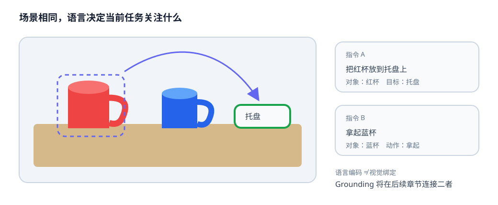

# 05-2 机器人指令的任务表示

05-1 已把文字变成带有效位的向量序列，但“得到一串向量”还不能告诉机械臂做什么。现在保持桌面图像不变，比较“拿起红杯”和“把蓝杯推到托盘旁”：词变了，操作对象、动作和目标也跟着变。本节要让语言表示保留这些决定行为的差别，并指出仅靠词表和句向量会遗漏什么。

## 从出现过哪些词，到词之间是什么关系

最简单的词袋表示只记录每个词出现次数，不记录顺序。“杯子在托盘左边”与“托盘在杯子左边”在词袋里可能完全相同，但两句描述的空间关系相反。直接把静态词向量平均，也会遇到类似问题：若位置和上下文没有参与计算，平均结果对词序不敏感。

上下文编码器接收 token id、位置和 mask，输出 $Z^{\mathrm{lang}}\in\mathbb R^{B\times L\times D}$。其中某个 token 的输出不再只由它自己的查表向量决定，还会包含句中其他位置提供的信息。举例说，“放”在“把杯子放到托盘上”中涉及物体的目标位置，在“放开夹爪”中则涉及末端开合；模型须结合相邻词及句子结构，才可能区分两种用途。第 09～10 章会展开 Attention 与多模态上下文的计算，本节先固定输出接口与任务含义。

可以把整句汇总成任务向量 $z_g\in\mathbb R^{B\times D}$，便于给动作模块一个总体条件；也可以保留 $[B,L,D]$ 的 token 级特征，让后续视觉模块分别读取“红色”“杯子”“托盘”。两种表示没有必然优劣：若只要粗略判断任务类别，全局向量可能足够；若要把“红色杯子”指向具体区域，过早汇总可能使对象与属性的对应关系难以恢复。

## 将指令拆成可以核对的任务字段

为了检查语言信息，可把“把红色杯子放到托盘上，不要碰蓝杯”暂时整理为一组字段：

| 字段 | 从示例指令读出的内容 | 若丢失会造成什么偏差 |
| --- | --- | --- |
| 动作 | 放置 | 可能误做推动或仅仅抓起 |
| 操作对象 | 杯子 | 可能操作托盘或其他物体 |
| 属性 | 红色 | 可能选错蓝杯 |
| 目标及关系 | 托盘上 | 可能只移动杯子而未放入目标区 |
| 约束 | 不碰蓝杯 | 可能走一条碰撞路径 |

这组字段是教学检查表，不是要求所有自然语言都必须被强行压成固定五格。连续的语言特征能表达更丰富的信息，结构化字段则便于发现漏掉了什么。两者可同时保留：例如视觉—动作模块读取 token 特征，同时用字段检查任务理解是否与指令一致。

<figure markdown="span">
  { width="1040" loading=lazy }
  <figcaption>图 05-2　左右两种指令面对同一桌面，却要求不同的对象和后续动作。读图时先找指令中的对象与属性，再在画面中找候选物体；这一步仍是人类读图说明，语言编码器本身并未自动完成区域定位。（本教程绘制）</figcaption>
</figure>

## 同义改写、组合与否定为何要分别测试

“拿起红杯”和“把红色杯子抓起来”在同一任务约定下可视为近似改写。模型应保持关键动作与对象一致，却不能把所有表面相似的句子也当作等价。“拿起红杯”与“**不要**拿起红杯”只有一个词不同，控制含义却相反。若句向量对否定词不敏感，相似度很高恰恰可能是不安全的信号。

组合能力也需单独检查。模型在训练中见过“拿起红杯”和“推动蓝块”，并不保证它理解“推动红杯”。要判断是否只是记住完整模板，可以把某些“动作 × 颜色 × 物体”的组合专门留作测试，同时确保单个词本身都已在训练中出现。若新组合失败，问题不一定是词表不够大，也可能是表示没有学会按角色重新组合已有内容。

“先打开抽屉，再把积木放进去”还包含时间顺序。只用词袋或简单平均池化，前后顺序可能被冲淡；“把积木放进去，再打开抽屉”包含类似词，却不可直接执行。课程后续在时间建模和 Context 章节讨论如何把历史与指令顺序放在一起使用，本节先把它列为语言接口必须保留的差别。

## 指令不完整时，向量也不等于答案

“把它放那里”需要对话或手势确定“它”和“那里”；画面中有三个杯子时，“拿杯子”没有指定哪一个；“整理一下”没有给出唯一动作序列。这不是分词器没有把字切好，而是任务输入本身缺少执行所需的信息。机器人可以询问用户、等待进一步指示，或按预定安全规则拒绝行动；不能把编码器给出的确定数值当成实际目标已经确定。

实践 05-02 用固定模板生成指令，预测动作、颜色、物体和目标四类字段。模型共享一个经 mask 汇总的句向量，各字段有各自的读出头。它能帮助观察已见词汇的未见组合，但**没有**“不要”的标签，也没有处理指代的机制。运行后应把成功读出字段与尚未建模的否定、约束和歧义分开写结论。

目前的任务字段仍只来自文字。即使语言表示区分了“红杯”和“蓝杯”，它也还不知道相机画面中哪个区域对应哪一个。下一节先建立整图与整句的可比较表示，再明确它与具体区域定位之间的距离。

[返回 05 导读](05-language-encoding.md) · [继续阅读 05-3 图文对齐](05-3-image-text-alignment.md)
