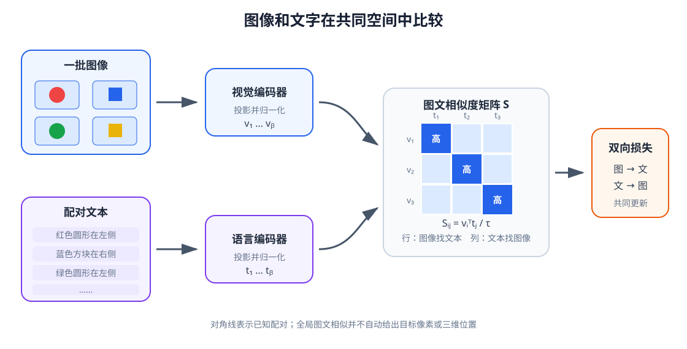

# 05-3 图文对齐与共同表示

05-2 的语言编码器能把“红杯”与“蓝杯”区分开，第 03～04 章的视觉编码器也能从图像提取特征。但两个编码器分别训练时，它们的向量坐标没有天然关系：即使输出都是 128 维，第 1 维也不一定表示同一种属性。要让文字帮助机器人选择图像内容，必须用配对数据建立可以比较的跨模态表示。本节以 CLIP 式双编码器说明这一步，同时划清整图对齐与物体定位的边界。

## 从成对图文到相似度矩阵

准备一批图文对 $(I_i,T_i)$。例如图像 $I_1$ 是“左侧红色圆形”，对应文本 $T_1$；图像 $I_2$ 是“右侧蓝色方形”，对应文本 $T_2$。视觉编码器先处理图像，语言编码器先处理文本；两个可训练投影层再把输出映射到同一宽度 $D$。投影层只是将原本不同维度或数值坐标的特征变成可共同计算的向量，并不会单凭“维度相同”自动学会语义对应。训练信号来自已知的图文配对。

将投影结果按长度归一化，记为 $v_i$ 和 $t_j$。两两计算相似度：

$$
S_{ij}=\frac{v_i^{\mathsf T}t_j}{\tau},\qquad S\in\mathbb R^{B\times B}.
$$

$S_{ij}$ 是第 $i$ 幅图像与第 $j$ 条文本的配对分数；$\tau$ 是控制 Softmax 敏感程度的温度，不是相机温度。若 batch 按正确配对顺序排列，对角线 $S_{11},S_{22},\ldots$ 对应已知配对。对两对样本，一个可能的训练后分数示意是

$$
S=\begin{bmatrix}3.0&1.0\\0.5&2.5\end{bmatrix}.
$$

第一行中 $3.0>1.0$，表示第一幅图更匹配第一句；第二列中 $2.5>1.0$，表示第二句更匹配第二幅图。对角线高只是当前候选集合内的相对关系，不是“这个动作有 3.0 的成功概率”。[CLIP 原论文](https://arxiv.org/abs/2103.00020)用成对图文训练两个编码器，使整图与整句的表示可以在共同空间中比较。

<figure markdown="span">
  { width="1120" loading=lazy }
  <figcaption>图 05-3　左侧两条编码链分别处理图像与文字，中间投影与归一化使表示可比较；右侧矩阵的行回答“这幅图配哪句话”，列回答“这句话配哪幅图”。图中整图—整句匹配尚未输出杯子的像素坐标。（本教程绘制）</figcaption>
</figure>

## 为什么要同时检查两个检索方向

对矩阵每一行做 Softmax，可以把“当前图像在这批文本中选哪句”作为一个分类问题；对每一列做 Softmax，则是“当前文本在这批图像中选哪幅”。常见损失对这两个方向分别计算交叉熵，再取平均：

$$
\mathcal L_{\mathrm{align}}=\tfrac12\bigl[\operatorname{CE}(S,y)+\operatorname{CE}(S^{\mathsf T},y)\bigr],
\qquad y=(0,1,\ldots,B-1).
$$

这里 $y$ 的第 $i$ 项指向第 $i$ 对图文，而不是机械臂动作标签。两个方向共享相似度矩阵，却可能有不同的检索错误：一幅图可能容易在几条文本中选对描述，但一条含糊描述可能同时匹配多幅相近图。若只报一个方向的准确率，会漏掉另一方向的混淆。

简单对角线标签还有前提：**同一 batch 里每条图文只有一个被标记的正确配对**。若有两张不同视角的红杯图像和两句同义文本，把其余真实相关配对都当成“错项”，会给模型矛盾的训练信号。真实数据需要去重、多正样本标注或其他能处理多对多关系的目标。配对规则与第 04 章对比学习中的正样本定义一样，会影响编码器最终认为哪些差别重要。

## 整图匹配为什么还不是区域定位

假设一幅桌面图同时含红杯、蓝杯和托盘，整图与“红杯”文本的相似度很高，也只说明两者相关，**不会自动指出红杯的边界或中心**。把词语与图像区域、检测框或三维物体绑定起来，叫作视觉 grounding（视觉指代定位）。后续可利用第 03 章保留的空间特征、区域检测或跨模态 Attention，但仅凭一个全局分数，机械臂还无法知道应去哪个像素抓取。

因此，评测应分层：先看整图—整句检索；再让候选只差颜色、形状或左右位置，检查是否保留指令中的关键条件；最后在多物体图像上检查目标区域。第 06 章还要把二维区域转换到机器人的三维坐标，区域匹配也不是最后一步。

实践 05-03 用 16 种颜色、形状和左右位置组合构成**语义唯一**的图文对，训练一个小型双编码器。运行热力图后，先辨认对角线和具体混淆位置，再比较图找文、文找图两个方向；最后看“绿色方块在右侧”能否在仅改一个属性的候选中选对。每幅候选图只有一个目标，实验验证的是整图检索，不能把它称为多物体定位。

图文对齐使两种模态能比较语义。下一节把它接回机器人任务：怎样选择语言输出接口、怎样处理指令不完整与预训练编码器，以及为何任务成功仍需现场观测判定。

[返回 05 导读](05-language-encoding.md) · [继续阅读 05-4 语言任务接口](05-4-language-interface-and-checks.md)
