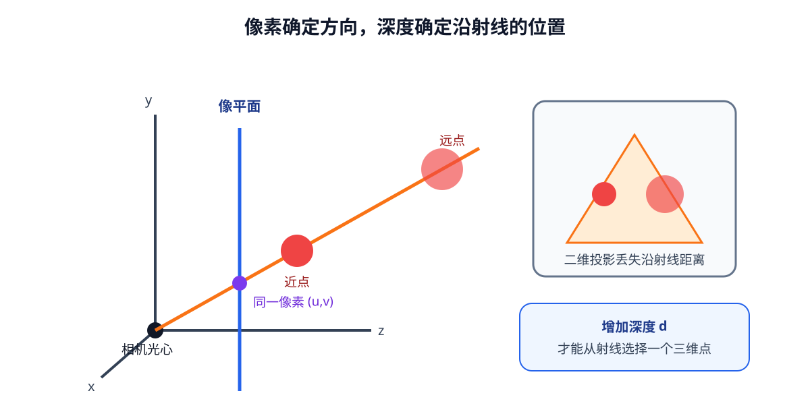

# 06-1 相机成像与 RGB-D 反投影

第 05 章只完成“红色杯子”在语言与画面中的对应，最多得到图像上的像素或区域。像素坐标 $(u,v)$ 是“画面第几列、第几行”，不是桌面上的米制位置。本节从针孔成像出发说明为什么还需要深度，并用一组数字完整算出相机坐标中的三维点。

## 一个像素对应一条射线

记杯子上的一个物理点在相机坐标系 $C$ 中的位置为 ${}^{C}p=(X_C,Y_C,Z_C)^{\mathsf T}$。本节采用常见的光学坐标约定：$x$ 向图像右方、$y$ 向下、$z$ 沿相机视线向前；真实设备的轴方向必须按驱动和标定结果核对。理想针孔相机先计算 $x_n=X_C/Z_C$、$y_n=Y_C/Z_C$，再用内参变成像素：

$$
u=f_x\frac{X_C}{Z_C}+c_x,\qquad
v=f_y\frac{Y_C}{Z_C}+c_y.
$$

$f_x,f_y$ 是以像素为单位的焦距，$(c_x,c_y)$ 是主点。若三维点沿着同一条从相机出发的射线移动，使 $X_C,Y_C,Z_C$ 同时乘以相同的正数，上式的比值不变。于是一个像素只确定方向，不能决定物体在该方向上有多远。写成矩阵形式时，$K=\begin{bmatrix}f_x&0&c_x\\0&f_y&c_y\\0&0&1\end{bmatrix}$ 是相机内参，满足 $Z_C[u,v,1]^{\mathsf T}=K[X_C,Y_C,Z_C]^{\mathsf T}$；这里的矩阵采用零斜切的简化模型。

<figure markdown="span">
  { width="1040" loading=lazy }
  <figcaption>图 06-1　近处点与远处点只要位于同一条成像射线上，就落到同一像素。图中的深度是在这条射线上定位三维点所缺的一项测量，而不是新增的物体类别信息。（本教程绘制）</figcaption>
</figure>

## 深度怎样把射线上的点确定下来

若深度图给出的 $d(u,v)$ 是沿相机 $z$ 轴测得的距离，便有 $Z_C=d$。把投影公式反过来：

$$
X_C=\frac{(u-c_x)d}{f_x},\qquad
Y_C=\frac{(v-c_y)d}{f_y},\qquad Z_C=d.
$$

例如取 $(u,v)=(420,260)$、$(c_x,c_y)=(320,240)$、$f_x=f_y=600$ 像素、$d=0.8$ 米，则 $X_C=100\times0.8/600\approx0.133$ 米，$Y_C=20\times0.8/600\approx0.027$ 米，$Z_C=0.8$ 米。所得 ${}^{C}p\approx(0.133,0.027,0.8)$ 米，只在**相机坐标系**中有这个数值。代回投影式，横坐标约为 $600\times0.133/0.8+320\approx420$；这种往返检查能发现像素顺序或内参使用错误，却不能证明真实相机已经标定准确。

有的深度设备报告的是**沿射线的欧氏距离** $r$，不是 $Z_C$。这时不能把 $r$ 直接代入上式。应先构造方向 $s=((u-c_x)/f_x,(v-c_y)/f_y,1)^{\mathsf T}$，把它归一化后求 ${}^{C}p=r\,s/\|s\|$；得到的第三个坐标才是相机 $z$ 深度。位于图像中心时两种数值可能相近，越到边缘差别越不能忽略。

## 公式成立前还须核对的输入条件

反投影假定深度值与 RGB 像素已经**对齐**。若彩色相机和深度相机安装在不同位置，$(u,v)$ 在两张图上不一定指向同一物理点；应先按标定关系配准。镜头畸变还会让图像边缘偏离理想针孔模型，使用畸变像素前须做相应校正，或采用包含畸变的相机模型。图像缩放、裁剪后，$K$ 也须按同样的几何变换更新，不能继续套原分辨率的焦距和主点。

深度值为零、无穷、超量程或被设备标为无效时，不代表物体就在相机光心。它应保留无效标记，不进入反投影。还要核对深度是米还是毫米：$800$ 毫米与 $0.8$ 米表示同一距离，若直接把 $800$ 当米，整幅点云会被放大千倍。

下面的交互示意依次突出射线、深度点和后续坐标变换；本节先只看前两步。动画不可用时，图 06-1 与数值例子仍可独立阅读。

  
静态说明：像素给出相机中的射线，深度在射线上确定三维点；把该点交给外参变换，才得到基座坐标。

06-01 实践先用人工 RGB-D 图像核对单像素反投影。运行后请指出每个输出坐标属于哪个轴、单位是什么，再解释为什么重投影回同一像素不等于真实传感器标定正确。下一节将不再只使用一个中心像素，而是从目标区域收集多点几何。

[返回 06 导读](06-spatial-geometry.md) · [继续阅读 06-2 目标区域与点云](06-2-target-region-and-point-cloud.md)
