# 06-3 坐标系与刚体变换

06-2 的点云中，杯子表面某点可以写作 ${}^{C}p$；上标 $C$ 表示数值是以**相机**为原点和轴方向表达的。机械臂控制器通常按**机器人基座**坐标系 $B$ 接收目标。两个向量可以描述同一物理点，却有不同数值。本节用刚体变换把它们连接，并给出防止“矩阵乘对了、方向却用反”的检查方法。

## 相机到基座的旋转与平移

记 ${}^{B}R_C$ 为把相机轴方向表达的向量旋转到基座轴方向的矩阵，${}^{B}t_C$ 为相机原点在基座坐标中的位置，则

$$
{}^{B}p={}^{B}R_C\,{}^{C}p+{}^{B}t_C.
$$

先旋转再平移，结果 ${}^{B}p$ 才能与基座中的末端位置作差。一个纯教学算例：相机中的点是 ${}^{C}p=(0.1,0,0.8)$ 米；相机相对基座绕 $z$ 轴旋转 $90^\circ$，因此前两维 $(0.1,0)$ 变为 $(0,0.1)$；相机原点在基座中是 $(0.4,0.1,0)$ 米。于是这个点的基座坐标是 $(0.4,0.2,0.8)$ 米。这里没有改变杯子的位置，只换了描述它的坐标尺。

<figure markdown="span">
  { width="1040" loading=lazy }
  <figcaption>图 06-2　相机与基座有不同的原点和轴方向。同一杯子点先按两套轴之间的旋转改写方向，再加上相机原点在基座中的位置，得到控制端使用的坐标。（本教程绘制）</figcaption>
</figure>

## 齐次矩阵为何有四行四列

把位置点写为 $\tilde p=(x,y,z,1)^{\mathsf T}$，上式就可写成一次矩阵乘法：

$$
{}^{B}T_C=
\begin{bmatrix}
{}^{B}R_C&{}^{B}t_C\\
0&1
\end{bmatrix},\qquad
{}^{B}\tilde p={}^{B}T_C\,{}^{C}\tilde p.
$$

矩阵左上角是 $3\times3$ 旋转，右上角是 $3\times1$ 平移，最下一行完整写作 $(0,0,0,1)$。点的最后一维是 1，故平移会作用于它；**方向向量**（例如夹爪接近方向）的最后一维应为 0，经过同一矩阵只被旋转，不会因相机原点变化而偏移。把两者都补成 1，会把方向错当位置。

记号的上、下标还说明乘法顺序。${}^{B}T_C$ 接受相机坐标的点，输出基座坐标；反向矩阵是 ${}^{C}T_B=({}^{B}T_C)^{-1}$。若已知基座到世界坐标 $W$ 和世界到相机坐标的变换，链式关系写为 ${}^{B}T_C={}^{B}T_W{}^{W}T_C$。中间相同的 $W$ 是检查连接方向的线索。矩阵通常**不能交换次序**。

对 $T=\begin{bmatrix}R&t\\0&1\end{bmatrix}$，逆变换为

$$
T^{-1}=\begin{bmatrix}R^{\mathsf T}&-R^{\mathsf T}t\\0&1\end{bmatrix}.
$$

不能只把平移改成 $-t$，因为逆方向的平移还必须用新的坐标轴表达。代码里可用已知点检查“相机 → 基座 → 相机”是否回到原数值；不过往返误差接近零只说明两个计算互为逆，不保证使用的相机外参真来自正确标定。

## 外参从哪里来，为什么会随时间改变

相机与基座之间的几何关系叫**外参**。相机固定在工作台旁时，可通过外参标定得到 ${}^{B}T_C$；相机装在机械臂末端时，相机随着关节运动，${}^{B}T_C$ 还须由当前关节状态、机器人正向运动学和相机相对末端的安装变换组合得到。此时不能把某一帧的变换永久复用。图像、深度与关节状态也必须按时间对齐，否则会把旧画面用新位姿转换。

数据接口至少写明：源坐标系、目标坐标系、轴朝向、长度单位和变换对应的时间。变量名 `transform_base_camera` 比匿名的 `transform` 更容易审查。若只拿到 ${}^{C}T_B$，应先求逆，不能因为两个矩阵都长成 $4\times4$ 就直接套用。

## 旋转表示与“六自由度位姿”

合法旋转矩阵满足 $R^{\mathsf T}R=I$ 与 $\det(R)=1$。旋转和平移组成的刚体变换属于 $SE(3)$；这里仅需理解它表示不改变物体形状和尺度的三维姿态与位置。所谓“六自由度位姿”是三个平移自由度加三个旋转自由度，并不限定文件里只能存六个数。

| 旋转表示 | 存储数 | 阅读时必须知道的约定 |
| --- | ---: | --- |
| 旋转矩阵 | 9 | 三列是否构成合法正交轴，矩阵方向是什么 |
| 欧拉角 | 3 | 旋转轴顺序、角度单位；组合不可简单逐项相加 |
| 四元数 | 4 | $(w,x,y,z)$ 还是 $(x,y,z,w)$；须保持单位长度 |
| 轴角 | 3 或 4 | 旋转轴、角度与小角度附近的数值处理 |

四元数用四个数存旋转，但有单位长度约束，$q$ 与 $-q$ 表示同一旋转；“位置 3 数 + 四元数 4 数”于是常被存为 7 维，物理自由度仍为 6。改变表示方式不会凭空增加对杯子姿态的观测信息。旋转矩阵的好处是组合与坐标变换直接，欧拉角便于人工阅读，却可能在某些姿态发生参数化问题；第 07 章使用位姿时仍应保留这些约定。

实践 06-02 的前半段构造一个已知相机到基座变换，把杯沿点云转换，再做逆变换。运行后应明确指出输入点、输出点和逆变换各属于哪个坐标系。下一节使用转换后的物体位置，讨论为什么它尚不是夹爪可直接执行的目标。

[返回 06 导读](06-spatial-geometry.md) · [继续阅读 06-4 抓取目标](06-4-object-pose-and-grasp-target.md)
