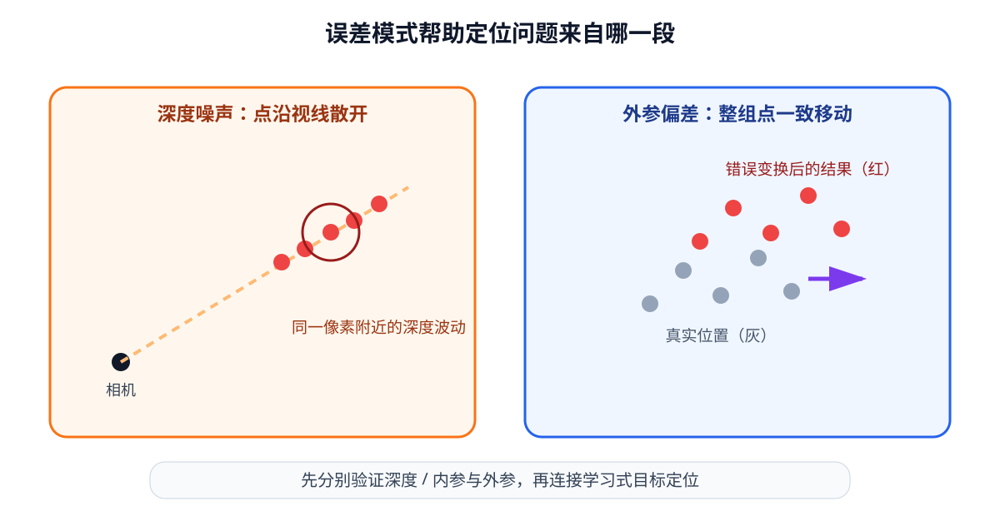

# 06-5 几何误差与标定检查

前四节建立了从像素到候选抓取目标的计算链，但每一项输入都可能有误差：视觉模型选的像素不准，深度图在反光杯沿出现噪声，相机安装关系也可能标定偏了。机器人最终关心的是**基座坐标中的目标偏离多少毫米、是否因此失去安全余量**。本节沿反投影与外参变换逐段追踪这些误差，并对应实践 06-02 的三种对照。

## 像素与深度误差怎样变成米制偏差

沿用 06-1 的 $X_C=(u-c_x)d/f_x$。保持其他量不变时，横向像素偏差 $\Delta u$ 近似造成 $\Delta X_C\approx(d/f_x)\Delta u$；深度偏差 $\Delta d$ 近似造成 $\Delta X_C\approx((u-c_x)/f_x)\Delta d$，同时 $\Delta Z_C=\Delta d$。纵向同理，有 $\Delta Y_C\approx(d/f_y)\Delta v+((v-c_y)/f_y)\Delta d$。这些是一阶近似：它们适合说明小误差的传播方向，不能取代实际数据的完整误差测量。

用 $u-c_x=100$ 像素、$v-c_y=20$ 像素、$f_x=f_y=600$ 像素、$d=0.8$ 米算一次：若横向定位错了 3 像素，$X_C$ 约偏 $0.8\times3/600=0.004$ 米，即 **4 毫米**；若深度错了 $0.02$ 米，$Z_C$ 直接错 **20 毫米**，$X_C$ 还约错 $100\times0.02/600\approx3.3$ 毫米。杯子越远，同样的像素偏差对应的横向距离越大；像素离主点越远，同样的深度偏差带来的横向误差也越明显。

这些数字是**单一误差源**的演示，不能把几项最大值简单相加就当成所有实际观测的误差分布。要判断能否安全抓取，应在任务距离、杯沿宽度和夹爪余量下报告误差，不能只报告“平均像素误差很小”。

## 外参偏差为何不能靠多取几个点消除

相机到基座的关系写作 ${}^{B}p={}^{B}R_C{}^{C}p+{}^{B}t_C$。若平移外参本身偏了 $(0.012,-0.006,0)$ 米，同一幅点云中**每个点**都会发生相同平移，偏移长度约 $13.4$ 毫米；对 80 个点求平均也不能把它抵消。相反，若每个点的深度噪声独立、正负大致对称，多点平均有机会减小估计中心的随机波动，但点之间相关的深度偏差依然不会自动消失。

旋转外参出错时，偏差随点到**旋转轴的垂直距离**增大。以该距离为 $0.8$ 米、旋转角偏 $2^\circ$ 的简化量级估算，横向偏移可达约 $0.8\sin2^\circ\approx28$ 毫米；实际方向和数值取决于旋转轴、相机平移及目标位置。它提醒我们：很小的角度误差也可能超过抓取允许的几毫米余量。

<figure markdown="span">
  { width="1040" loading=lazy }
  <figcaption>图 06-3　左侧深度扰动使各测量点沿各自视线偏移；右侧固定外参偏差让整组点产生同方向的平移或旋转。读图时先区分逐点变化与整体偏移，再判断多点平均能消除哪一种。（本教程绘制）</figcaption>
</figure>

## 怎样按链路排查，而不是只改最后的动作

如果最终杯子位置偏了，应按数据流逐段检查。先核对 RGB 与深度图是否对齐、无效深度是否被过滤、深度是米还是毫米；再用已知尺寸的标定物核对当前分辨率的内参与去畸变状态；接着用基座坐标中位置已知的标记核对相机外参；最后才接入学习式目标检测和抓取生成。若目标在画面各处的偏差随位置变化，可能是内参、畸变或目标定位问题；若整片点云在基座中总偏向同一侧，外参偏差值得优先检查。这些只是诊断线索，仍须用独立测量验证。

数值实现还可做两个低成本检查：一是把相机点变到基座，再用逆变换还原，确认坐标顺序与代码计算自洽；二是在基座中放置已知位置的实际标记，核对转换结果是否真的落在那里。**往返误差接近零不等于外参正确**：一个错误矩阵与它自己的逆也会完美往返。真实设备还须核对变换对应的时间戳，特别是相机装在运动末端时。

实践 06-02 分别加入逐点深度噪声、固定平移偏差和固定旋转偏差，输出基座坐标中的杯沿中心误差。运行后先看图中点是散开还是整体偏移，再看以毫米计的误差；不要只比较三根柱子的高度，还要说明每一种错误来自链路的哪一段。该 Notebook 的外参是人为设定的“已知正确值”，实验旨在理解误差，不是对真实相机完成了标定。

本章最后得到的是一条可追溯的空间信息链：图像指定目标，深度与内参恢复相机中的三维证据，外参把它转到基座，抓取模块再提出带方向的末端目标。每一环都要保留坐标系、单位、时间和误差约定。第 07 章继续接上机器人的当前关节、触觉状态与动作语义，才可能谈“如何执行”。

[返回 06 导读](06-spatial-geometry.md) · [继续阅读第 07 章](07-robot-state-and-action.md)
