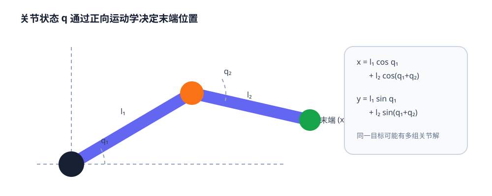

# 07-1 本体状态与机械臂运动学

第 06 章给出了杯子在基座坐标中的位置，却没有告诉机器人自己的末端在哪里。视觉可以拍到机械臂，但关节编码器通常能更直接地报告自身构型。本节先区分“外部物体状态”与“机器人本体状态”，再用二连杆例子把关节角、末端位置和末端速度连起来。

## 本体读数记录哪些身体信息

对有 $n$ 个关节的机械臂，可把某时刻的本体信息写作 $s_t^{\mathrm{prop}}=(q_t,\dot q_t,\tau_t,p_t^{\mathrm{ee}},r_t^{\mathrm{ee}},g_t)$。其中 $q_t$ 是关节位置，$\dot q_t$ 是关节速度，$\tau_t$ 是测得或估计的关节力矩；末端位置 $p_t^{\mathrm{ee}}$ 与旋转表示 $r_t^{\mathrm{ee}}$ 可由关节状态和机器人几何推得；$g_t$ 是夹爪开合状态。并非每个系统都能可靠取得全部字段，实际输入必须以部署时可获得的传感器为准。

| 量 | 常见单位 | 直接读数还是推得 | 回答的问题 |
| --- | --- | --- | --- |
| 旋转关节位置 $q_i$ | 弧度 | 编码器读数 | 关节目前转到哪里 |
| 关节速度 $\dot q_i$ | 弧度/秒 | 传感器或估计 | 关节正在怎样运动 |
| 关节力矩 $\tau_i$ | 牛·米 | 传感器或电流估计 | 负载与受力是否变化 |
| 末端位姿 | 米与旋转表示 | 关节位置经正向运动学 | 夹爪在基座中的位置与朝向 |
| 夹爪状态 $g_t$ | 米、弧度或开合值 | 夹爪传感器 | 手指开到多大、是否正在闭合 |

关节位置、末端位置和杯子位置不是同一量。末端已到杯子附近，也不代表夹爪已接触；关节收到目标命令，也不代表编码器已经测到对应角度。仿真器可能额外提供物体精确位姿、真实接触点等内部真值，这些值可作评测答案，却不能未经区分便放入要部署到真机的策略输入。

## 正向运动学从关节角算末端位置

正向运动学（Forward Kinematics，FK）用机器人连杆长度与关节角计算末端位置或位姿。以平面二连杆为例，长度 $l_1,l_2$，两关节角为 $q_1,q_2$，末端坐标为

$$
x=l_1\cos q_1+l_2\cos(q_1+q_2),\qquad
y=l_1\sin q_1+l_2\sin(q_1+q_2).
$$

$q_2$ 是第二连杆相对第一连杆的转角，所以第二段的全局方向是 $q_1+q_2$。若两段长度都为 $0.3$ 米，$q_1=0$、$q_2=90^\circ$，第一段沿右方走 $0.3$ 米，第二段向上走 $0.3$ 米，末端就是 $(0.3,0.3)$ 米。角度在公式和 Notebook 中都按**弧度**参与计算；这里的 $90^\circ$ 只是便于读图的写法。

<figure markdown="span">
  { width="1000" loading=lazy }
  <figcaption>图 07-1　先沿第一连杆走到肘部，再按两关节角的合成方向走到末端。虚线可达边界只表示距离上可能到达，不包含碰撞、关节限位或夹爪朝向检查。（本教程绘制）</figcaption>
</figure>

真实三维机械臂可以把每段关节变换依次相乘，得到末端位姿；与第 06 章的相机到基座变换使用同一套坐标方向规则。机器人底座、工具安装点或末端工具改变时，也要更新几何链，而不能只沿用旧关节角。

## 雅可比说明小幅关节运动会怎样移动末端

正向运动学给定“当前关节角 → 当前末端位置”。若想知道关节**现在转动一点**带来多快的末端运动，用雅可比矩阵 $J(q)$：

$$
\dot p_{\mathrm{ee}}=J(q)\dot q.
$$

雅可比由正向运动学对各关节角的局部变化得到，随当前姿态而变。在上面的两连杆例子里，$q=(0,90^\circ)$ 时，平移部分的雅可比为 $\begin{bmatrix}-0.3&-0.3\\0.3&0\end{bmatrix}$，单位是米/弧度。若只让第一关节以 $0.1$ 弧度/秒转动，末端瞬时速度约为 $(-0.03,0.03)$ 米/秒；这不是一次指令要移动的最终距离，而是当前姿态附近的速度关系。

连杆几乎伸直时，雅可比在某些方向上失去有效映射能力，称为**奇异构型**。它不表示机器人完全不能动，而是某些期望末端方向可能需要非常大的关节速度。逆运动学（Inverse Kinematics，IK）则从期望末端位姿求可能的关节角；它可能有多个解、无解或靠近关节限位。第 06 章的三维抓取目标因此仍须通过可达性与安全检查，而不是只把一个坐标输入电机。

实践 07-01 先画二连杆与末端位置，再用有限差分核对雅可比，最后观察接近伸直构型时最小奇异值的变化。运行时分清“最大可达边界”“当前末端位置”和“奇异时难以实现的速度方向”，不要把曲线接近零误读成全部末端速度恒为零。

本体读数和运动学说明“机器人在哪里、怎样移动”，却不能单独判断杯子是否已经被抓稳。下一节加入接触证据。

[返回 07 导读](07-robot-state-and-action.md) · [继续阅读 07-2 力、触觉与接触状态](07-2-force-tactile-and-contact.md)
