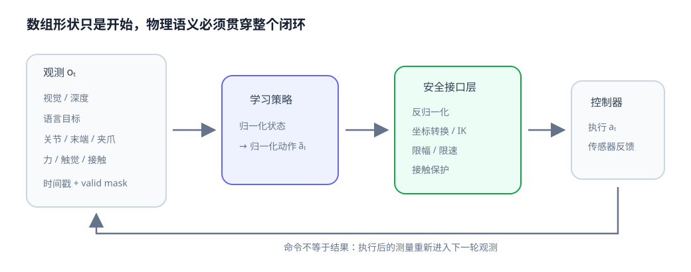

# 07-4 动作尺度、频率与安全执行

第 07-3 节规定了动作的字段与坐标系，但模型训练时通常使用缩放后的数值，控制器则接收带物理单位的命令。这中间还隔着执行频率、延迟和安全检查。若把模型输出看成可以直接发送给电机的七个数，动作接口就缺了最关键的一段。

## 频率决定“每步增量”代表多快的运动

假设动作表示每个控制周期的末端位置增量，而希望末端沿某方向保持 $0.1$ 米/秒。在 $20$ Hz 下，一个周期为 $0.05$ 秒，每步应移动 $0.005$ 米，即 $5$ 毫米；在 $50$ Hz 下，一个周期为 $0.02$ 秒，每步只应移动 $0.002$ 米，即 $2$ 毫米。如果把训练于 $20$ Hz 的“每步移动 $5$ 毫米”原样用在 $50$ Hz 控制器上，速度会变为 $0.25$ 米/秒。

因此动作定义至少要同时包含数值单位和周期 $Δt$。对于速度命令，$Δt$ 主要决定这一速度持续后造成的位移；对于每步位置增量，$Δt$ 直接决定同一个数值对应的物理速度。若相机、力传感器和控制器频率不同，还要说明一条动作使用了哪一次观测，而不是只给三个频率数字。

## 从模型数值还原物理命令

训练时常按训练集的统计量把某一维状态标准化：

$$
\tilde x=\frac{x-\mu}{\sigma+\epsilon},\qquad
x=\tilde x(\sigma+\epsilon)+\mu.
$$

$\mu$ 与 $\sigma$ 分别是该维训练数据的均值和标准差，$\epsilon$ 用来避免尺度为零时除零。它们应只从**训练集中的有效时间步**计算，并与训练好的模型一起保存。不能为测试集重新计算一组统计量，也不能把补齐轨迹长度时插入的零当作真实测量参与统计。

实践 07-02 对动作使用另一种约定：先把模型输出限制在 $[-1,1]$，再逐维映射到物理区间 $[a_{\min},a_{\max}]$：

$$
a_{\mathrm{physical}}=a_{\min}+\frac{\tilde a+1}{2}(a_{\max}-a_{\min}).
$$

例如平移一维的范围为 $[-0.02,0.02]$ 米时，模型值 $\tilde a=0.5$ 对应 $0.01$ 米，不是 $0.5$ 米。七维动作中的平移、旋转和夹爪各有自己的范围与单位，不能用统一的“乘一个系数”替代逐维解释。标准化状态与区间缩放动作也是两种不同变换，推理时必须照各自训练约定还原。

## 一条动作从提出到执行经过哪些检查

<figure markdown="span">
  { width="1040" loading=lazy }
  <figcaption>图 07-2　左侧是带时间信息的观测；模型在约定的数值空间提出动作。安全接口把动作恢复到物理单位，核对坐标系、幅度与可执行性；右侧控制器执行后，新的传感器读数才说明动作实际造成了什么。（本教程绘制）</figcaption>
</figure>

图中的“限幅”只检查数值是否落在约定区间。例如把每步末端平移限制为不超过两厘米，并不能保证安全：机器人可能离桌面仅一厘米，也可能连续多步向障碍移动。还应按动作形式检查相邻命令的速度、加速度、关节与工作空间边界，以及与环境的碰撞；真实系统由经过验证的控制器、保护机制和急停承担最终执行保护。若末端目标需通过逆运动学转换，也必须核对是否存在可达且不碰撞的关节解。

时序同样属于执行检查。可以记录观测时间 $t_{\mathrm{obs}}$、模型完成计算的时间 $t_{\mathrm{decision}}$ 和命令实际开始执行的时间 $t_{\mathrm{act}}$。若杯子在此期间移动，基于旧画面的命令即使数值合法，也可能指向错误位置。因此控制器要使用执行后的关节与接触反馈更新下一次观测；**模型发出的命令不等于传感器测到的结果**。

实践 07-02 会显示一条七维模型输出如何逐维还原和限幅，再演示“测得接触力较大便缩小平移”的玩具规则。运行后应读出修正前、修正后分别是什么物理量，并注意该规则没有检查碰撞、速度或传感器故障，绝不可照搬到真实机械臂。

至此，观测与动作都已有物理含义。最后还需把字段顺序、时间对齐和缺失信息写成可检查的数据契约，让训练与部署读取同一件事。

[返回 07 导读](07-robot-state-and-action.md) · [继续阅读 07-5 多模态观测—动作数据契约](07-5-observation-action-schema.md)
