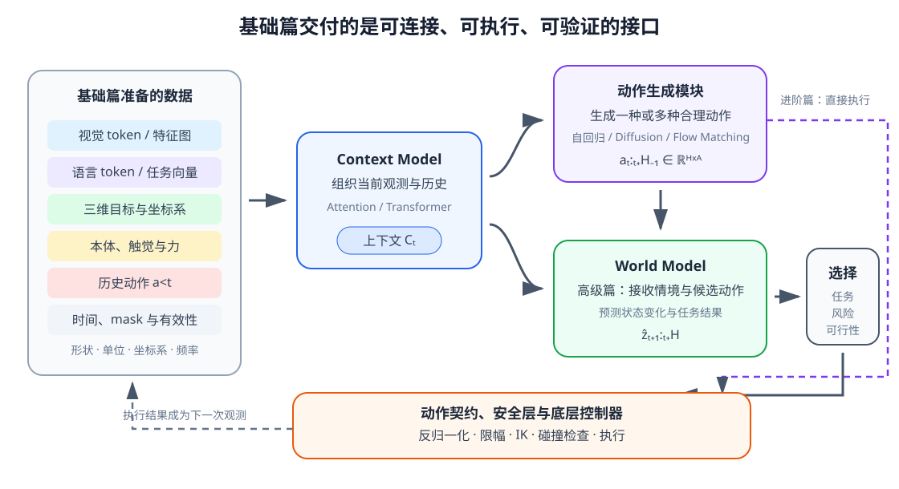

# 07-5 多模态观测—动作数据契约

前面四节分别说明了身体读数、接触证据、动作语义与执行检查。它们只有在同一条记录中正确配对，才能用于训练动作模型。**数据契约**不是仅列出“有图像和七维动作”，而是对每个字段的形状、单位、坐标系、时间、缺失方式和版本作出统一约定，让写数据、训练模型和执行命令的各方都按同一种含义解释它。

## 一条交互记录的输入、命令和结果

把杯子放入盒子的某一个决策时刻，可按如下顺序整理：

| 记录位置 | 内容 | 为什么需要保存 |
| --- | --- | --- |
| 决策前 $o_t$ | 此时可获得的图像、语言目标、杯子目标位置、关节/夹爪状态、力与触觉，以及各自的时间戳 | 模型只能依据已经观测到的信息作决定 |
| 提出的命令 $a_t^{\mathrm{cmd}}$ | 动作字段、单位、坐标系、持续时间和归一化版本 | 重现模型当时要求机器人做什么 |
| 实际执行 $a_t^{\mathrm{exec}}$ | 控制器接受或修正后的目标与执行状态 | 限幅、碰撞保护或跟踪误差会让执行偏离原命令 |
| 下一次观测 $o_{t+1}$ | 执行后重新测到的图像、本体和接触信息 | 判断杯子和夹爪是否按预期变化 |

这条记录把“想做什么”和“实际发生什么”分开。训练第 02 章的示范动作预测时，常把决策前可见的 $o_t$ 作为输入，把示范动作作为学习答案；以后训练动作条件世界模型时，则要特别核对使 $o_{t+1}$ 发生变化的是哪段**实际执行的动作**。若安全层改写了命令却只存原命令，世界模型便会学到错误的动作—后果对应关系。

## 张量形状之外还要保存什么

在一批长度不一的轨迹中，用 $B$ 表示批量大小，$T$ 表示补齐后的时间长度，$P$ 表示本体特征数，$A$ 表示动作维数。于是本体张量可为 $[B,T,P]$，六维力/力矩为 $[B,T,6]$，动作张量为 $[B,T,A]$，时间有效位为 $[B,T]$。若原始图像也按时间存储，可写作 $[B,T,C,H,W]$；送入模型后的视觉 token 则有另一套形状，不能混用。

`valid_mask[b,t]` 只说明第 $b$ 条轨迹的第 $t$ 个时间步是不是为了凑齐长度而补出来的。它不能说明这一真实时间步的触觉传感器是否掉线，也不能说明图像是否过期；这些需要各模态自己的可用性标记和时间戳。尤其不能让“有效且压力恰为零”和“没有触觉设备，随手补零”成为同一条记录。

形状检查之后，还要读字段表。例如六维本体向量中的第二个值究竟是第二关节角、第一关节速度还是夹爪开度？七维动作中的旋转增量采用什么表示？图像是 RGB 还是 BGR，坐标正方向如何定义？这些约定可以写入版本化 schema，并连同归一化统计、控制周期和传感器标定一起保存。模型换一版、工具换一个、相机重新标定时，若含义发生变化，就应更新相应版本，防止“形状没变、意义已变”的静默错误。

## 从基础篇接口走向后续模型

<figure markdown="span">
  { width="1120" loading=lazy }
  <figcaption>图 07-3　左侧是本章整理好的输入约定；Context Model 组织当前观测与历史，动作生成模块据此提出动作。进阶篇可将动作经执行接口送往控制器；高级篇还会加入世界模型，在执行前预测候选动作的后果并辅助选择。两条路线都要依赖执行后的真实反馈。（本教程绘制）</figcaption>
</figure>

图中的左侧输入并非把每种数据一股脑堆入模型。第 08 章先处理时间序列，第 09 章学习怎样从不同位置读取相关信息，第 10 章构造可供下游使用的 Context；第 11—13 章再用这一 Context 条件化动作生成。此时动作模型回答“接下来可以做什么”，却未必能回答“做完会怎样”。高级篇加入世界模型时，后者以当前情境与候选动作预测后果，才有可能在执行前比较多个方案。预测本身仍可能出错，所以每次执行后的实测反馈不能省去。

实践 07-02 的前半部分把本体、力和有效时间步放在同一批数据中，检查形状，并只用真实训练时间步计算标准化统计量。请特别核对两个问题：若把 padding 零值算入均值，模型会怎样误读真实关节位置？若两个数据集都给出 `[B,T,7]` 动作，但一个用米制末端增量、另一个用关节角，形状检查为什么不能发现错误？这两点正是数据契约要解决的不同层次。

基础篇至此交出了带物理语义的观测与动作接口。下一阶段要解决的不是再增加一种字段，而是怎样从一段**有时间顺序的记录**中记住过去、关注关键变化，并生成与当前任务相符的后续动作。

[返回 07 导读](07-robot-state-and-action.md) · [继续阅读 08 时间与记忆](../intermediate/08-time-and-memory.md)
