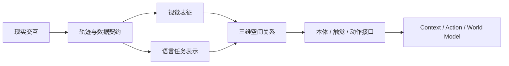

# 基础篇：机器人怎样准备可学习的观测与动作接口

核心问题：

> 现实交互、视觉、语言、空间关系、机器人自身状态和动作，怎样变成模型能够学习和组合的输入输出？

基础篇不急于搭建完整的动作生成器或世界模型。它先把数据语义、训练机制和各类模态接口说明清楚，使后续 Context Model、Action Model 与 World Model 建立在可验证的数据基础上。

## 本阶段要打通的能力

```text
现实交互如何成为训练数据
→ 像素和语言如何成为模型表征
→ 二维目标如何落到机器人三维空间
→ 本体、触觉和动作如何形成统一接口
```



## 单元一：从现实交互到学习问题

| 章节 | 要补上的缺口 | 状态 |
|---|---|---|
| [01 机器人眼中的世界](01-robot-view-of-the-world.md) | 从[现实任务与观测](01-1-robot-observation.md)、[决策与轨迹](01-2-policy-and-trajectory.md)，到[时间和空间对齐](01-3-synchronization-and-coordinates.md)、[张量与数据契约](01-4-tensors-and-data-contract.md) | 已完成 |
| [02 神经网络如何学习](02-how-neural-networks-learn.md) | 从[学习任务](02-1-learning-task-from-trajectories.md)、[前向预测](02-2-forward-and-nonlinearity.md)、[参数更新](02-3-loss-gradient-and-update.md)到[泛化与闭环检验](02-4-generalization-and-closed-loop.md) | 已完成 |

## 单元二：从多模态观测到机器人模型接口

| 章节 | 要补上的缺口 | 状态 |
|---|---|---|
| [03 视觉编码：从像素到视觉特征](03-vision-encoding.md) | 从[图像输入](03-1-image-tensors-and-preprocessing.md)、[卷积特征](03-2-convolution-and-cnn-features.md)，到[输出表示](03-3-visual-encoder-outputs.md)与[定位检验](03-4-object-localization-and-checks.md) | 已完成 |
| [04 视觉表征学习：编码器怎样学到有用特征](04-visual-representation-learning.md) | 从[训练目标](04-1-representation-and-objectives.md)，经[重建](04-2-reconstruction-ae-vae-mae.md)、[对比](04-3-contrastive-representation.md)、[预测](04-4-predictive-representation-jepa.md)，到[任务检验](04-5-evaluation-and-use.md) | 已完成 |
| [05 语言编码：从自然语言到任务表示](05-language-encoding.md) | 从[文本数值化](05-1-tokenization-embedding-and-mask.md)、[指令表示](05-2-instruction-and-task-representation.md)，到[图文对齐](05-3-image-text-alignment.md)与[任务接口](05-4-language-interface-and-checks.md) | 已完成 |
| [06 三维感知与坐标变换：从相机像素到机器人目标](06-spatial-geometry.md) | 从[像素反投影](06-1-camera-projection-and-backprojection.md)、[目标点云](06-2-target-region-and-point-cloud.md)、[坐标变换](06-3-coordinate-frames-and-transforms.md)，到[抓取目标](06-4-object-pose-and-grasp-target.md)与[误差检查](06-5-geometric-error-and-calibration.md) | 已完成 |
| [07 本体、触觉与动作：机器人怎样描述自身并执行指令](07-robot-state-and-action.md) | 从[本体与运动学](07-1-proprioception-and-kinematics.md)、[接触证据](07-2-force-tactile-and-contact.md)、[动作语义](07-3-action-spaces-and-coordinate-semantics.md)，到[尺度与执行](07-4-action-scaling-and-execution.md)和[数据契约](07-5-observation-action-schema.md) | 已完成 |

## 学完基础篇应该能解释

- [x] 为什么机器人学习数据必须记录时间、单位、坐标系和动作语义；
- [x] 神经网络怎样通过损失、梯度和参数更新学习一个任务；
- [x] 图像怎样变成全局向量、空间特征图或视觉 token；
- [x] AE、VAE、MAE、对比学习和 JEPA 分别要求视觉表征保留什么；
- [x] 语言怎样变成带有 mask 的任务表示，图文对齐怎样建立相似度，以及任务描述为什么不等于成功条件；
- [x] 二维位置为什么需要深度、内参和外参才能成为机器人目标；
- [x] 本体、触觉和动作接口为什么必须明确单位、频率、尺度与控制语义；
- [x] 这些接口以后怎样连接 Context Model、动作生成模块与 World Model。

## 配套实践索引

每章的实践都从正文中的具体问题出发。建议先读完相应章节，再从章节末尾的实践卡片打开 Colab；课程页面和 Notebook 会分别保留在不同标签页中，便于边运行边对照。

| 章节 | 配套实践 | 主要观察内容 |
|---|---|---|
| [01 机器人眼中的世界](01-robot-view-of-the-world.md) | 观测与轨迹；张量形状 | 对照[01-2](01-2-policy-and-trajectory.md)核对轨迹时间顺序，对照[01-4](01-4-tensors-and-data-contract.md)理解 batch、时间和特征维 |
| [02 神经网络如何学习](02-how-neural-networks-learn.md) | 前向计算与激活函数；训练与泛化 | 对照[02-2](02-2-forward-and-nonlinearity.md)看非线性预测，对照[02-3](02-3-loss-gradient-and-update.md)与[02-4](02-4-generalization-and-closed-loop.md)检查参数更新、未见数据和闭环表现 |
| [03 视觉编码](03-vision-encoding.md) | 卷积与特征图；目标位置预测 | 对照[03-2](03-2-convolution-and-cnn-features.md)看局部卷积及尺寸变化，对照[03-4](03-4-object-localization-and-checks.md)检查空间特征是否支持目标定位 |
| [04 视觉表征学习](04-visual-representation-learning.md) | AE、VAE 与 MAE；对比与预测式学习 | 对照[04-2](04-2-reconstruction-ae-vae-mae.md)比较重建目标，对照[04-3](04-3-contrastive-representation.md)、[04-4](04-4-predictive-representation-jepa.md)与[04-5](04-5-evaluation-and-use.md)解释样本关系、特征预测及任务读取 |
| [05 语言编码](05-language-encoding.md) | 分词、补齐与 mask；任务槽位；图文对齐 | 对照[05-1](05-1-tokenization-embedding-and-mask.md)检查文本输入，对照[05-2](05-2-instruction-and-task-representation.md)读出指令字段，对照[05-3](05-3-image-text-alignment.md)核对图文配对及整图检索边界 |
| [06 三维感知与坐标变换](06-spatial-geometry.md) | RGB-D 反投影；坐标变换与标定误差 | 对照[06-1](06-1-camera-projection-and-backprojection.md)、[06-2](06-2-target-region-and-point-cloud.md)核对目标点云，对照[06-3](06-3-coordinate-frames-and-transforms.md)、[06-5](06-5-geometric-error-and-calibration.md)理解基座变换与毫米级误差 |
| [07 本体、触觉与动作](07-robot-state-and-action.md) | 二连杆正向运动学；观测—动作数据契约 | 对照[07-1](07-1-proprioception-and-kinematics.md)核对关节与末端位置，对照[07-4](07-4-action-scaling-and-execution.md)及[07-5](07-5-observation-action-schema.md)检查动作还原、多模态字段与有效时间步 |

## 本阶段结束后留下的问题

基础篇准备了视觉表征、语言目标、三维关系、本体、触觉和动作接口，但还没有回答：

- 模型怎样从当前观测和历史中构建任务相关的 Context？
- 动作生成模块怎样通过自回归、Diffusion 或 Flow Matching 生成动作序列？
- World Model 怎样预测候选动作执行后的未来？
- 模型怎样比较多个未来并持续闭环纠错？

前两项进入[进阶篇](../intermediate/index.md)，后两项将在[高级篇](../advanced/index.md)继续展开。
