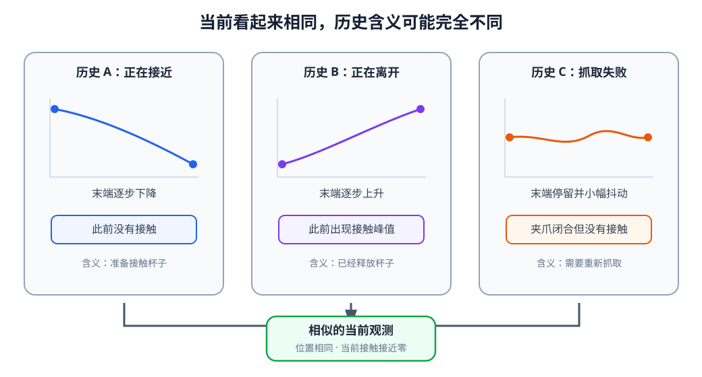

# 08-1 从交互轨迹到时间序列样本

基础篇已经为每个时刻的图像、本体、触觉和动作规定了含义。但机器人要判断杯子是否抓稳，不能只看夹爪此刻的位置：夹爪刚刚闭合、曾经碰到杯子却又滑开，以及一直没有接触杯子，都可能留下相近的当前画面。本节先不引入循环网络，而是把连续交互整理成后面各模型都能使用的训练样本。时间顺序如果在这一步弄错，换用更复杂的网络也无法补救。

<figure markdown="span">
  { width="1040" loading=lazy }
  <figcaption>图 08-1　当前画面相近时，此前夹爪和触觉的变化仍可能不同。判断抓取阶段，需要把当前观测放回交互历史。（本教程绘制）</figcaption>
</figure>

## 1. 先确定模型要回答的问题

沿用“把红色杯子放进盒子”的任务，本组小章采用一个较小的问题：在机械臂准备抬起杯子时，判断抓取是否稳定。若判断不稳，后续动作模块不应直接大幅抬升。这里的模型先输出“稳定抓取”的预测，而不是直接输出关节命令；第 11—13 章再把历史表示接到动作生成模型。

训练记录可以包含一个用于核对的目标值 $y_t$：经过人工标注或根据接下来的接触、滑移记录判定，时刻 $t$ 的抓取是否稳定。用未来几帧帮助制作训练标签是允许的，因为标签是已发生记录中的答案；但在时刻 $t$ 做预测时，未来观测不能进入模型输入。需要把“制作答案用到了什么”和“机器人当时能够看见什么”分开。

单帧模型只计算 $\hat y_t=f(o_t)$。若两个样本的当前画面相近，却一个抓稳、一个即将滑落，仅凭这张画面可能很难区分。时间模型改为读取截至当前的历史：

$$
\hat y_t=f(o_{t-H+1:t},a_{t-H+1:t-1},g).
$$

$H$ 是观察窗口长度，$g$ 是任务目标。这个式子并不要求输入必须是原始图像；下一步要先把每个时刻的数据整理成数值向量。

## 2. 一条记录中，动作和观测怎样对应

一段完整交互可写成

$$
\tau=(o_0,a_0,o_1,a_1,\ldots,a_{T-1},o_T).
$$

机器人取得 $o_t$ 后发出动作命令 $a_t$，该动作实际执行所造成的变化，才可能在后面的 $o_{t+1}$ 中出现。下表仅用四个时刻示意这种先后关系；“触觉变化”是观测的一部分，不是动作标签。

| 时刻 | 此时可用的观测 | 随后发出的动作 | 后续可能观察到的结果 |
|---|---|---|---|
| $t=0$ | 夹爪靠近杯子，尚无接触 | 继续下降 | 下一帧出现接触 |
| $t=1$ | 触觉出现接触变化 | 闭合夹爪 | 下一帧触觉保持或减弱 |
| $t=2$ | 画面仍像已经抓住杯子 | 小幅抬起 | 杯子可能随动，也可能滑落 |
| $t=3$ | 新观测显示实际结果 | 根据新情况决定动作 | 继续执行或重新抓取 |

假如要在 $t=2$ 预测抓取是否稳定，输入可以包含 $o_0,o_1,o_2$ 和此前实际发出的 $a_0,a_1$，不能包含 $o_3$。$o_3$ 可以用于事后确定标签或检验预测，但那是模型给出 $\hat y_2$ 之后的事情。尤其不能因为数据文件把图像和动作排成两列，就默认同一行的动作已经影响了同一行的图像。

不同设备还可能有延迟：命令时间、控制器真正开始执行的时间与相机采样时间不一定一致。制作序列前，应依据时间戳和控制日志确认哪一段动作实际发生在两帧之间。第 07 章规定的动作单位、坐标系和控制频率在这里仍然有效。

## 3. 从逐时刻数据形成输入向量

为了把注意力放在时间关系上，可以先使用基础篇已经介绍的编码结果。令 $\mathbf z_t^{\mathrm{vis}}$ 为视觉编码器的输出，$\mathbf s_t^{\mathrm{prop}}$ 为本体状态，$\mathbf s_t^{\mathrm{touch}}$ 为触觉读数，$\mathbf g$ 为目标表示，则一个时刻的输入可写成

$$
\mathbf x_t=\operatorname{concat}
\left(\mathbf z_t^{\mathrm{vis}},
\mathbf s_t^{\mathrm{prop}},
\mathbf s_t^{\mathrm{touch}},
\mathbf a_{t-1},
\mathbf g\right).
$$

这里加入的是上一时刻动作 $\mathbf a_{t-1}$，因为它可能解释当前观测为何改变。序列开头没有上一动作时，可以使用一个约定的起始值，并另行记录“此处没有历史动作”；不要让起始值与真实的零动作混淆。如果某个传感器此刻没有新数据，也要单独标记缺失，而不是默默填零后当作真实测量。

假设一段输入取最近四步，在 $t=5$ 时得到 $[\mathbf x_2,\mathbf x_3,\mathbf x_4,\mathbf x_5]$，对应目标 $y_5$。到 $t=6$ 时，窗口变成 $[\mathbf x_3,\mathbf x_4,\mathbf x_5,\mathbf x_6]$，对应目标 $y_6$。这就是滑动窗口：它复用一条轨迹中的多个时间片段，却始终只读取预测时刻及以前的信息。窗口不能越过一次任务结束的边界，否则上一回抓杯子的历史会错误地接到下一回任务开头。

多个样本组成一批时，输入通常表示为

$$
X\in\mathbb R^{B\times H\times D},
$$

其中 $B$ 是样本数，$H$ 是窗口长度，$D$ 是每个时刻的特征维度。三个维度的含义要与数值大小一起记录；把时间维与特征维交换，即使程序仍能运行，模型看到的问题也已经变了。

## 4. 不等长历史与缺失观测

任务刚开始时，机器人没有足够的 $H$ 步历史。可以用较短序列，或补齐到共同长度并设置有效位

$$
M\in\{0,1\}^{B\times H},
$$

其中 $M_{b,t}=1$ 表示真实时间步，$0$ 表示为凑齐长度而增加的位置。补齐的零向量不是机器人真的测到了零。计算损失、更新循环状态以及以后使用 Attention 时，都不能把它当成真实历史。

这与传感器缺失不同：相机在某一真实时间步掉帧时，那个时间步仍存在，本体和动作记录也可能正常，只是视觉模态不可用。因此至少要区分“时间步不存在”和“时间步存在但一种模态缺失”。如果相机是 30 Hz、控制器是 100 Hz，还需要选定参考时间轴，按时间戳匹配或聚合记录，并在必要时提供相邻采样间隔 $\Delta t$。不应只按数组下标把两种频率的数据逐行拼接。

经过这些处理，交给模型的不只是 $X$，还包括每段序列的边界、时间戳、有效位、缺失模态标记和目标 $y$。它们合起来才是一份能够解释“过去发生了什么”的时间数据契约。

## 5. 进入循环模型前的检查

拿一条真实轨迹，从当前预测时刻向前逐格查看：每个输入是否已经发生？上一动作是否确实位于当前观测之前？补齐位置是否被标出？稳定抓取的标签是否只作为答案、没有混入输入？再把窗口倒过来观看，如果“接触后滑落”和“滑落后接触”变得无法区分，就说明时间顺序本身包含任务信息。

下一节保持同一份序列样本不变，只替换处理历史的模型。普通 RNN 会在每个时刻读取 $\mathbf x_t$，并把一个不断更新的隐藏状态传给下一时刻。

[返回 08 导读](08-time-and-memory.md) · [继续阅读 08-2 RNN](08-2-rnn.md)
