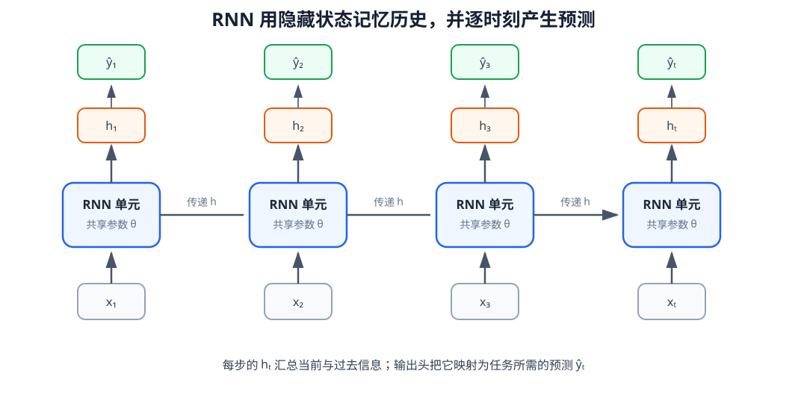

# 08-2 循环神经网络：让隐藏状态沿时间更新

第 08-1 节已经把一段抓取记录变成按时间排列的输入 $\mathbf x_1,\mathbf x_2,\ldots,\mathbf x_T$。如果把每个 $\mathbf x_t$ 分别送入同一个普通前馈网络，网络在处理当前帧时并不知道此前是否出现过接触峰值。循环神经网络（Recurrent Neural Network，RNN）的基本办法是：每处理一步，就把当前输入与上一时刻留下的内部状态一起用于计算，再把新的内部状态交给下一步。

## 1. 一个 RNN 单元接收什么、交出什么

令 $\mathbf h_{t-1}$ 是处理当前输入之前的隐藏状态。最简单的 RNN 可写成

$$
\mathbf h_t=\tanh(W_x\mathbf x_t+W_h\mathbf h_{t-1}+\mathbf b_h),
$$

$$
\hat y_t=\sigma(\mathbf w_y^\top\mathbf h_t+b_y).
$$

第一个式子负责更新记忆：$W_x$ 把当前输入映射到隐藏空间，$W_h$ 把旧隐藏状态映射到同一空间，两部分相加后经 $\tanh$ 得到新状态。第二个式子只是本组小章的一个具体任务输出：通过输出层和 $\sigma$（Sigmoid）把新状态转成“抓取稳定”的预测概率。符号 $\hat y_t$ 表示模型预测，$y_t$ 是记录中用来核对的答案；若任务改成预测下一位置，输出层与损失函数也要随之改变。

假设 $\mathbf x_t$ 有 $D$ 个数、隐藏状态有 $D_h$ 个数，则 $W_x$ 的形状是 $D_h\times D$，$W_h$ 的形状是 $D_h\times D_h$。隐藏状态 $\mathbf h_t$ 不是杯子或机器人的真实物理状态，而是网络根据截至当前的输入形成的内部数值表示；它是否真的保存了接触事件，需要通过实验检验。

<figure markdown="span">
  { width="1080" loading=lazy }
  <figcaption>图 08-2　从下往上读，每步输入 xₜ 经 RNN 单元得到隐藏状态 hₜ，再由输出层形成预测 ŷₜ；横向箭头把隐藏状态传到下一步。各方框重复使用同一组参数。（本教程绘制）</figcaption>
</figure>

图中画了多个 RNN 单元，只是把同一次计算沿时间展开，便于看清数据流；它们不是几套分别训练的网络。所有时刻共用 $W_x$、$W_h$ 和输出层参数。第一步尚无历史时，可把 $\mathbf h_0$ 设为零向量，或者用明确规定的初始化方法给出。读者可以沿图逐步追踪：$x_1$ 形成 $h_1$，再由 $x_2$ 与 $h_1$ 形成 $h_2$；$x_3$ 的预测因此可能受 $x_1$ 影响。

## 2. 用三个时刻算一遍“记住接触”

为了只观察时间更新，暂时把高维输入压成一个教学用数字：$x_t=1$ 表示此时出现明显接触变化，$x_t=0$ 表示没有新的接触变化。令 $h_0=0$，并人为给这个演示 RNN 取 $W_x=1$、$W_h=0.5$、$b_h=0$。这些数值仅用于算例；真正训练时，参数会根据样本误差学习。

现在输入序列为 $[1,0,0]$，即接触只在第一步出现。逐步计算得到：

| 时刻 | 当前 $x_t$ | 旧状态 $h_{t-1}$ | 新状态 $h_t=\tanh(x_t+0.5h_{t-1})$ |
|---|---:|---:|---:|
| 1 | 1 | 0 | 约 $0.762$ |
| 2 | 0 | $0.762$ | 约 $0.364$ |
| 3 | 0 | $0.364$ | 约 $0.180$ |

第三步的当前输入已经是零，但隐藏状态仍不是零：早先的接触在计算中留下了痕迹。若另一条记录的输入是 $[0,0,0]$，在同一初始状态和同一参数下三个隐藏状态都为零。两条记录的最后一步输入同为 $0$，RNN 却能给出不同内部状态。这就是“同样的当前观测，历史可能改变预测”的最小例子。

也要看清这个例子的边界：数值逐步减小，是演示参数取 $W_h=0.5$ 的结果，并不意味着每个训练好的 RNN 都按同一速度遗忘。它说明过去只能经由反复更新的状态传到当前；模型是否能长期保留一条线索，取决于学到的参数、输入和任务。

## 3. 何时读取最后状态，何时读取整段状态

如果只需对整段抓取记录作一次判断，可以在最后一个真实时间步读取 $\mathbf h_T$，经输出层得到一个答案。例如，观察夹爪闭合及抬升的全过程后，判断本次抓取是否稳定。如果每个时刻都要更新判断，则需要保留

$$
H=[\mathbf h_1,\mathbf h_2,\ldots,\mathbf h_T]
\in\mathbb R^{B\times T\times D_h},
$$

并分别计算各时刻的 $\hat y_t$。在真实机器人上，后者更接近“每收到新观测就重新判断”的用法。第 09 章还会利用整段隐藏状态，使模型能够选择读取某个较早时刻，而不只依赖最后的 $\mathbf h_T$。

训练仍遵循第 02 章的过程：用已知答案 $y_t$ 比较预测 $\hat y_t$，计算损失并更新共享参数。训练阶段可以把保存好的完整轨迹交给程序；但预测 $t$ 时必须按时间顺序只处理到 $t$，不能让 $t+1$ 之后的输入影响当前结果。第 08-1 节的有效位也要参与处理：补齐时间步不应当作一次真实状态更新。

## 4. 普通 RNN 为什么可能丢失较早的事件

回到杯子任务。第 1 步的触觉峰值可能表明夹爪碰到了杯壁；到第 20 步，画面和关节状态已经变化多次，当前又需要判断杯子是否仍被抓住。普通 RNN 每一步都用新输入和旧状态重新产生一个固定维度的状态。早先的信息若没有被网络持续保存，就可能逐渐变弱或被后来的变化覆盖。前面的数值例子展示了一种变弱方式；即使增大隐藏维度，也不能保证模型一定把正确线索留到第 20 步。

这不仅是推理时“记不住”的问题。若训练答案要在很晚才体现早期事件的重要性，较早输入对当前误差的影响还要穿过许多连续的状态更新，学习也可能变困难。这里不另开一段抽象的训练算法推导；理解本节只需抓住一个事实：普通 RNN 没有分别决定“旧内容留多少、新内容写多少”的显式结构。

下一节的 LSTM 沿用同一条抓取序列，却增加一条专门传递内部记忆的通道，并让模型通过门控控制保留、写入和读取。

## 配套实践：手工展开循环记忆

实践 08-01 用 NumPy 逐时刻计算最小 RNN。先观察相同当前输入、不同历史对应的隐藏状态，再倒转输入顺序并检查补齐位置的影响。运行前可以先用本节的三步算例预测图中曲线方向；运行后再解释哪条线说明模型确实使用了过去。

[返回 08 导读](08-time-and-memory.md) · [继续阅读 08-3 LSTM](08-3-lstm.md)
