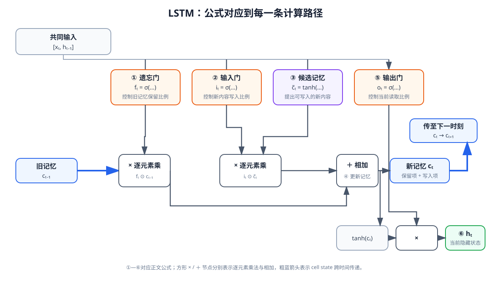

# 08-3 LSTM：记忆的保留、写入与读取

普通 RNN 可以把早先的接触带到当前，但每一步都要在同一个隐藏状态中重新融合旧信息和新输入。假设夹爪在第 1 步确实抓到杯子，第 2—10 步主要观察到机械臂抬升和背景移动，到第 11 步才需要判断“抓取是否仍稳定”。此时模型既不能完全忽略新观测，也不该让无关画面不断覆盖第 1 步的接触线索。长短期记忆网络（Long Short-Term Memory，LSTM）为这一取舍设计了单独的记忆通道和控制门。

## 1. 隐藏状态与记忆单元分别承担什么

LSTM 在普通 RNN 的隐藏状态 $\mathbf h_t$ 之外，增加记忆单元状态 $\mathbf c_t$（cell state）。可以把 $\mathbf c_t$ 理解为沿时间传递的内部记忆，把 $\mathbf h_t$ 理解为本时刻向输出层和下一步计算提供的状态。二者都是网络中的向量，不是传感器直接量到的“杯子是否抓牢”，也不能未经检验就给某个维度命名。

每到一个真实时间步，LSTM 根据当前输入 $\mathbf x_t$ 和上一隐藏状态 $\mathbf h_{t-1}$ 回答三个计算问题：旧记忆保留多少？当前候选信息写入多少？更新后的记忆有多少用于当前输出？对应的是遗忘门、输入门和输出门。所谓“门”不是额外传感器，而是一组由训练学得的参数计算出的 $0$ 到 $1$ 之间的数值。

## 2. 按计算顺序读懂三个门

先计算遗忘门 $\mathbf f_t$、输入门 $\mathbf i_t$ 和准备写入的候选记忆 $\tilde{\mathbf c}_t$：

$$
\mathbf f_t=\sigma\!\left(W_f[\mathbf x_t,\mathbf h_{t-1}]+\mathbf b_f\right),
$$

$$
\mathbf i_t=\sigma\!\left(W_i[\mathbf x_t,\mathbf h_{t-1}]+\mathbf b_i\right),
$$

$$
\tilde{\mathbf c}_t=\tanh\!\left(W_c[\mathbf x_t,\mathbf h_{t-1}]+\mathbf b_c\right).
$$

方括号表示把当前输入与旧隐藏状态拼在一起；$\sigma$ 是 Sigmoid，使门值落在 $0$ 到 $1$ 之间。每个门通常与记忆向量有相同数量的分量，因此模型可以分别调整不同分量，而不是对整段记忆只作一个“留”或“删”的决定。候选记忆通过 $\tanh$ 得到，可以包含正值或负值；它只是准备写入的内容，写入多少还要看输入门。

随后更新记忆：

$$
\mathbf c_t
=\mathbf f_t\odot\mathbf c_{t-1}
+\mathbf i_t\odot\tilde{\mathbf c}_t.
$$

$\odot$ 表示对应位置相乘。等号右边第一项是被保留的旧记忆，第二项是新写入的内容，二者相加才形成当前 $\mathbf c_t$。遗忘门接近 $1$ 不等于“模型永远记得”，只表示这一次更新较多地保留了相应分量；后续时间步仍会继续更新它。

最后计算输出门，并形成当前隐藏状态：

$$
\mathbf o_t=\sigma\!\left(W_o[\mathbf x_t,\mathbf h_{t-1}]+\mathbf b_o\right),
$$

$$
\mathbf h_t=\mathbf o_t\odot\tanh(\mathbf c_t).
$$

这里的粗体 $\mathbf o_t$ 专指 LSTM 的输出门，不是第 08-1 节的观测 $o_t$。输出门控制当前有多少内部记忆进入 $\mathbf h_t$。本组小章的“抓取是否稳定”预测，仍需由一个任务输出层读取 $\mathbf h_t$，例如 $\hat y_t=\sigma(\mathbf w_y^\top\mathbf h_t+b_y)$。输出门 $\mathbf o_t$ 本身不是这个预测概率，也不是机器人发出的动作。

<figure markdown="span">
  { width="1080" loading=lazy }
  <figcaption>图 08-3　①遗忘门与旧记忆相乘，②输入门和③候选记忆相乘；两项在④相加得到新记忆。⑤输出门控制新记忆经 tanh 后有多少成为⑥隐藏状态。粗蓝线标出记忆向下一时刻传递。（本教程绘制）</figcaption>
</figure>

图中的每条支路都能在公式中找到对应项。读图时先沿中间两条乘法支路走到加法节点，再从新记忆分别追踪“传至下一时刻”和“形成当前隐藏状态”两条去向。这样可以避免把输出门误认为决定 $\mathbf c_t$ 中写入多少：写入由输入门控制，输出门控制的是当前读取。

## 3. 一次简化的记忆更新

实际 LSTM 的记忆是向量。为了看清运算，先只取其中一个分量。假设此前的记忆值 $c_{t-1}=0.80$，这一时刻遗忘门 $f_t=0.90$，输入门 $i_t=0.10$，候选记忆 $\tilde c_t=0.20$，输出门 $o_t=0.80$。那么

$$
c_t=0.90\times0.80+0.10\times0.20=0.74,
$$

$$
h_t=0.80\times\tanh(0.74)\approx0.50.
$$

旧值 $0.80$ 中有 $0.72$ 进入新记忆，新候选只贡献 $0.02$。如果这一时刻主要是背景移动、没有新的抓取证据，可以用这种数值关系理解“保留旧线索，少写入新内容”。反过来，若出现明显滑移，网络可能给候选信息更大的写入比例，改变当前记忆和预测。这里的门值全部是人为给出的算例；训练好的网络根据 $\mathbf x_t$ 与 $\mathbf h_{t-1}$ 计算它们，我们不能预先规定它看到“滑移”必然使某一个门等于某个值。

还要区分两个数：$c_t=0.74$ 是内部记忆分量，$h_t\approx0.50$ 是该分量当前向外提供的隐藏状态。它们都不是“抓稳概率为 74% 或 50%”。只有经过针对抓取任务训练的输出层，得到的 $\hat y_t$ 才具有这一预测语义。

## 4. LSTM 能改善什么，不能替代什么

相比普通 RNN，$\mathbf c_t$ 的更新含有一条显式的保留路径：当某些维度的遗忘门持续较大、写入门较小时，早先信息有机会跨过多个时间步继续存在。这可以缓解“第 1 步发生接触，第 11 步才需要判断”的困难，但不保证它一定学会了保留正确事件。训练样本若缺少滑落情形，或触觉与动作时间戳错位，门控结构也无法凭空知道什么时候发生接触。

在机器人任务中，较可靠的验证不是看门图“像不像在记忆”，而是固定当前画面，更换此前的接触历史，观察预测是否合理变化；再逐渐把关键事件移到更早时刻，检查效果是否下降。第 08-4 节会把这套检查用于 RNN、LSTM 和 GRU 的同任务比较。

LSTM 还需按时间顺序逐步计算，并把有限维记忆不断更新。面对很长的历史或多种模态，即使保存能力得到改善，模型也未必能在当前直接定位到“第 7 步的接触峰值”。这是下一章 Attention 要处理的另一类问题。

[返回 08 导读](08-time-and-memory.md) · [继续阅读 08-4 GRU 与模型比较](08-4-gru-and-comparison.md)
