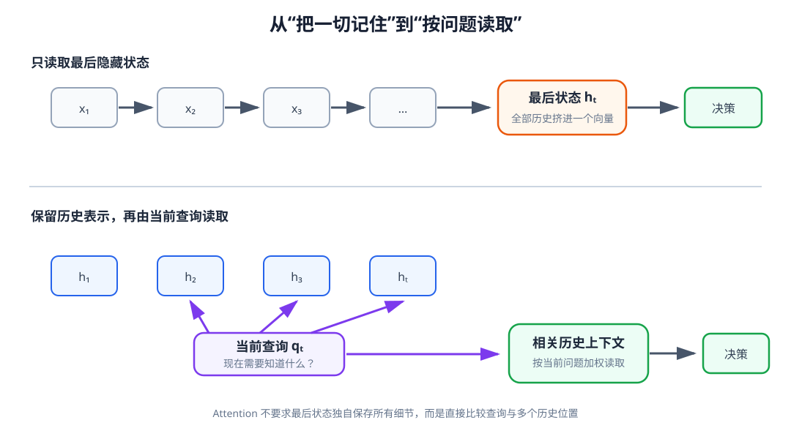

# 08-4 GRU 与循环记忆的模型选择

LSTM 用记忆单元和三个门分别处理保留、写入与读取。门控循环单元（Gated Recurrent Unit，GRU）保留“按当前输入决定怎样更新旧状态”的思路，但不再单独维护 cell state，而是在隐藏状态上直接完成更新。本节先读懂这个较紧凑的结构，再把 RNN、LSTM 和 GRU 放回同一抓取任务中比较，最后说明第 09 章为何还需要 Attention。

## 1. GRU 用两个门更新一个状态

令 $\mathbf h_{t-1}$ 为旧隐藏状态。采用一种常见记号，GRU 的更新门 $\mathbf z_t$、重置门 $\mathbf r_t$ 和候选隐藏状态 $\tilde{\mathbf h}_t$ 为

$$
\mathbf z_t=\sigma(W_z\mathbf x_t+U_z\mathbf h_{t-1}+\mathbf b_z),
$$

$$
\mathbf r_t=\sigma(W_r\mathbf x_t+U_r\mathbf h_{t-1}+\mathbf b_r),
$$

$$
\tilde{\mathbf h}_t
=\tanh\!\left(W_h\mathbf x_t+
U_h(\mathbf r_t\odot\mathbf h_{t-1})+\mathbf b_h\right),
$$

$$
\mathbf h_t=(1-\mathbf z_t)\odot\mathbf h_{t-1}
+\mathbf z_t\odot\tilde{\mathbf h}_t.
$$

更新门决定旧状态和候选新状态各占多少。在这里采用的写法中，$\mathbf z_t$ 接近 $0$ 时较多保留旧状态，接近 $1$ 时较多采用新候选。有些资料把更新门定义成相反的比例，因此公式中的 $\mathbf z_t$ 与 $1-\mathbf z_t$ 可能交换；读公式时应先确认作者采用的约定，而不是只背“门接近 1 代表什么”。

重置门的作用位置与更新门不同。它先调整旧状态有多少参与候选状态 $\tilde{\mathbf h}_t$ 的计算；它并不是在最后一步直接把旧状态清零。若机器人碰到杯子后出现了新的滑移线索，候选状态可以较少依赖先前“已抓住”的信息，再由更新门决定新候选写入多少。这里同样只是帮助理解计算路径，不能断言训练后的某一门恰好代表“接触”或“滑移”。

## 2. 用数值区分“形成候选”和“接受候选”

假设某一隐藏维度的旧值为 $h_{t-1}=0.80$，当前计算出的候选值为 $\tilde h_t=0.20$。若更新门 $z_t=0.10$，则

$$
h_t=0.90\times0.80+0.10\times0.20=0.74.
$$

旧值占主要部分。若相同的旧值与候选值遇到 $z_t=0.90$，结果变为 $h_t=0.26$，即当前更愿意采用新内容。但候选值 $0.20$ 并非凭空出现：计算它之前，重置门已经决定旧状态以多大比例参与候选的形成。因此两个门不能合并理解成同一个“遗忘按钮”。

GRU 的 $\mathbf h_t$ 同时承担跨时间传递和当前输出的任务；LSTM 则另有 $\mathbf c_t$ 作为记忆通道。不能仅因为 GRU 参数通常较少，就认定它一定更快完成任务或更容易训练。真实速度还受到输入尺寸、序列长度、硬件和实现方式影响。

## 3. 在同一任务中公平比较三种模型

沿用前面“根据较早触觉事件判断抓取是否稳定”的任务，比较时要先固定输入通道、训练与测试轨迹划分、输出标签和预测时刻。例如，每个时间步都输入触觉、末端运动趋势和夹爪状态，三种模型都在序列最后预测“早先是稳定接触还是滑移警告”。如果给 LSTM 更多历史、却只给 RNN 最后五步，就无法把差异归因于模型结构。

可以先使用相同隐藏维度，观察一个直观的结构对照；但这时参数量并不相同，LSTM 通常需要更多门控参数。若问题改成“相同参数预算下谁更好”，就要相应调整隐藏维度，并明确报告这一变化。两种比较回答的问题不同，不应混为一个结论。

| 检查 | 怎样做 | 读到什么现象才有意义 |
|---|---|---|
| 当前观测基线 | 只给最后时刻的输入 | 确认任务是否真的需要历史，而非背景已经泄露答案 |
| 延迟距离 | 保持接触事件类型不变，改变它到预测时刻的步数 | 判断模型是否只适应训练时固定长度 |
| 历史顺序 | 保持当前观测相同，交换早期接触、闭合和抬升的顺序 | 判断模型是否使用先后关系，而非仅统计出现过哪些数值 |
| 模态删除 | 只删除此前触觉，保留当前视觉与本体 | 检查预测是否依赖期望的历史证据 |
| 连续执行 | 在仿真中根据每步新观测继续判断并行动 | 检查离线正确率能否转化为稳定的闭环行为 |

如果训练集中的稳定接触样本总发生在第 4 步、滑移样本总发生在第 7 步，模型可能只学会了计时。改变关键事件的位置与序列总长度，可以暴露这种捷径。图像背景、补齐样式或任务编号也可能泄露标签，因此评测时不仅要看正确率，还要确认输入中哪些信息真正可用于判断。

## 4. 实践结果怎样读，而不是给模型排永久名次

配套实践 08-02 在人工构造的延迟记忆任务上训练 RNN、LSTM 和 GRU：触觉事件只在早期出现，末尾的触觉接近零，末端位置和夹爪通道对两类样本近似相同。读图时先确认“末尾输入几乎无法直接提供答案”，再看训练曲线和不同测试长度下的准确率。如果三种模型都在训练长度上表现好，却有一种在更长序列上明显下降，可以说它在这个设置中没有稳健地保留早期线索；不能由一次实验宣布这类网络在所有机器人任务上都不好。

实践还显示输出对各输入时间步的小扰动有多敏感。早期输入的梯度很小，提示当前预测对那里的局部变化不敏感；梯度较大，也只表明存在可影响输出的计算路径，不能单凭它证明网络“理解了接触”。应把这种观察与延迟长度、顺序打乱和实际执行结果互相核对。

## 5. 循环记忆为什么引出 Attention

三种网络都能形成随时间变化的隐藏状态序列。若后续模块只读取最后一个状态，较早的目标、接触与运动变化都必须先被压进这一个有限维向量。LSTM 和 GRU 能改善沿途更新，却不保证当前问题能直接找到久远的特定事件。

<figure markdown="span">
  { width="1080" loading=lazy }
  <figcaption>图 08-4　只交出最后状态时，历史要经过同一个记忆瓶颈；若保留每步的隐藏状态，后续模块就有机会按当前问题读取较早位置。（本教程绘制）</figcaption>
</figure>

这里要把限制说准确：循环网络并非不能输出完整历史状态。我们可以保留

$$
H_t=[\mathbf h_1,\mathbf h_2,\ldots,\mathbf h_t].
$$

问题在于，若要判断“第几步曾有短暂滑移”，仅有这组状态还没有给出一个按当前问题选择位置的计算方法。第 09 章将在这些历史表示上引入 Attention：根据当前需要构造查询，再比较不同历史位置，读取相关信息。它不会替代第 08-1 节的时间对齐，也不会自动修复错误的动作记录；它解决的是另一件事——不再要求最后一个隐藏状态独自保存所有细节。

[返回 08 导读](08-time-and-memory.md) · [继续阅读第 09 章 Attention 与 Transformer](09-attention-and-transformer.md)
