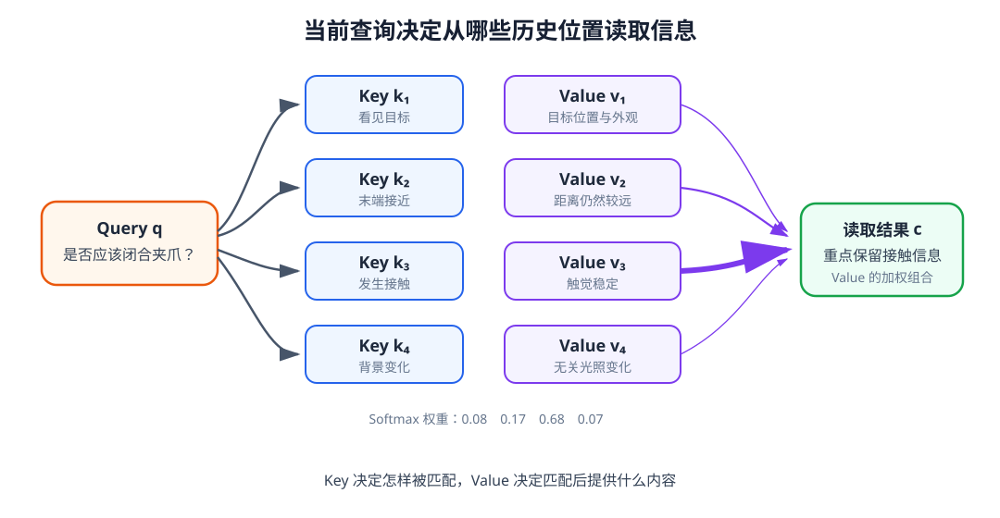

# 09-1 Attention：从当前问题读取历史

第 08 章让机器人沿时间形成隐藏状态。若保留每一步的表示 $H_t=[h_1,\ldots,h_t]$，当前决策就不必只接受最后一个状态压缩后的结果；但模型仍需回答“此刻应该读取历史的哪一部分”。判断杯子是否滑落时，较早的触觉变化可能比远处的背景更有用；寻找放置目标时，同一段历史中的语言目标和目标区域又更相关。Attention 把这个按当前问题读取历史的过程变成可计算的步骤。

## 1. Query、Key 和 Value 是什么

一次读取有三个角色。Query（查询向量）表示当前要从历史寻找什么；每个历史位置的 Key（匹配向量）用于与 Query 比较；该位置的 Value（内容向量）是匹配后实际取回并混合的信息。它们都是数字向量，不是网络直接读到“接触”“目标”几个汉字。

例如，当前的机器人表示 $x_q$ 可以由图像、本体和触觉特征形成。此前第 $i$ 个时刻的表示为 $x_i$。训练得到的投影矩阵分别产生

$$
q=x_qW_Q,\qquad k_i=x_iW_K,\qquad v_i=x_iW_V.
$$

输入 $x_q$ 与监督答案不是一回事。若训练任务是判断抓取是否稳定，答案 $y_t$ 只用于比较模型预测并更新参数；它不会在推理时作为 Query 输入。投影矩阵 $W_Q,W_K,W_V$ 也不是人工编写的“接触匹配规则”：训练开始时它们先被初始化，随后与网络其他参数一起根据任务误差更新。一个历史位置可以用 Key 告诉模型“怎样找到我”，并用另一组数值 Value 表达“找到后我提供什么”。

基础篇介绍过这些输入如何变成数字：图像可变成视觉区域特征，语言先分词再查 embedding，关节和触觉数值先归一化再投影。具体由哪些输入构成一个 token，要到第 10 章设计多模态 Context Model 时才确定；本节先假定数值表示已经准备好。

<figure markdown="span">
  { width="1080" loading=lazy }
  <figcaption>图 09-1　当前 Query 逐一与历史 Key 比较，得到读取权重，再按权重混合对应的 Value。改变当前 Query，即使历史不变，读取结果也会改变。（本教程绘制）</figcaption>
</figure>

## 2. 一次读取怎样算出结果

先用点积得到 Query 与第 $i$ 个 Key 的匹配分数 $s_i=q^\top k_i$。分数较大表示在当前投影空间中更匹配，并不是“这个位置的物理事件一定更重要”。Softmax 把所有可读取位置的分数转成非负且总和为 $1$ 的权重：

$$
\alpha_i=\frac{\exp(s_i)}{\sum_j\exp(s_j)},\qquad
c=\sum_i\alpha_i v_i.
$$

$c$ 是这次读取的结果，也称上下文向量。它不是挑出唯一一个位置，而是按权重混合多个 Value。模型的下一层可以继续处理 $c$；当前权重本身不等于最终动作。

用一个可手算的例子看清每个数字。设历史有“看见目标”“发生接触”“背景变化”三个位置，教学用 Key 分别为 $(1,0)$、$(0,1)$、$(0.2,0.2)$，Value 分别为 $(1,0)$、$(0,1)$、$(0,0)$。现在人工设定查询 $q=(0,2)$，用于演示一个偏向接触信息的读取。取 Key 维度 $d_k=2$，按后面要讲的缩放规则，三个分数为

$$
\left(0,\frac{2}{\sqrt2},\frac{0.4}{\sqrt2}\right)
\approx(0,1.414,0.283).
$$

Softmax 后权重约为 $(0.155,0.639,0.206)$，所以读取结果约为

$$
c=0.155(1,0)+0.639(0,1)+0.206(0,0)
=(0.155,0.639).
$$

可以逐项核对：第二个位置获得最大权重，背景虽然也分到权重，但它在这个例子中的 Value 为零，因而不增加输出。若把 Query 改成 $(2,0)$，在同一组 Key 和 Value 上，第一、第二位置的权重会互换；历史并没有改，改变的是本次要读取什么。这些 Key、Value 和 Query 是特意设置的教学数字，不是一个真实机器人模型训练后的内部向量，也不能把输出第二维 $0.639$ 当作抓取成功率。

## 3. 为什么点积要缩放

当 Key 有 $d_k$ 个分量时，点积把多项相加。维度变大后，分数的典型波动可能随之增大，使 Softmax 很早就把几乎全部权重压到一个位置，其他位置得到极小梯度。缩放点积 Attention 在 Softmax 前除以 $\sqrt{d_k}$，让分数尺度更稳定：

$$
\operatorname{Attention}(Q,K,V)
=\operatorname{softmax}\!\left(\frac{QK^\top}{\sqrt{d_k}}\right)V.
$$

缩放并不要求模型平均读取所有位置，它只是避免分数因为维度增加而过早变得极端。上面三位置算例已经按 $\sqrt2$ 缩放。若多个 Query 同时计算，$QK^\top$ 的每一行对应一个 Query 对所有 Key 的分数，Softmax 沿 Key 位置进行，最后与 $V$ 相乘。这与逐个计算 $\alpha_i$、再求加权和是同一过程的矩阵写法。[Transformer 原论文](https://arxiv.org/abs/1706.03762)给出了这种缩放点积形式。

在真实历史中，还存在“不应被读取”的位置，例如为了凑齐长度而补出的空白帧，以及预测当前动作时尚未发生的未来帧。下一节将在分数变成权重之前明确排除这些位置，并说明 Attention 如何知道时间先后。

[返回 09 导读](09-attention-and-transformer.md) · [继续阅读 09-2 时间位置与 mask](09-2-position-and-masks.md)
