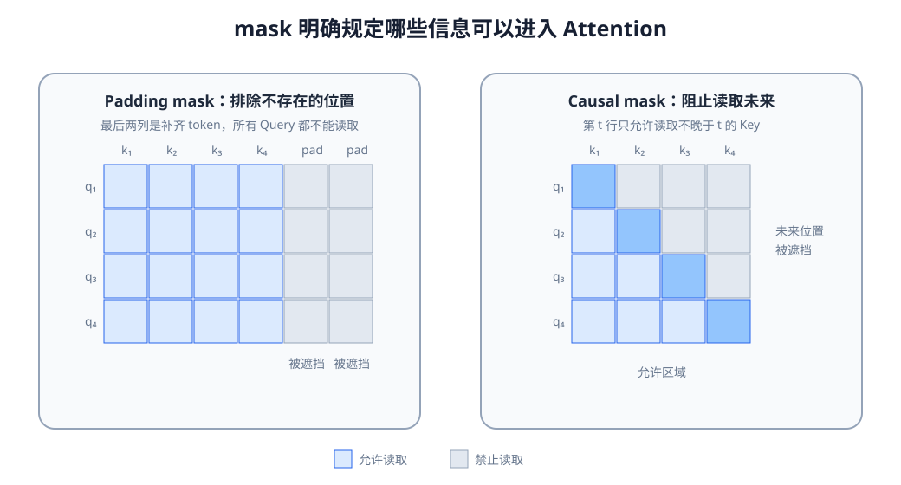

# 09-2 时间位置与 Attention 的读取限制

第 09-1 节让 Query 对历史各位置分配权重，但这还没有说明两个基本问题：哪些位置在当前时刻允许读取，以及这些位置谁先谁后。机器人在训练文件中可以看见完整轨迹；真正运行到时刻 $t$ 时，却只有截至 $t$ 的记录。如果不规定读取范围，模型可能利用未来信息取得很好的训练分数，部署时却无法工作。

## 1. mask 在计算的哪一步起作用

mask（遮罩）把不允许读取的位置从匹配分数中排除。设第 $i$ 个 Query 对第 $j$ 个 Key 的未遮挡分数为 $s_{ij}$。构造同形状的加性遮罩 $M$：允许读取的位置取 $0$，禁止读取的位置取一个足够大的负数，在数学说明中记作 $-\infty$。随后才计算 Softmax：

$$
A=\operatorname{softmax}\!\left(\frac{QK^\top}{\sqrt{d_k}}+M\right),\qquad
C=AV.
$$

$A_{ij}$ 是第 $i$ 个 Query 分给第 $j$ 个 Key/Value 位置的权重。矩阵 $A$ 每一行在允许读取的位置上归一化为 $1$；被禁止的位置权重为 $0$。例如三个位置的分数原本是 $(2,1,3)$，第三个位置虽得分最高，却是补齐数据；遮挡后成为 $(2,1,-\infty)$，权重约为 $(0.731,0.269,0)$。这不是模型“觉得第三个位置不重要”，而是数据契约规定它根本不能参与读取。

实现时还要保证每个有效 Query 至少有一个可读 Key，否则一整行都是禁止值，Softmax 无法得到有意义的分布。补齐出来的 Query 行即使产生数值，也不应参与任务损失或后续有效输出。

## 2. 三种“不能读”来自不同原因

Padding mask（补齐遮罩）处理不存在的时间步。若两条轨迹分别长 5 步和 3 步，为了组成同一批而把第二条补到 5 步，最后两格不是真实观测。对所有有效 Query，都要禁止读取这两格作为 Key/Value；还要避免用补齐 Query 的输出计算监督损失。

Causal mask（因果遮罩）处理“真实存在、但对当前预测来说尚未发生”的时间步。假设训练文件中保存了四帧 $o_0,o_1,o_2,o_3$，并要求模型分别预测每一时刻的动作。用于预测 $a_1$ 的 Query 最多只能读取 $o_0,o_1$，不能因为训练文件已包含 $o_2,o_3$ 就偷看后两帧。四个 Query 的可读范围逐行增加，形成下三角结构。若只在当前时刻 $t$ 用一个 Query 读取已经截好的历史 $o_{0:t}$，输入里本来就没有未来帧，此次读取未必需要再加三角形遮罩；是否需要 causal mask 取决于具体输入组织方式，而不是看见“机器人”就一律加。

模态有效性处理另一种情况：时刻 $t$ 真实存在，本体状态也正常，但相机此时掉帧。它不能简单当成“整个时间步是 padding”。应分别记录视觉、触觉等模态是否可用，避免模型从伪造的全零图像 token 读取信息。第 10 章会进一步设计这些有效位怎样与多模态 token 对应。

<figure markdown="span">
  { width="1040" loading=lazy }
  <figcaption>图 09-2　左图的补齐遮罩排除不存在的列；右图的因果遮罩排除每一行之后的未来列。两种规则可以同时作用，但各自解决的问题不同。（本教程绘制）</figcaption>
</figure>

读图时横向是被读取的 Key 位置，纵向是发起读取的 Query 位置。先看一行对应的预测时刻，再看这一行哪些列被保留。不要把“补齐的最后一列”和“对于早期 Query 来说仍属未来的真实列”混为一类。

## 3. 可读取不等于知道顺序

即使输入顺序正确，单纯的 Self-Attention 计算也没有天然的时间坐标。比较“先接触，再抬起”和“先抬起，再接触”：两段历史各含同样一次接触和一次抬起，区别在事件出现的位置。若没有位置表示，也没有其他带顺序信息的机制，对全部位置做同样的 Self-Attention，再把结果平均成一个向量，就无法可靠地区分这两种排列。

常见做法是给第 $t$ 个 token 加入位置向量

$$
\tilde x_t=x_t+p_t.
$$

$p_t$ 可以由固定规则计算，也可以作为可学习参数。加完以后，两个内容相同但位置不同的事件进入 Attention 时不再完全一样。图像 patch 还需要空间位置，多相机输入需要相机来源；第 10 章会把这些来源标识放进统一 Context。机器人历史的时间步编号则未必等于真实经过的时间：如果相邻两帧有时相隔 10 毫秒、有时相隔 200 毫秒，仅给“第 3、4 帧”两个编号仍不足以表达时间差，还应考虑时间戳或间隔 $\Delta t$。

位置编码与因果遮罩不能互相替代。位置告诉模型“这是第几步”；causal mask 规定“这一步允许读取哪些步”。反过来，因果遮罩本身也会给计算带来一定的顺序结构，所以不能笼统宣称“只要没有位置编码，任何带 Attention 的模型都绝不可能利用顺序”。本教程配套实践的对照条件更严格：两种模型均不使用因果遮罩，最后对位置求平均，唯一改变的是有无位置向量，因而可以观察这项信息是否使事件先后变得可辨。

## 配套实践：查询、缩放与两种遮罩

实践 09-01 先用手工设置的数值 Query、Key、Value 计算读取结果，再比较缩放、补齐遮罩和因果遮罩。它不是训练出的抓取策略。运行后应按权重矩阵的每一行解释：当前 Query 可以看哪些历史位置、哪一列是规则禁止的、各可读列如何重新分配权重。若只看颜色深浅而不确认行列含义，就容易把遮罩图读反。

下一节保持 Query、Key、Value、mask 和位置的基本计算不变，讨论这些向量到底来自同一段序列还是不同来源，以及“多个头”怎样并行读取。

[返回 09 导读](09-attention-and-transformer.md) · [继续阅读 09-3 注意力接口与多头读取](09-3-attention-interfaces.md)
