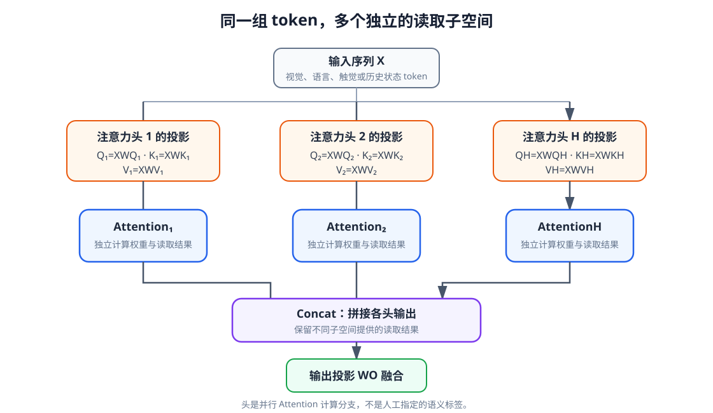

# 09-3 Self-Attention、Cross-Attention 与多头读取

前两节确定了 Attention 的基本运算和可读取范围，但还没有规定 Query、Key、Value 从哪里来。面对机器人历史，有时希望历史各时刻互相交换信息；有时只希望当前任务表示向历史提问。两种用法的差别是输入来源，而不是点积、Softmax 换了一套公式。

## 1. Self-Attention：同一组 token 内部交换信息

Self-Attention（自注意力）让 Query、Key 和 Value 都由同一组输入 $X$ 投影得到：

$$
Q=XW_Q,\qquad K=XW_K,\qquad V=XW_V.
$$

“同一组”不表示三个结果相同；三套矩阵各自可学习。假设输入 $X$ 包含过去十个时间步的表示，每一步都可以发起一个 Query，并在 mask 允许的范围内读取其他时刻。抓取发生后较晚的状态，可能读取早先接触附近的状态；早先的状态也可以在非因果编码任务中读取较晚位置。若要逐时刻预测在线动作，则必须按第 09-2 节的因果规则限制这种读取。

Self-Attention 也可作用于同一张图像的视觉区域，或一段指令的语言 token。名称中的“Self”说的是 Query 与 Key/Value 出自同一输入集合，不表示某个 token 只看自己，更不表示模型已经理解了这些 token 的物理语义。

## 2. Cross-Attention：让一组表示读取另一组表示

Cross-Attention（交叉注意力）把发起查询的输入记为 $X_q$，把提供记忆的输入记为 $X_m$：

$$
Q=X_qW_Q,\qquad K=X_mW_K,\qquad V=X_mW_V.
$$

例如，机器人在当前时刻形成一个“抓取是否稳定”的决策表示，让它读取过去各时刻的触觉与本体表示。这个决策表示经过投影成为 Query，历史经过另外两套投影成为 Key 和 Value。Query 可以只有一个位置，历史却有几十个位置；Cross-Attention 不要求两边长度相同。换成“杯子应该放到哪里”的查询时，同一批历史中的目标语言和视觉位置可能获得不同的读取比例。

这里的“抓取是否稳定”是我们用自然语言说明任务，不是把正确答案文字直接塞给网络。Query 是由当前可用输入形成的向量；用于核对的标签仍只在训练损失中出现。以后第 10 章会用 Cross-Attention 让语言读取视觉区域，或让下游动作模块的查询读取 Context token。

| 结构 | Query 来源 | Key、Value 来源 | 机器人中的一种用途 |
|---|---|---|---|
| Self-Attention | 历史序列自身 | 同一历史序列 | 各时刻表示互相交换信息 |
| Cross-Attention | 当前任务或动作侧表示 | 观测历史 | 根据当前需求读取历史 |

这两种结构可以在同一个模型中前后相接：先用 Self-Attention 更新历史，再用 Cross-Attention 从更新后的历史中读取与当前任务有关的信息。它们也都可以使用多头计算；“Self/Cross”与“单头/多头”描述的是两条不同的结构维度。

## 3. 一个注意力头究竟是什么

一个 head（注意力头）是一条独立的读取分支：它有自己的 Query、Key、Value 投影，计算一张匹配权重表，再输出一组加权 Value。它不是一个额外的机器人传感器，也不是已经具备完整决策能力的小模型。第 09-1 节手算的就是单头、单个 Query 的最小情形。

Multi-Head Attention（多头注意力）对同一批输入并行使用多组投影。仍用上一节的 $X_q$ 表示查询侧输入、$X_m$ 表示被读取的输入，第 $j$ 个头产生

$$
\operatorname{head}_j
=\operatorname{Attention}(X_qW_Q^{(j)},X_mW_K^{(j)},X_mW_V^{(j)}),
$$

再把各头结果拼接，并用输出矩阵 $W_O$ 合成为模型所需维度：

$$
\operatorname{MHA}(X_q,X_m)
=\operatorname{Concat}(\operatorname{head}_1,\ldots,\operatorname{head}_J)W_O.
$$

自注意力时 $X_q=X_m=X$；交叉注意力时两者来自不同输入。这里每个头各做一次投影，不能把第 1 节已经投影好的 $Q,K,V$ 再重复投影。

例如模型表示宽度为 128，使用 4 个头、每头输出 32 个数，那么四头拼接后每个 Query 仍得到 128 个数，再由 $W_O$ 混合这些分支。对一个有 10 个历史位置的 Self-Attention，每个头都有一张 $10\times10$ 的读取权重表；四个头是四张表，不是把十个时间步分成四组后各看一组。

<figure markdown="span">
  { width="1080" loading=lazy }
  <figcaption>图 09-3　每个头对同一输入使用独立投影，分别完成一次 Attention；各头输出拼接后，再通过输出投影合成为一个结果。（本教程绘制）</figcaption>
</figure>

沿图从输入到输出读一遍：输入被复制到多个投影分支；每支先形成自己的 Query、Key、Value，再得到权重和读取结果；最后拼接并投影。一个头可能更常读取接触变化，另一个头可能更常读取目标位置，但这些只是模型训练后可能出现的分工，不能在画图时预先指定，也不能仅凭一张热图证明。多个头甚至可能学到相近的读取方式。

## 4. 把维度和计算代价说清楚

若 Query 长度为 $N_q$、Key/Value 长度为 $N_m$，单个头的权重表在一条样本上有 $N_q\times N_m$ 个位置。Self-Attention 取两边同长 $N$ 时，这部分随 $N^2$ 增长；Cross-Attention 则与两个序列长度的乘积有关。加入多个头可以让模型在不同投影空间中读取，并不使这一长度开销凭空消失。

机器人同时提供多相机图像块、长时间历史和语言 token 时，$N$ 很容易变大。可先做视觉编码或压缩、限制历史窗口，或使用少量查询读取较多输入；这些做法都涉及保留哪些信息的取舍。第 10 章才会把不同模态组织成一个完整 Context，不应在这里把“拼上所有 token”默认为唯一正确方案。

到此为止，我们得到的仍是一次或若干次 Attention 读取。下一节把多头读取、逐位置非线性变换、残差和归一化组成完整 Transformer，并借原论文架构图区分 Encoder 与 Decoder。

[返回 09 导读](09-attention-and-transformer.md) · [继续阅读 09-4 Transformer 架构](09-4-transformer-architecture.md)
