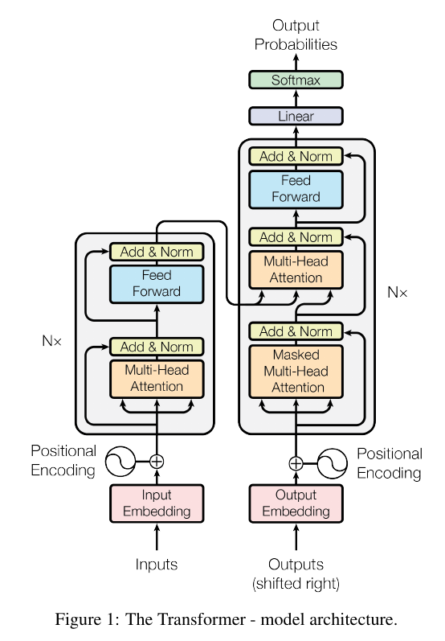
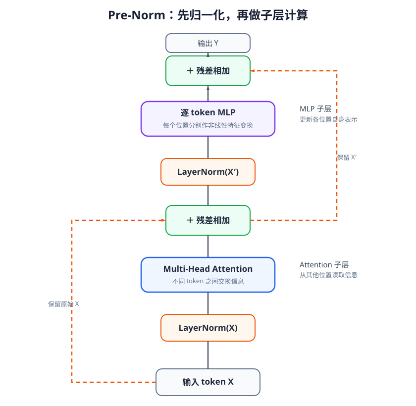

# 09-4 Transformer：从注意力运算到完整网络

前面三节分别解决了怎样计算一次读取、怎样限制可读取位置，以及 Query 与被读取内容怎样连接。Transformer 并不是给 Attention 换一个名字，而是把多头注意力与逐位置的非线性计算反复组合，使每个 token 在多层中更新。本节先读原论文的完整架构，再看单个计算层，最后回到机器人观测历史：究竟应选用哪一部分，输出又交给谁。

## 1. 从原论文架构图辨认数据流

<figure markdown="span">
  { width="640" loading=lazy }
  <figcaption>图 09-4　Transformer 原论文的编码器—解码器架构，转载自 Vaswani 等人（2017）《Attention Is All You Need》图 1；<a href="https://arxiv.org/abs/1706.03762" target="_blank" rel="noopener noreferrer">论文与原图来源</a>。</figcaption>
</figure>

图 09-4 最容易被误读的地方，是把左右两列当作每个 Transformer 都必须具备的结构。它画的是当时用于序列到序列任务的**编码器—解码器**：左列读取输入序列，右列依据左列的结果逐位置生成输出序列。两列上方的 “Nx” 表示相应层重复堆叠；原论文使用六层，不是说模型只能有六层。

先沿左列从下往上看。输入词被转成数字向量（Input Embedding），加入位置编码后进入编码器层。层内的 Multi-Head Attention 让同一输入序列的各位置交换信息；之后的 Feed Forward 是逐位置的前馈网络。每个子层旁边都有 Add & Norm，即把原输入与子层结果相加，再归一化。这样的编码器可以把“输入里有哪些信息、它们彼此怎样关联”整理成一组输出向量。

右列底部的 “Outputs (shifted right)” 是**已经生成的前缀**，在训练原任务时也可以是向右移位的真实目标序列。它不是监督答案被直接作为当前时刻可见的未来输入。右列先做 Masked Multi-Head Attention：第 3 个位置可以读取前 1～3 个目标位置，却不能偷看第 4 个及之后的位置。接着，右列的第二个注意力子层以当前解码器表示为 Query，读取左列编码器输出形成的 Key 和 Value；这就是 09-3 节的交叉注意力。逐位置前馈网络继续更新表示，顶部的 Linear 和 Softmax 把每个位置映射成下一输出 token 的概率。

所以，这张图包含三次不同的读取：编码器内部的自注意力、解码器内部受因果限制的自注意力，以及解码器读取编码器输出的交叉注意力。训练目标决定顶部概率对应的是词、离散动作，还是其他 token；不能仅凭图中的 “Outputs” 就认为它一定预测自然语言。

## 2. 一个 Transformer 层如何更新表示

原论文图把残差相加与归一化画在子层之后，这称为 Post-Norm（后归一化）。本教程后续讨论机器人 Context 时常使用另一种顺序：Pre-Norm（前归一化），即先归一化，再计算子层，最后与原输入相加。下面的图与公式都画 **Pre-Norm**，不要把它们误认成原论文图中的同一顺序。

设一批输入有 $B$ 条序列，每条有 $T$ 个 token，每个 token 用 $d$ 个数表示，则 $X$ 的形状是 $B\times T\times d$。一层中的两次更新是

$$
X'=X+\operatorname{MHA}(\operatorname{LN}(X)),
$$

$$
Y=X'+\operatorname{MLP}(\operatorname{LN}(X')).
$$

这里 LN 是 Layer Normalization（层归一化），使单个 token 的特征尺度更稳定；MHA 是多头注意力，负责让允许相互读取的 token 交换信息。式中的单输入 MHA 表示自注意力：查询侧和被读取侧都取归一化后的 $X$。第一次相加后得到 $X'$。MLP 是逐位置使用同一组参数的小型多层网络，常由“线性层—非线性激活—线性层”组成：它不在不同时间之间传递信息，而是改变**每个位置内部**的特征组合。第二次相加得到 $Y$。两条加法路径称为残差连接，使原有表示可以直接保留下来，让子层主要学习“需要补充或修正什么”。

<figure markdown="span">
  { width="840" loading=lazy }
  <figcaption>图 09-5　前归一化层的两次更新：上方分支计算多头注意力并加回输入 X，另一分支计算逐位置 MLP 并加回中间结果 X′，最后得到 Y。（本教程绘制）</figcaption>
</figure>

对照图 09-5：两条虚线是直接到加法节点的原表示，实线依次经过 LN 和相应子层。假如 $B=2$、$T=4$、$d=128$，输入 $X$ 是 $2\times4\times128$；多头输出合并并投影回 128 维后，$X'$ 仍是 $2\times4\times128$，才能逐元素与 $X$ 相加。MLP 内部可以暂时扩大特征维度，但输出也必须回到 128 维，才能与 $X'$ 相加。堆叠多个这样的层，后一层就能在前一层已整理的表示上继续读取和变换。

Post-Norm 的单个子层顺序则是“子层计算 → 与输入相加 → LayerNorm”；Pre-Norm 是“LayerNorm → 子层计算 → 与输入相加”。二者都使用注意力、MLP 和残差，差异在运算顺序。本教程采用哪一种会明确写出，不能只看图中都有 “Add & Norm” 就断定一致。

## 3. 哪一种 Transformer 适合机器人历史

原论文的左右两列可以按任务需要分别使用，不必整套照搬。**编码器**一般允许已经获得的各个输入位置相互读取，适合把一段完整可见的观测历史整理成 Context token。**因果解码器**用 mask 约束每个位置只能读取之前的位置，适合逐个生成动作 token。**编码器—解码器**则先整理观测，再让动作侧表示通过交叉注意力读取观测；当两边序列长度或含义不同，这种分工尤其直观。

把第 08 章的例子接进来：机器人在抬起杯子前，曾短暂检测到夹爪接触。若现在只有一个“是否继续抬起”的查询，它可以读取**到当前为止**的全部历史，没必要因为用了 Attention 就再对这一个查询套三角形因果 mask；未来观测本来就不在输入中。相反，若一次送入多个时刻的历史，并同时训练“每一时刻下一步该做什么”，那么早期位置不得读取后来才出现的接触信号，需要 09-2 节的因果 mask。是否使用 mask，取决于各个输出位置在真实使用时能看到什么，而不是取决于模块名叫编码器还是解码器。

Transformer 输出也未必是最终动作。一个历史编码器可以输出每个时刻的新表示，再由任务查询读取其中的接触信息；一个自回归动作模型可以在这些表示的条件下逐步输出动作；非自回归动作模型也可以一次处理整段带噪动作。由 Attention 组成的网络本身不强制“必须自回归”，训练目标与读取限制才决定生成方式。第 11、12 章会分别讨论动作生成的不同做法。

## 4. 怎样检查它确实在使用历史

09-1 节的权重 $\alpha_{ij}$ 表示第 $i$ 个 Query 在当前头、当前层分配给第 $j$ 个 Key/Value 位置的读取比例。画出权重表，可检查 padding 位置是否错误地获得权重，也可观察当前查询有没有读取较早的接触位置。解读一张图时至少要指出：它是哪一层、哪一个头、哪一个 Query，横轴位置对应什么时刻，以及 mask 禁止了什么。

但较大的权重并不等于“这个位置导致了最终动作”。Value 的内容、输出投影、残差、MLP 和后续层都会改变结果；多个位置也可能携带相同信息。较可靠的对照是保留其他条件不变，删除或打乱早先接触片段，再观察动作预测是否改变。若模型只在训练集的固定时序中看起来准确，打乱关键事件后仍给出同样动作，就不能据此说它真正利用了接触历史。

多头自注意力还要为长度为 $T$ 的序列计算约为 $T\times T$ 的读取权重。把多个相机的图像块与很长的时间历史直接拼接，会增加显存和决策延迟。因此真实系统常控制图像 token 数、历史窗口和更新频率。第 10 章将具体讨论视觉、语言、本体与触觉怎样成为同一套 Context 的输入，而不是默认所有原始数据都直接进入 Transformer。

## 配套实践：事件顺序为什么需要位置

[实践 09-02：Transformer 怎样识别事件顺序](https://colab.research.google.com/github/qi-robotics/robot-world-model-tutorial/blob/main/colab/intermediate/09/09-02-transformer-history.ipynb)训练一个小模型判断两类机器人事件谁先发生。实验让输入内容保持相近，只改变时间位置的表示，观察模型是否还能区分“先接触再抬起”与“先抬起再接触”。运行前先回顾 09-2 节的位置编码；运行后不要只看一项准确率，还要把有、无位置编码两组结果放在一起，说明模型能否辨认顺序。

## 从 09 章走向多模态 Context

至此，我们知道如何把时间序列变成 token，怎样按需要读取它们，以及 Transformer 层如何反复更新这些表示。但还剩一个接口问题：图像区域、语言词、本体状态和触觉读数形状与频率不同，谁先编码、如何标明来源、怎样对齐时间，最后给动作模块的究竟是一组 token 还是一个汇总向量？[第 10 章：多模态 Context Model](10-multimodal-context-model.md)将接着解决这些问题。

[返回 09 导读](09-attention-and-transformer.md)
