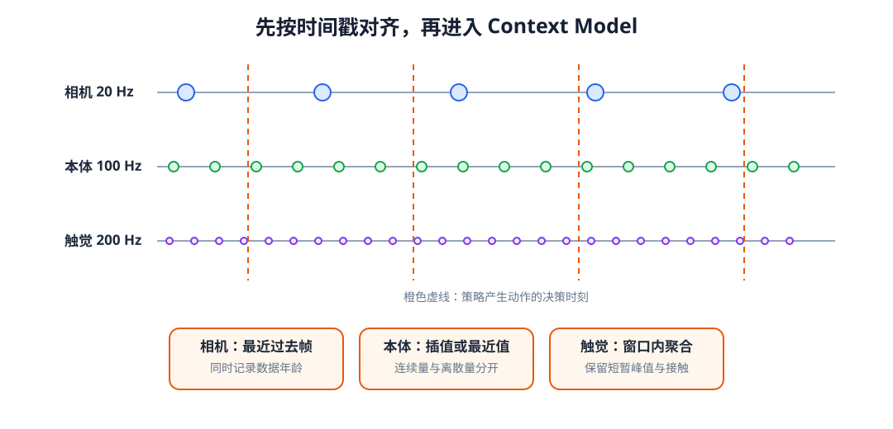
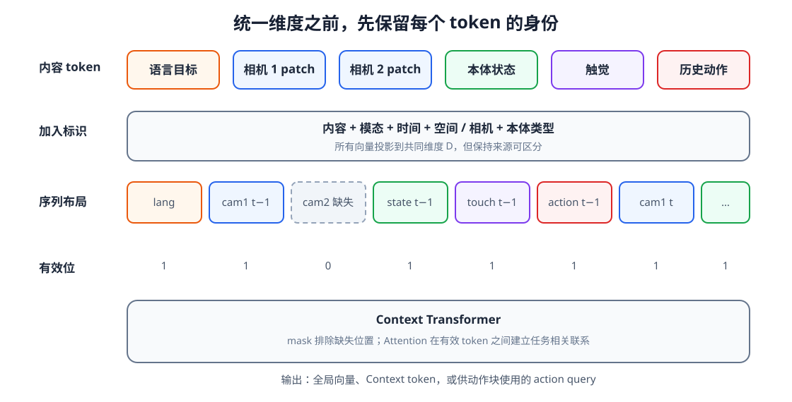

# 10-1 从传感器记录到多模态 token

第 09 章的 Transformer 接收的是已经排好顺序的向量。真实机器人却先得到来自不同设备的记录：相机帧、关节角、触觉、任务指令以及先前执行的动作。它们的采样频率、形状和时间含义均不相同。本节先不讨论用哪种网络融合，而是把“某一时刻实际能用哪些信息”整理成可核对的输入。若这一步错位，后续 Attention 即使计算正确，也只会准确地读取错误的数据。

## 1. 以决策时刻为准对齐观测

设机器人每隔 0.1 秒做一次动作决策，相机约每 0.05 秒给一帧，本体状态每 0.01 秒更新，触觉传感器每 0.005 秒采样。决策时刻为 0.30 秒时，不能把三个数组中“第 3 项”直接拼在一起：这些项的真实发生时间不同。应先保留各设备的原始时间戳，然后规定每种信号如何变成 0.30 秒这一决策的输入。

相机可以取**不晚于 0.30 秒**的最近一帧，并记录这帧距决策时刻有多旧。本体关节角是连续量，可以取最新测量；离线构造样本时，若使用插值，插值所依赖的两端数据都必须在当前决策可用的范围内。触觉中的短暂接触可能在两次决策之间发生又消失，因此可以在刚过去的 0.1 秒窗口中取峰值，同时保留这项统计量覆盖的时间范围。最近值、插值、窗口统计不是等价操作：它们分别保留最新状态、估计连续变化和汇总短时事件。

<figure markdown="span">
  { width="1080" loading=lazy }
  <figcaption>图 10-1　相机、本体和触觉各有自己的采样时间轴；竖线代表策略决策时刻。构造这一时刻的输入，只能从竖线左侧及线上选取测量。（本教程绘制）</figcaption>
</figure>

沿图 10-1 的同一条决策竖线观察三行传感器，便能发现“最近”是相对于真实时间，而不是数组下标。离线处理时尤其要警惕双向最近邻搜索：它可能选中决策之后才到达的相机帧，造成**未来信息泄漏**。同样，记录在 $t$ 之后实际执行的动作 $a_t$，不能作为产生 $a_t$ 的 Context 输入；可用的动作历史是 $a_{<t}$。历史窗口还应保存真实时间间隔，避免把一次 20 毫秒的变化与一次 200 毫秒的变化误当作同一速度。

## 2. 先编码内容，再标明来源

基础篇已分别介绍视觉、语言、本体和触觉的表示。现在可以让各自编码器或线性投影输出同一宽度 $D$ 的向量。例如视觉编码器输出图像区域特征，语言编码器输出词元特征，本体关节数值经归一化和线性层成为状态特征。相同宽度只解决“能否作为同一网络的输入”，不表示这些数值自动拥有相同的物理含义。

给第 $i$ 个 token 的内容向量加上必要的身份标识，可以写成

$$
x_i=z_i^{\mathrm{content}}+
e_i^{\mathrm{modality}}+
e_i^{\mathrm{time}}+
e_i^{\mathrm{source}}+
e_i^{\mathrm{position}}.
$$

$z_i^{\mathrm{content}}$ 来自实际测量或语言内容；其余向量分别表明它属于哪种模态、哪个时间、哪台相机或哪种机器人、图像中的哪个位置。没有某项来源区分时，对应标识可以省略，而不必制造无意义的字段。标识与内容都作为数字向量进入模型，训练时可学习的标识会随任务误差一起更新。

<figure markdown="span">
  { width="1120" loading=lazy }
  <figcaption>图 10-2　同一决策的输入包含语言和多个历史时刻；每个时间位置又有视觉、本体、触觉和过去动作。内容向量之外，还要保留时间、模态、来源与有效性。（本教程绘制）</figcaption>
</figure>

可把图 10-2 想成一张有明确列名的记录表。两个相机即使在同一时刻拍到相近画面，也不能仅凭内容推断“这是左相机还是腕部相机”；相同的关节角数值和上一动作数值也不能因为都是数字而混为一类。模态标识不代替数值归一化：关节角、速度、力与视觉特征仍需按各自训练时约定的尺度处理。

## 3. 有效位说明“数据是否真的存在”

历史轨迹长度不等，组成同一批训练样本时会加入 padding（补齐位置）。这些位置从未发生。相机掉帧则不同：这个时间步存在，本体状态可能正常，只是某台相机没有有效图像。若机器人本来就不装这台相机，又是第三种情况，属于机器人配置的差异。三者都可能使某个槽位不可读取，但原因和后续处理不同。

因此，一个输入条目至少要能记录内容、时间戳、模态、来源、有效位以及缺失原因。进入 Attention 前，无效位置不能成为可读取的 Key/Value；若它也是补齐出来的 Query，其输出不应计入训练损失。简单地把缺失图像置成零而不提供有效位，会让模型把“没有画面”和“真实的黑色画面”混淆。第 09-2 节的 padding mask 解决可读性计算，本节的记录字段则让数据管线知道**为什么**不可读。

## 配套实践：亲自检查一次输入整理

实践 10-01 先画出不同频率的传感器采样点，再组成带时间和来源的 token 布局，最后对照相机掉帧与批量补齐的 mask。运行第一幅图时检查被选样本有没有落在决策竖线右侧；运行最后三幅图时分别指出“可读取”“模态缺失”“批量补齐”各自记录什么，而不只看颜色。

整理出的 token 尚未形成任务相关的 Context。下一节讨论：这些 token 之间应怎样交换信息，是否一定要把它们全部放进一条长序列？

[返回 10 导读](10-multimodal-context-model.md) · [继续阅读 10-2 多模态 Context 的构建](10-2-multimodal-fusion.md)
