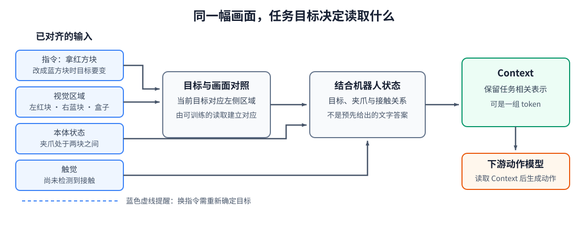

# 10-2 多模态 Context 的构建

第 10-1 节完成了数据准备：在同一次决策中，把语言、图像、本体状态和触觉转换成带时间、来源与有效位的 token。但“放进同一条序列”并不等于机器人已经知道该做什么。本节只追踪一次决策：指令怎样与画面中的物体对应，物体信息怎样与机器人自身状态结合，最终又以什么形式交给动作模型。

## 1. 先确定这一次决策需要哪些信息

桌面左侧有红色方块，右侧有蓝色方块，盒子在后方；夹爪位于两者之间，触觉尚未检测到接触。当前指令是“把红色方块放进盒子”。如果下一步要向目标靠近，机器人至少需要确定三个关系：**指令指的是左侧红色方块**，**夹爪相对于它在哪里**，以及**目前还没有抓住它**。蓝色方块虽也在图像中，却不是这次抓取的目标；盒子暂时不是靠近阶段的直接移动目标，但以后放置仍需要它的位置。

这些话是我们用来说明任务的，并非要求网络内部输出“红色方块在左侧”这样的文字。输入模型的是第 10-1 节得到的数字向量。若把指令改成“把蓝色方块放进盒子”，画面和身体状态都不变，下一步应靠近的目标却要变为右侧。一个有用的 Context 必须能反映这种**目标改变、观测不变**的差异。

## 2. 目标怎样与视觉区域建立联系

基础篇已经把指令转为语言 token、把画面转为视觉区域 token。用第 09-3 节的 Cross-Attention 举一种具体做法：表示当前目标的语言向量经过可训练投影形成 Query，视觉区域分别形成 Key 和 Value；Query 与各 Key 计算匹配权重，再从对应 Value 中读取视觉信息。若网络在任务训练中学会把“红色方块”对应到画面左侧，那么与左侧方块有关的视觉内容便能更多地进入目标相关表示。

这里的匹配不是预先写死的颜色规则。训练初期，Query、Key 的投影矩阵还未学好，权重可能没有明确目标；任务误差会更新这些矩阵。即使某个位置获得较大权重，也不能仅凭一次权重图断言模型已“认出红色方块”，还要在 10-3 节通过更换指令检验输出是否随之改变。

目标定位也不是动作决策的全部。模型还要让目标相关视觉信息与夹爪位置、本体状态和触觉互相作用。例如视觉表示指出目标在夹爪左侧，本体表示指出夹爪当前姿态，触觉表示尚未接触；融合后的表示应足以让下游模型区分“还需靠近”与“已经抓稳可以抬起”。这可以由单流 Self-Attention 在多层中完成，也可以先分组编码、再通过 Cross-Attention 定向读取。**计算顺序可以不同，必须保留的任务关系相同。**

<figure markdown="span">
  { width="1120" loading=lazy }
  <figcaption>图 10-3　红色目标指令与视觉区域对应，再结合夹爪状态和触觉形成 Context；动作模型读取 Context 后才产生动作。虚线蓝色目标表示换一条指令时需要重新确定目标。（本教程绘制）</figcaption>
</figure>

图 10-3 要从左往右读。第一列是 10-1 节已整理好的输入；中间两步分别解决“找哪个物体”和“机器人与它处于什么关系”；右侧先得到 Context，再由**另一个模块**生成动作。图中“红色目标”等文字只是图解，计算中对应的是向量及其相互读取，不是把人工写出的正确关系直接送进模型。

## 3. 融合结果应该怎样保留下来

完成上述信息交换后，模型并不一定只输出一个向量。如果下游只需判断“这次抓取是否成功”，把有效信息汇总为一个全局 Context 向量即可。若下一步动作还要分别读取目标区域、夹爪附近区域、接触线索和盒子位置，把这些内容过早压成一个数字集合可能丢失可再次定位的细节。此时更合适的是保留一组 Context token。

用形状区分两种接口。一次处理 $B$ 个样本、每个向量宽度为 $D$ 时，全局向量可记为 $c_t\in\mathbb R^{B\times D}$；若保留 $N_c$ 个位置，则是 $C_t\in\mathbb R^{B\times N_c\times D}$。这里 $N_c$ 只表示交给下游的 token 数量，不一定等于原始图像块数：融合网络可以更新、筛选或压缩输入。一个系统也可以同时提供全局向量和 token 序列。

对于“靠近红方块，再抓起放入盒中”的动作任务，本章先采用**保留 Context token** 的接口。动作模型可以在靠近阶段读取目标与夹爪的关系，在抬起阶段读取接触信息，在放置阶段读取盒子位置。本章不规定动作模型内部如何安排动作查询，也不把未来示范动作放入 Context；动作怎样逐步或整块生成，是第 11 章及后续章节的问题。此处只需保证它拿到的是**当前可用、与目标有关的条件**，而不是已经算好的动作命令。

## 4. 同一构建目标可以有不同网络布局

讲清上面的主路线后，再比较实现上的选择才有意义：

| 布局 | 信息如何交换 | 在方块任务中要特别检查什么 |
|---|---|---|
| 单流 Self-Attention | 语言、视觉、状态和触觉 token 一起更新 | 多相机与长历史使 token 数增加时，计算是否来得及 |
| 分组后 Cross-Attention | 先分别编码，再让目标或状态表示读取其他组 | 读取到的目标视觉信息是否真的传到动作侧 |
| 少量中间 token 汇总 | 用较少的内部查询读取大量输入 | 压缩后是否仍保留方块、夹爪和盒子的相对位置 |

三者不是三个要先后执行的步骤，而是完成同一任务的不同结构选择。第 09 章已解释 Self-Attention 与 Cross-Attention 的运算；这里选择布局时要从任务证据和计算预算出发，而非按名称判断优劣。不论选择哪一种，最后都应能回答：目标改变时 Context 是否改变，接触发生时 Context 是否保留这项变化，动作模型能否读取它需要的部分。

现在我们有了清楚的输入、计算过程和输出接口，却仍不能凭图 10-3 断言模型真的学到了这些对应关系。下一节用训练样本和输入对照，把“形成了有用 Context”变成可检查的说法。

[返回 10 导读](10-multimodal-context-model.md) · [继续阅读 10-3 Context Model 的训练与验证](10-3-context-training-and-validation.md)
