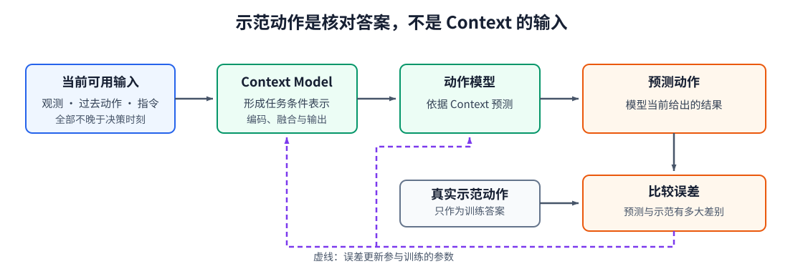
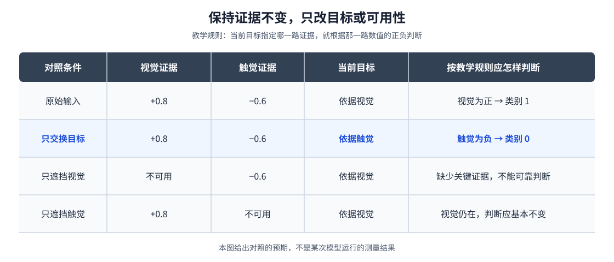

# 10-3 Context Model 的训练与验证

第 10-2 节描述了一条希望模型学会的数据流：指令确定目标，目标与画面对应，再与夹爪和触觉形成 Context。但图中的“红方块对应左侧区域”是教学解释，不是训练时逐项写给模型的正确答案。怎样让投影、Attention 和融合层逐渐产生有用的表示？又怎样排除模型只是记住“通常往左走”？本节用训练样本和改变输入的对照来回答。

## 1. 训练样本的输入与答案必须分开

仍看桌面的两个方块。一次真实示范可以记录：决策时刻以前的图像、本体和触觉，指令“拿红方块”，以及示范者随后执行的动作。把前三类观测与指令交给 Context Model，得到 $C_t$；动作模型读取 $C_t$ 后预测下一步动作 $\hat a_t$。最后才拿预测与记录中的动作 $a_t$ 比较，计算训练误差：

$$
C_t=F_\psi(o_{\le t},a_{<t},g),\qquad
\hat a_t=G_\theta(C_t),\qquad
\mathcal L=\ell(\hat a_t,a_t).
$$

$F_\psi$ 是 Context Model，$G_\theta$ 是动作模型；$o_{\le t}$ 表示当前及以前可用的观测，$a_{<t}$ 是过去已执行动作，$g$ 是目标指令。示范动作 $a_t$ 只在右侧作为核对预测的答案，不能提前混入 $C_t$。误差经反向传播更新可训练参数时，Context Model 才逐渐有机会学会哪些视觉位置和身体信号对动作有用。这个训练方式也不保证它一定按我们期望的方式利用信息，所以后面还需对照检查。

<figure markdown="span">
  { width="1120" loading=lazy }
  <figcaption>图 10-4　左侧可用观测和目标先形成 Context，动作模型据此预测；示范动作只在比较误差时出现。实线表示一次前向计算，虚线表示误差更新可训练模块。（本教程绘制）</figcaption>
</figure>

图 10-4 中的两条进入误差框的线含义不同：上面一条是模型预测，下面一条是真实示范。若把下面一条接到 Context 输入，训练时模型就能偷看答案，而真正执行时却拿不到。开始训练前，先检查每条轨迹中观测、指令和实际执行动作的时间戳是否对应；这是第 10-1 节时间对齐在训练环节的延续。

视觉和语言编码器不一定都要从头更新。数据较少时，可先固定预训练编码器，只训练它们之后的维度投影、融合层和动作模型；数据与计算允许时，再考虑微调编码器。这里的维度投影是把不同模态特征转换成统一宽度，**不是** Attention 内部的 Query、Key、Value 投影。无论采用哪种更新范围，都应记录哪些参数真正参加训练，而不能把“接入了编码器”等同于“编码器学会了机器人任务”。

## 2. 用简化任务看清“按目标读取信息”

真实示范的下一步动作可能有多种合理选法，不便在这一节单靠一个标签判断 Context 是否找对目标。配套实践 10-02 因而构造一个**教学用判断任务**：每条样本给一个视觉证据值、一个触觉证据值，以及目标“依据视觉判断”或“依据触觉判断”。目标决定哪个证据才是答案的来源。例如视觉值为 $+0.8$、触觉值为 $-0.6$；约定正值对应类别 1、负值对应类别 0 时，视觉目标的正确答案是 1，触觉目标的正确答案是 0。两路测量都没有变，变的只有目标。

这时模型仍先把目标、视觉、触觉转成 token，融合成 Context，再由一个分类输出层给出两个类别的预测。训练时与正确类别计算交叉熵，并更新可训练参数。它学的是“根据目标选用哪一路证据”的机制，**不是**已经学会识别真实红方块、估计真实接触或驱动机械臂。上节的机器人例子说明为什么需要这项机制；这个小实验则让我们能在清楚的正确答案下核对它。

## 3. 固定观测，只改变一项输入

训练损失下降、完整输入上的测试准确率上升，只说明模型在这些样本上答对得更多；还不知道它究竟依赖目标、视觉还是触觉。保持其他输入与模型参数不变，每次只改变一项，才能让不同解释产生可观察的差别。

<figure markdown="span">
  { width="1120" loading=lazy }
  <figcaption>图 10-5　固定视觉证据为正、触觉证据为负：交换目标时正确类别应从 1 变为 0；遮挡某一模态时，是否仍能判断取决于当前目标是否需要它。这是检查方法的示意，不是某次实验的测量结果。（本教程绘制）</figcaption>
</figure>

先看图 10-5 上方两行：视觉和触觉数值相同，目标由视觉换为触觉，正确答案随之改变。若模型仍给相同回答，就说明它至少在这一对照中没有充分使用目标。再看下方的遮挡：视觉目标下去掉触觉，关键证据仍在；去掉视觉，则缺少决定答案的那一路证据，不应要求模型继续保持同样可靠。反过来，触觉目标下的判断应更多受触觉遮挡影响。这里比较的是**条件是否改变模型行为**，而不是要求每个模态在每种目标下都同样重要。

实践 10-02 的“交换目标”图仍与**原始目标的标签**比较。因此，如果模型真的改按新目标回答，而两路证据恰好相反，该图上的准确率会下降；它不是“模型换目标后突然不会做题”。读实验结果必须先说明保留了哪个答案作为对照，再解释每根柱子的含义。

## 4. 将同一种检查带回机器人任务

教学任务能清楚核对“目标是否决定证据来源”，但不能代替机器人执行评测。回到红、蓝方块的场景，可以保持桌面画面不变，只交换“拿红方块”和“拿蓝方块”的指令，检查下游动作是否转向另一侧；保持指令与物体位置不变，只改变触觉接触状态，检查“继续靠近”与“开始抬起”的判断是否相应变化。若要检验历史是否被使用，可在保留单帧内容的前提下打乱“先接触、后抬起”的顺序。每次都应写明**只改变了哪一项**、期望哪部分输出改变，以及哪些部分不应改变。

这些干预还不能单独证明动作一定安全或任务一定成功：模型输出可能随目标变化，却仍指向错误位置。因此最终仍要结合真实或模拟闭环任务，观察是否能完成抓取与放置。Context 的验证到此有了清楚边界：它检查模型有没有利用正确条件；下一单元再检查利用这些条件生成的动作是否可执行、是否完成任务。

第 11 章由此接上：**条件信息已经准备好，示范中的动作该如何表示，模型又应该一次预测一步还是一段？** [继续阅读第 11 章](11-demonstrations-to-action-sequences.md)。

[返回 10 导读](10-multimodal-context-model.md)
