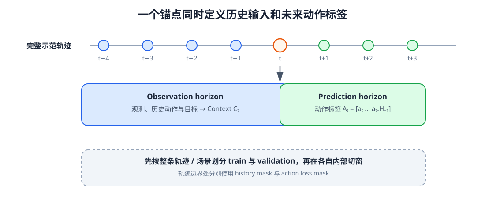

# 11-1 示范轨迹与动作标签

第 10 章已经能在决策时刻 $t$ 形成 Context：它只使用当时可见的画面、身体状态、触觉、过去动作和目标指令。要训练 Action Model，还缺另一半——这一时刻的**正确动作标签**。一段示范录像不能直接当标签；必须确认示范者实际发出了什么命令、命令从何时开始生效，以及它使用哪个坐标系和控制频率。本节先把这些约定写清，再从轨迹切出训练样本。

## 1. 一条记录中的观测与动作如何相邻

把一次完整示范记为

$$
\tau=(o_0,a_0,o_1,a_1,\ldots,a_{T-1},o_T).
$$

$o_t$ 是时刻 $t$ 可用的观测，$a_t$ 是从该时刻开始发送、随后影响环境的动作。因此，训练模型预测 $a_t$ 时，输入可含 $o_t$ 与更早记录，却不能含执行 $a_t$ 后才得到的 $o_{t+1}$。第 10 章的 Context Model 可以写成 $C_t=F(o_{\le t},a_{<t},g)$；这里的 $g$ 是任务目标，$a_{<t}$ 是已执行的过去动作。示范者在相同条件下做出的 $a_t$ 才是本次预测要核对的标签。

以“把红方块放进盒子”为例，假设一帧画面显示夹爪仍距方块两厘米、触觉尚未接触。对应的动作可能是向方块靠近；下一帧若已经接触，示范者才闭合夹爪。若把“闭合夹爪”错配到前一帧，模型会学到过早夹取。时间戳不齐不是一个小的格式错误，而是改变了训练问题本身。

## 2. 先定义动作数值的物理含义

即使两条动作记录都是七个数，也可能代表完全不同的命令：六个关节的目标角度加一个夹爪开度，或末端在空间中的位姿增量加一个夹爪命令。关节位置、关节速度、末端位姿和力矩各有不同的执行器接口；“绝对目标”与“相对变化”也不能互换。

例如当前关节角为 $0.40$ rad，希望下一控制时刻达到 $0.42$ rad。若使用绝对位置目标，标签是 $0.42$ rad；若使用位置增量，标签是 $+0.02$ rad。把 $0.02$ 当绝对角度执行，会把关节送往完全不同的位置。因而每份示范至少要写明控制空间、单位、坐标系、更新频率、绝对或增量语义、各维边界，以及夹爪通道是连续宽度还是离散开合。第 06～07 章对本体状态和动作的区分，在这里变成训练数据必须遵守的约定。

不同动作维度还可能相差几个数量级。训练前可用训练集统计量按维归一化，例如

$$
\tilde a_{t,j}=\frac{a_{t,j}-\mu_j}{\sigma_j+\epsilon}.
$$

$j$ 指某个关节、位移或夹爪维度，$\mu_j,\sigma_j$ 只从训练数据计算；验证和实际使用都沿用同一组数值。模型输出后还原到物理单位，再做位置、速度和碰撞等约束检查。归一化只是改变学习时的数值尺度，**不是**安全保证。

## 3. 以当前时刻切出“输入—未来标签”

若希望模型一次预测 $H_p$ 步，固定时刻 $t$ 后的标签就是

$$
A_t=[a_t,a_{t+1},\ldots,a_{t+H_p-1}].
$$

同时，可让 Context 只读取最近 $H_o$ 个观测位置，记为观察长度 $H_o$。例如 $H_o=4$、$H_p=3$、锚点 $t=5$：输入侧使用 $o_2,o_3,o_4,o_5$ 和对齐的过去动作，标签侧使用 $a_5,a_6,a_7$。输入与标签相邻，但不能把右侧未来动作或它们造成的观测提前放进输入。相邻锚点可以产生彼此重叠的样本；这是让模型从不同当前时刻学习后续动作，而不是采样错误。

<figure markdown="span">
  { width="1100" loading=lazy }
  <figcaption>图 11-1　以当前时刻为界，左侧的历史观测形成 Context，右侧的未来动作形成训练标签；绿色动作不能反向进入蓝色输入。（本教程绘制）</figcaption>
</figure>

读图 11-1 时，先找锚点，再分别向左数观察位置、向右数动作标签。轨迹开头若历史不足，可以补齐并给出有效位；轨迹末尾若未来不足，可以丢弃样本或只对真实存在的动作位置计算损失，不能把补出来的零动作当成示范。

**数据划分要早于切窗。** 假如先从一条轨迹切出许多相邻窗口，再随机分到训练集和验证集，两边将包含几乎相同的运动片段，测试分数会虚高。应先按完整轨迹、场景或物体划分，再分别切窗。至此，我们得到了每条训练样本的 Context 输入和物理含义明确的未来动作标签；下一节才让网络学习由前者预测后者。

[返回 11 导读](11-demonstrations-to-action-sequences.md) · [继续阅读 11-2 行为克隆与动作块预测](11-2-behavior-cloning.md)
