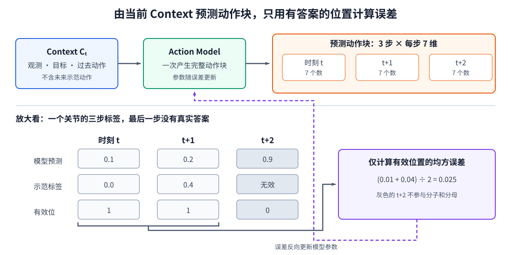

# 11-2 行为克隆与动作块预测

第 11-1 节把示范整理为一对数据：当前可用的 Context $C_t$，以及示范者从当前开始执行的未来动作 $A_t$。本节沿用第 02 章“预测—计算误差—更新参数”的流程，训练第一个 Action Model。先让它给出一个确定的动作块；这种方法足以学会基本映射，也会在本章末尾暴露重要局限。

## 1. 从 Context 预测一段动作

Action Model 可以记为

$$
\hat A_t=f_\theta(C_t),\qquad
\hat A_t\in\mathbb R^{B\times H_p\times D_a}.
$$

$B$ 是一次输入的样本数，$H_p$ 是每条预测包含多少个未来控制时刻，$D_a$ 是每步动作有多少个数。若预测三步、每步是六个关节目标加一个夹爪量，模型需给每条样本输出 $3\times7=21$ 个数，再按“三步、每步七维”排列。第 11-1 节规定这些数代表什么物理命令；仅仅输出形状正确，还不等于控制语义正确。

如果 Context Model 给出一个全局向量，最小的动作头可以用 MLP 一次输出这 21 个数。如果给出的是一组 Context token，动作模型可以为三个未来位置准备三个可学习的**动作查询位置**：它们各自带有“我是动作块第几步”的位置信息，读取 Context，再通过输出层得到该步七个动作数值。这些查询是动作模型内部学到的向量，不是摄像头观测，也不是把未来示范动作偷偷作为输入。两种动作头在本节都完成同一任务：根据当前可用条件，**一次预测完整动作块**；无需在这里引入特定模型名称或潜变量。

<figure markdown="span">
  { width="1140" loading=lazy }
  <figcaption>图 11-2　上半部分从当前 Context 一次得到三步、每步七维的动作预测；下半部分只取其中一个关节展示三步的预测与标签，灰色无效位置不参与误差。实线是预测与核对，紫色虚线是误差对模型参数的更新。（本教程绘制）</figcaption>
</figure>

沿图 11-2 的上半部分从左向右读：Context 只包含当前可用的条件，动作模型输出按未来时刻排列的一整块预测。图中的三个小框分别是三个时间位置，不是三个独立模型；同一模型的参数共同产生这三步。下半部分只取其中一个关节来说明损失怎样计算，不能把示范标签误读成上方模型的输入。

预测长度 $H_p=1$ 时退化为单步策略。增大 $H_p$ 能让模型同时考虑“接近、闭合、抬起”等相邻动作之间的关系，却不表示机器人必须把整段预测一次执行完。预测与执行的时间范围会在 11-3 节分开。

## 2. 用示范动作计算训练误差

行为克隆就是把示范动作作为监督答案。对于连续数值动作，一种简单选择是逐位置平方误差。轨迹末尾可能没有完整的未来动作块，某些动作维度也可能无效，因此只在真实存在的位置计算：

$$
\mathcal L_{\mathrm{BC}}
=\frac{\sum_{b,h,j}m_{b,h,j}\bigl(\hat a_{b,h,j}-a_{b,h,j}\bigr)^2}
{\sum_{b,h,j}m_{b,h,j}}.
$$

$b$ 是批次中的样本，$h$ 是动作块内第几步，$j$ 是某个动作维度；有效位 $m_{b,h,j}$ 在有真实标签时为 1，在补齐或不可用时为 0。分子只加总有答案的位置，分母就是本批实际参与比较的动作数。这样，批次大小或补齐比例改变时，损失仍表示“平均每个有效动作分量错多少”，而不是主要反映这一批有多少数字。

举一个极小的核对例子：一个关节的三步示范依次为 0.0、0.4、无效，模型预测为 0.1、0.2、0.9。第三步没有真实答案，不能因为预测了 0.9 就罚它；前两步的平方误差分别是 0.01 和 0.04，平均为 0.025。若误把无效位置填零并算进损失，不仅数值变大，还会教模型在轨迹结束后“应该输出零”，这不是示范者做过的事。

这正对应图 11-2 的下半部分：有效位为 1 的前两列进入误差框；灰色第三列虽然有模型输出，却没有可核对的示范值，有效位为 0，因此不进入分子，也不增加分母。只有比较出误差以后，虚线所示的参数更新才发生。

每批训练依次取 $C_t$、得到 $\hat A_t$、计算有效动作上的损失，再用梯度更新动作模型参数；若 Context Model 被允许共同训练，误差也可沿它的输出回传。这里的监督答案只在计算损失时出现，实际使用时模型只能依靠观测、目标和自己的参数。除了平方误差，也可根据动作语义选用绝对误差或其他回归损失；不同量纲的动作应结合归一化与控制意义设计权重。

## 3. 怎样判断第一个模型是否学会了基本映射

先用**未参与训练的完整轨迹**测试，而不是从训练轨迹切出的相邻窗口。报告归一化误差之余，把预测还原到第 11-1 节定义的物理单位，检查关节目标、夹爪指令和连续动作是否大致合理。对于“靠近红方块”的片段，模型给出朝目标移动的动作，比单看一个平均损失数字更能说明它学到了什么。

但这个检查仍属于离线比较：模型输入的是示范轨迹中实际出现过的状态。真正执行时，任何一次动作偏差都会改变后续观测，模型可能来到示范没有覆盖的位置。第 11-3 节将说明动作块怎样在执行中重新读取观测、减少整段开环的风险；第 11-4 节再讨论另一个问题——即使离线平方误差很低，面对两条都正确的示范路线，一个确定输出也可能落在两条路线之间。

[返回 11 导读](11-demonstrations-to-action-sequences.md) · [继续阅读 11-3 动作块的执行与反馈](11-3-action-chunk-execution.md)
