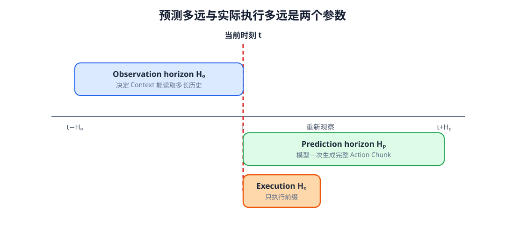

# 11-3 动作块的执行与反馈

11-2 节的模型一次输出一段未来动作，但“预测了八步”与“接下来一定执行八步”是两回事。执行期间物体可能移动、夹爪可能打滑，模型在时刻 $t$ 看见的 Context 会逐渐变旧。本节把动作块接到真实时间轴上：先区分观察、预测与执行三段长度，再说明何时重新观察，以及不同预测块在边界处怎样衔接。

## 1. 三个时间范围分别控制什么

观察长度 $H_o$ 指形成当前 Context 时回看多少个观测位置；预测长度 $H_p$ 指 Action Model 输出多少步未来动作；执行长度 $H_e$ 指机器人在读取新观测前实际采用多少步。取一个例子：$H_o=4$、$H_p=8$、$H_e=2$。时刻 $t$ 的模型读取最近四步历史，预测 $a_t$ 到 $a_{t+7}$，但执行器只使用前两步。到了 $t+2$，机器人读取新的画面和身体状态，再预测从 $a_{t+2}$ 开始的新动作块。前一块尚未执行的六步只是当时的计划，不是已经发生的动作。

<figure markdown="span">
  { width="1080" loading=lazy }
  <figcaption>图 11-3　观察范围位于决策时刻之前，预测范围覆盖随后的一段动作，执行范围只取预测块的前缀；执行结束后再由新观测生成下一块。（本教程绘制）</figcaption>
</figure>

读图 11-3 时要分别看三件事：蓝色历史是模型能看到的，未来预测是模型提出的，执行部分才会真的改变环境。三者不必等长。若 $H_e=H_p$，整块动作执行完才再看环境，开环时间较长；若 $H_e=1$，每走一步都能重新观察，但大模型可能来不及高频运行。执行长度是在反应速度、预测连贯性和计算延迟之间作出的选择。

## 2. 只执行前缀为什么能够纠错

假设机器人根据当前画面规划八步向红方块靠近，执行前两步后方块被人轻推，位置发生变化。若继续执行旧块的后六步，它仍会朝旧位置走；若此时重新观察并生成新块，后续动作就能以新位置为起点修正。这种“规划一段、只执行一段前缀、再观察并重算”的方式称为**滚动执行**（receding horizon）。这里的重新计算仍由 Action Model 完成，并不意味着已经使用世界模型预测候选动作的后果。

重新观察也不能神奇地消除所有风险。视觉帧可能有延迟，模型可能在新状态上同样预测错误；已经执行的前两步无法撤回。因而仍要记录每次决策读到的观测时间、动作块的起始时刻，以及底层控制器实际完成了哪些命令。第 13 章会在完整控制循环中继续讨论动作块到达延迟和缓冲衔接。

## 3. 同一时刻收到多份预测时怎么办

若模型频繁产生长度为八步的块，时刻 $s$ 的动作可能同时出现在几份预测中：时刻 $s-2$ 生成块时把它当作“未来第 3 步”，时刻 $s-1$ 生成块时当作“未来第 2 步”，时刻 $s$ 又给出新的“第 1 步”。它们都指向**同一个绝对执行时刻 $s$**，而不是同一块内相同序号。最简单的规则是只取最新预测；另一种做法是把这些值按新旧加权平均，称为 temporal ensemble（时间集成）。

若记 $\hat a_{s\mid t}$ 为在决策时刻 $t$ 对执行时刻 $s$ 的预测，可写成

$$
\bar a_s=
\frac{\sum_{t\le s}w_{s-t}\hat a_{s\mid t}}
{\sum_{t\le s}w_{s-t}}.
$$

例如两份预测对同一关节在时刻 $s$ 给出 $0.04$ rad 和 $0.06$ rad，若较新预测权重是较旧的两倍，融合结果便是 $(0.04+2\times0.06)/3\approx0.053$ rad。先确认它们都是**同一关节、同一时刻、同一种绝对位置命令**，才能平均；绝对位置和相对位移即使数值相近，也不能直接混在一起。

时间集成能缓和相邻动作块输出不一致造成的抖动，但旧预测也会让新障碍或滑移后的转向变慢。它与“执行两步后重新观察”不是一回事：滚动执行决定何时生成新块，时间集成决定有多份覆盖预测时怎样形成当前命令。突发事件要求迅速修正时，应限制旧块的影响，不能把“更平滑”当作唯一目标。

## 配套实践：沿时间轴核对动作块

实践 11-01 先从一维关节位置轨迹切出观察窗口和未来动作标签；再画出同一执行时刻的多份预测如何融合；最后在执行途中加入扰动，对比整块开环和每隔几步重新观察的结果。第一幅图核对未来信息没有进入输入；第二幅图核对“重叠”的是**绝对执行时刻**；最后一幅图则看扰动发生后，哪一种方法在下一次观测时调整了后续动作。这些是教学用的一维曲线，不是机械臂安全控制器。

滚动执行解决的是“预测后环境变了，什么时候再看”的问题。下一节讨论另一个独立问题：即使当前观测完全正确，同一情境下的示范本来就可能有多条合理动作，单个确定输出该怎样面对它们？

[返回 11 导读](11-demonstrations-to-action-sequences.md) · [继续阅读 11-4 多种合理动作](11-4-multimodal-actions.md)
