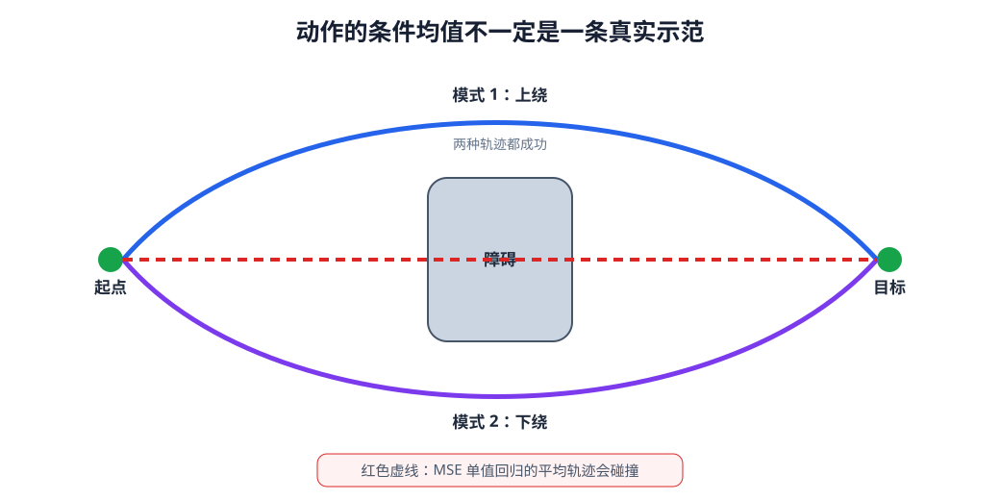

# 11-4 多种合理动作与单值预测的局限

前两节的行为克隆模型给每个 Context 输出一段确定动作，并通过执行前缀、重新观察减少开环误差。但即使观测没有延迟、动作也尚未执行，训练答案仍可能不止一条：同一个起点和目标，示范者可以从障碍上方或下方绕过。此时困难不在“何时重新观察”，而在模型如何表示**同一条件下的多个合理未来**。

## 1. 两条成功示范为何会产生一个失败均值

沿用把方块送向盒子的任务，在夹爪与盒子之间放一个障碍。假定上绕与下绕都安全，起点、终点、当前画面与指令却相同。简化成二维路径，在越过障碍的中间位置，上绕示范的纵坐标约为 $+0.75$，下绕约为 $-0.75$；障碍恰好占据纵坐标接近 0 的区域。若数据里两种示范各占一半，一个只输出一条路径的模型用逐点平方误差学习时，会被两侧标签同时拉扯，中间位置倾向预测为

$$
\frac{(+0.75)+(-0.75)}{2}=0.
$$

这个数比只选上绕或下绕更接近两组示范的**平均数值**，却可能把机器人送进障碍。对于均方误差，若同一输入下的动作有多种取值，理想的单值预测趋向它们的条件均值 $\mathbb E[A\mid C]$。问题不是计算出错，而是“只能给一个答案”加上“逐点逼近所有示范”共同决定了这个结果。

<figure markdown="span">
  { width="1040" loading=lazy }
  <figcaption>图 11-4　上下两条示范都绕过中央障碍；单值平方误差模型可能预测两者之间的平均轨迹，而平均轨迹反而穿过障碍。（本教程绘制）</figcaption>
</figure>

读图 11-4 时应先验证两条示范各自满足任务，再看中间线是否真的可执行。不能因为它在数值上距两条示范都“不太远”，就说它是一条折中的成功路线。动作空间中的平均与任务结果中的平均不是同一回事。

## 2. 先区分“条件不足”和“本来就有多种选择”

上绕或下绕也可能由当前 Context 中尚未利用的线索决定。例如上方放了新障碍，或语言指令明确要求从下方经过；这时应先改进观测、目标编码与第 10 章的 Context，让不同条件对应不同路线。若输入中已经包含所有相关障碍与目标信息，上下两条依然都成功，那么问题才是**一个 Context 对应多个合理动作**，需要模型表示分布，而不是强迫它只给均值。

这一区别对实验设计很重要。把不同画面误当成同一条件，发现均值穿障后就立刻换用复杂生成模型，可能掩盖了数据对齐或 Context 丢失位置的问题。相反，即使 Context 已足够清楚，确定性模型仍可能在对称抓取姿态、左右绕行等任务中遇到真正的多解。

## 3. 从预测一个数转向保留多个模式

一个容易看懂的改法是让模型描述两个动作模式。它可以分别给上绕与下绕一条代表轨迹，并给出各自的权重，而不是先把两条轨迹平均成一条。若用混合分布表示，可概括为

$$
p_\theta(A\mid C)
=\pi_1(C)\,p_1(A\mid C)+\pi_2(C)\,p_2(A\mid C).
$$

$\pi_1,\pi_2$ 表示当前条件下选择各模式的相对权重，和为 1；$p_1,p_2$ 分别描述围绕一条模式的动作变化。使用时可以选一个模式或按权重采样完整动作块，**不能先把两条代表轨迹按权重逐点平均后执行**，否则会回到穿障的中间路线。

实践 11-02 把 Context 固定成同一种教学场景，生成“上绕”和“下绕”两组二维位置轨迹，再比较单一平方误差输出与两个分量的混合模型。它展示的是多峰动作的基本现象，不是一个已经能随任意图像指令改变模式的完整机器人策略。运行后应先看两条示范是否各自绕障，再看单值结果是否进入中央障碍，最后检查两个分量是否分别落在可行的上下区域。两个训练目标的损失数值不同，不能仅凭曲线高低直接比较模型好坏。

## 4. 本章留下的生成问题

动作模型现在有统一的输入与输出约定：Context $C_t$ 来自第 10 章；动作块 $A_t$ 的控制空间、单位、预测长度和有效位来自 11-1；11-2 提供第一个可训练的确定性基线；11-3 规定如何只执行前缀并重新观察。11-4 则说明，当相同条件下确有多种成功动作时，应学习“哪些完整动作块有可能且可行”，而不只输出一个平均块。

混合模型能帮助理解多峰，但在高维、长时间动作块中，预先设定少量分量未必容易覆盖复杂轨迹。[第 12 章](12-diffusion-and-flow-matching.md)将接着讨论 Diffusion 与 Flow Matching：它们不改变这里的 Context、动作语义和执行约定，而是尝试从随机初值生成一条完整的连续动作块。

[返回 11 导读](11-demonstrations-to-action-sequences.md)
