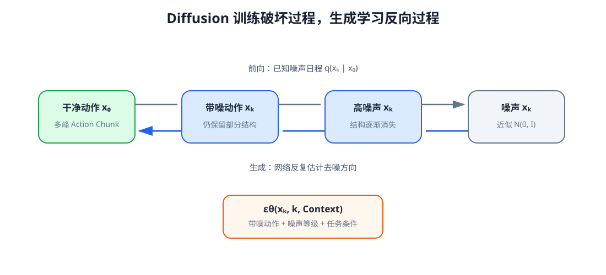

# 12-1 Diffusion：构造带噪动作与训练目标

第 11-4 节展示了一个困难：同一 Context 下，上绕和下绕都可能成功，单值平方误差却容易预测两者之间的碰撞路线。Diffusion（扩散模型）不要求网络只给出一个平均动作；它先学习如何识别不同噪声强度下被破坏的动作，再在使用时从新噪声逐步生成一条完整动作。本节只讲**训练题目怎样产生、网络在一次训练中要回答什么**。把训练好后的网络连续调用来生成动作，留到 12-2 节。

## 1. 生成对象与两个“时间”

沿用第 11 章的动作定义：示范给出一段 $H$ 步、每步 $D_a$ 维的动作块，记为 $x_0=A_t$，形状为 $H\times D_a$。这里 $t$ 是机器人做决策的环境时刻；下标 0 仅表示“还没有加噪的干净动作”，**不是环境中的第 0 帧**。当前视觉、语言、本体和历史由第 10 章整理成情境 $C_t$。训练和生成的目标都是得到在 $C_t$ 下合理的完整动作块，而非只预测一个关节的下一步。

为防止关节角、末端平移和夹爪开度因量纲不同而互相压制，先按第 11-1 节约定的训练集统计量归一化动作。下面所有 $x_k$ 都处于这个模型空间；真正执行前还须恢复物理单位。

## 2. 前向加噪由预先设定的日程决定

选定 $K$ 个离散噪声等级，用 $k=1,\ldots,K$ 标记“破坏到了第几级”。$x_k$ 是第 $k$ 级的带噪动作，不是噪声步编号本身。每级指定一个小的噪声方差 $\beta_k$，再令 $\alpha_k=1-\beta_k$。从一级走向下一级的规则是

$$
x_k=\sqrt{\alpha_k}\,x_{k-1}+\sqrt{\beta_k}\,\epsilon_k,
\qquad \epsilon_k\sim\mathcal N(0,I).
$$

即保留一部分原有动作数值，再混入同形状的标准高斯噪声。累积信号比例记为 $\bar\alpha_k=\prod_{i=1}^{k}\alpha_i$。训练时不必真的循环加噪 $k$ 次：抽一份标准高斯噪声 $\epsilon$，可直接构造任意等级的样本

$$
x_k=\sqrt{\bar\alpha_k}\,x_0+
\sqrt{1-\bar\alpha_k}\,\epsilon,
\qquad \epsilon\sim\mathcal N(0,I).
$$

两项前的平方根使信号和噪声按设定的方差比例混合。例如某一维干净动作为 $0.8$、累计信号比例为 $0.64$、抽到的噪声为 $-0.5$，那这一维的带噪结果是 $0.8\times0.8+0.6\times(-0.5)=0.34$。当 $\bar\alpha_k$ 接近 1，动作结构大多保留；接近 0 时，$x_k$ 更像标准高斯。$\beta_k$ 是训练前选择的噪声日程参数，在这里**不是**网络最后学出的答案；$\epsilon$ 是本次实际抽到的随机数，也不是可训练参数。

<figure markdown="span">
  { width="1100" loading=lazy }
  <figcaption>图 12-1　上方的前向过程按已知日程破坏示范动作；下方的生成过程以后会从新噪声出发，多次调用学到的去噪网络。两条方向相反的箭头不是把同一次加噪计算机械地倒放。（本教程绘制）</figcaption>
</figure>

图 12-1 先只看从动作走向噪声的方向：动作块仍保持原来的时间位置和维度，只是每个数值逐渐混入噪声。另一方向为什么能走通，取决于下一节要训练的网络，而不是前向日程自己会“自动反演”。

## 3. 一次训练迭代到底做了什么

一次训练只在**随机抽到的一个噪声等级**上提问，而不要求模型当场把 $x_K$ 连续还原到 $x_0$。步骤可以逐项核对：

1. 从示范数据取当前情境 $C_t$ 和对应的干净动作块 $x_0$。
2. 随机抽噪声等级 $k$，再抽同形状的标准高斯噪声 $\epsilon$。
3. 按上一节的闭式公式计算带噪动作 $x_k$。
4. 将 $x_k$、$k$ 和 $C_t$ 送给可训练网络，得到噪声估计 $\hat\epsilon_\theta(x_k,k,C_t)$。
5. 用已知的真实噪声 $\epsilon$ 核对估计，计算误差并更新参数。

训练所用的一种目标是

$$
\mathcal L_{\mathrm{diff}}=
\mathbb E_{x_0,k,\epsilon}
\left\lVert\epsilon-
\hat\epsilon_\theta(x_k,k,C_t)\right\rVert_2^2.
$$

实际计算对有效动作位置和维度求平均；补齐的时间步不参与。若某个分量实际加的噪声为 $-0.5$，网络估计为 $-0.4$，这个分量贡献的平方误差就是 $0.01$。$x_0$ 和 $\epsilon$ 用来造题与核对，**不会作为两个额外输入交给去噪网络**。不同批次可以抽不同 $x_0,k,\epsilon$，$k$ 也不需要按从小到大的顺序出现；经过许多批次，网络才有机会学到各噪声等级的估计规律。

这里的“网络”不是 Diffusion 另行规定的一种固定架构。二维教学实验可把 $x_k$、噪声等级和 Context 拼接后送进小型多层感知机（MLP）；完整机器人动作块常需要在时间位置之间交换信息，可以用动作 Transformer。无论具体结构，**输出必须与动作块同形状**：输入是 16 步、每步 7 维时，预测噪声也有 $16\times7$ 个数。12-2 节将把 Transformer 内的动作 token、Attention 和逐位置输出层明确接到这一步，再解释训练好的网络怎样参与生成。

[返回 12 导读](12-diffusion-and-flow-matching.md) · [继续阅读 12-2 Diffusion 的生成](12-2-diffusion-sampling.md)
